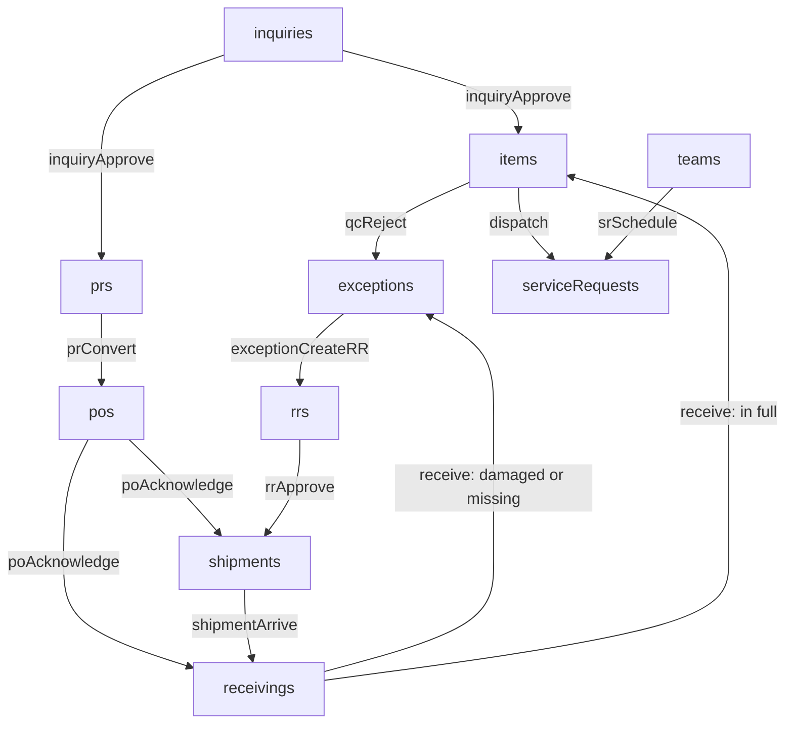

# Data Model

The whole database is one JSON object held in the browser (see [[How the engine works]]). Each collection is an array of plain records.

| Collection | What it is | Rows in sample |
| --- | --- | --- |
| [[suppliers]] | The recognised suppliers. HC System is Local sourcing; Warehouse Stock means no purchase. | 4 |
| [[teams]] | A delivery team with a daily job capacity and days off. | 3 |
| [[transfers]] | A warehouse request or a warehouse-to-warehouse transfer. | 4 |
| [[salesReturns]] | A return for a completed or failed delivery, sent to Books with an RMA. | 2 |
| [[siteVisits]] | A site assessment before installation or repair. | 3 |
| [[truckChecks]] | A daily vehicle checklist: Open, In Progress, Completed with a signature. | 3 |
| [[truckEntries]] | A fuel or service entry for a truck. | 2 |
| [[scheduleRequests]] | A client request to move a delivery date. | 2 |
| [[customers]] | A customer from the customer master, with type, contacts and billing and shipping addresses. | 38 |
| [[projects]] | A customer project with a PRJ-xxxxx code and a group discount. Inquiries of the same project and discount share a quote group. | 37 |
| [[products]] | An item in the product catalog. Picking one on an inquiry autofills SKU, description, unit and SRP. | 51 |
| [[inquiries]] | A customer enquiry that is quoted by a supplier, estimated, and approved into a Sales Order. | 47 |
| [[timeline]] | One line of an inquiry history: created, updated (with the changed fields), SRP approved, estimate, messages, deleted. | 116 |
| [[messages]] | One message in an inquiry conversation with Fenteng or Tony. | 3 |
| [[notes]] | One note in the Sales and Purchasing conversation on an inquiry. | 2 |
| [[prs]] | One request per Sales Order item that must be bought from a supplier. | 19 |
| [[pos]] | The order sent to a supplier. One per supplier per conversion. | 11 |
| [[shipments]] | A supplier shipment on its way to the warehouse. Replacement shipments carry an RR number instead of a PO. | 11 |
| [[receivings]] | The count of goods off a shipment. One per shipment. | 11 |
| [[exceptions]] | Damaged, missing or QC-rejected goods. Source is Procurement or Fulfillment. | 8 |
| [[rrs]] | A request for a supplier to replace goods from an exception. | 4 |
| [[items]] | One record per Sales Order item, carried through every Fulfillment stage by changing its stage. | 33 |
| [[serviceRequests]] | A delivery job in Delivery Management, from Initial Scheduling to Completed. | 8 |
| [[audit]] | One line per workflow step taken. | 40 |

## How the records connect

**The links are by number, not by id:** a PR points at its PO by `poNo`, an item points at its PR by `prNo` and at its Service Request by `srNo`. Records point back to their source by internal id where the code needs to follow them (`poId`, `shipmentId`, `itemId`).
