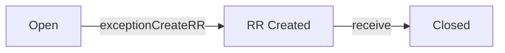

# exceptions

**Exception.** Damaged, missing or QC-rejected goods. Source is Procurement or Fulfillment.

2 rows in the sample data.

## Created by
- [[receive]]
- [[qcReject]]

## Shown on
- [[Dashboard]]
- [[Exceptions]]

## Lifecycle (`status`)



| From | To | Step |
| --- | --- | --- |
| Open | RR Created | [[exceptionCreateRR]] |
| RR Created | Closed | [[receive]] |

Closed happens when the replacement shipment is received in full.

Values seen in the sample data: `Open`.

## Fields
- `id`
- `no`
- `source`
- `receivingNo`
- `shipmentNo`
- `poNo`
- `supplier`
- `item`
- `type`
- `qty`
- `prNos`
- `itemId`
- `status`
- `rrNo`
- `raisedOn`
- `notes`

## A sample row

```json
{
  "id": "exc64",
  "no": "EXC-00001",
  "source": "Procurement",
  "receivingNo": "RCV-00003",
  "shipmentNo": "SHP-00003",
  "poNo": "PO-00003",
  "supplier": "Tony Fan",
  "item": "Outdoor Bollard",
  "type": "Damaged + Missing",
  "qty": 3,
  "prNos": [
    "PR-00006"
  ],
  "itemId": "",
  "status": "Open",
  "rrNo": "",
  "raisedOn": "2026-11-11"
}
```

Up: [[Data Model]].
