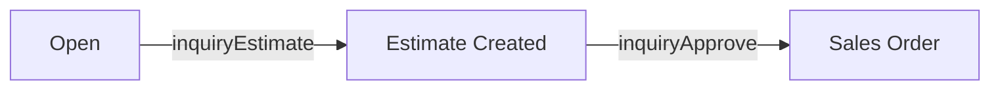

# inquiries

**Inquiry.** A customer enquiry that is quoted by a supplier, estimated, and approved into a Sales Order.

47 rows in the sample data.

## Created by
- [[inquiryCreate]]

## Shown on
- [[Supply Chain Analytic]]
- [[Procurement Dashboard]]
- [[Inquiry List]]
- [[Forecast Setting]]
- [[Tony Fan - Inquiries]]
- [[Fenteng Lighting - Inquiries]]

## Lifecycle (`status`)



| From | To | Step |
| --- | --- | --- |
| Open | Estimate Created | [[inquiryEstimate]] |
| Estimate Created | Sales Order | [[inquiryApprove]] |

Readiness (Not Ready, In Progress, Ready) is never stored. It is worked out from five conditions each time, see [[INQ.READINESS]]. An estimate needs Ready, and a group estimate also moves the other Ready inquiries of the project to Estimate Created.

Values seen in the sample data: `Sales Order`, `Open`, `Estimate Created`.

## Fields
- `id`
- `no`
- `status`
- `estimateNo`
- `soNo`
- `quoteGroup`
- `suppliers`
- `createdAt`
- `itemId`
- `item`
- `customerId`
- `customer`
- `customerType`
- `projectId`
- `projectName`
- `projectType`
- `qty`
- `unit`
- `sku`
- `description`
- `targetDate`
- `salesOwner`
- `waitingOn`
- `orderType`
- `commission`
- `forBidding`
- `designCompany`
- `designPartner`
- `designerArchitect`
- `addtlDiscNeeded`
- `groupDiscountPct`
- `openToSimilar`
- `additionalDescription`
- `specDetails`
- `dimension`
- `colorBody`
- `colorTemperature`
- `bulbType`
- `voltage`
- `lumens`
- `attachments`
- `similarPhotos`
- `collateral`
- `quotes`
- `srp`

## A sample row

```json
{
  "id": "inq4",
  "no": "INQ-00001",
  "status": "Sales Order",
  "estimateNo": "EST-00001",
  "soNo": "SO-16601",
  "quoteGroup": "QG-0001",
  "suppliers": [
    "Fenteng Lighting",
    "Tony Fan",
    "HC System"
  ],
  "createdAt": "2026-11-11T08:00:00.000Z",
  "itemId": "prd3",
  "item": "LED Panel 60W",
  "customerId": "cus1",
  "customer": "Marco Villa",
  "customerType": "Designer",
  "projectId": "prj2",
  "projectName": "Villa Project",
  "projectType": "Residential",
  "qty": 20,
  "unit": "pcs",
  "sku": "SKU-0001",
  "description": "LED Panel 60W (sample catalog item)",
  "targetDate": "2026-12-11",
  "salesOwner": "HC Sales 1",
  "waitingOn": "None",
  "orderType": "Normal",
  "commission": 0,
  "forBidding": false,
  "designCompany": "",
  "designPartner": "No",
  "designerArchitect": "",
  "addtlDiscNeeded": "No",
  "groupDiscountPct": "",
  "openToSimilar": false,
  "additionalDescription": "",
  "specDetails": "",
  "dimension": "",
  "colorBody": "",
  "colorTemperature": "",
  "bulbType": "",
  "voltage": "",
  "lumens": "",
  "attachments": [],
  "similarPhotos": [],
  "collateral": {
    "sample": "Completed",
    "dImage": "Completed",
    "drawing": "Completed",
    "spec": "Completed"
  },
  "quotes": [
    {
      "supplier": "Fenteng Lighting",
      "availability": "Confirmed",
      "initial": 850,
      "negotiated": 0,
      "final": 850,
      "leadTime": "2 weeks",
      "stage": "Final",
      "selected": true
    }
  ],
  "srp": 1445
}
```

Up: [[Data Model]].
