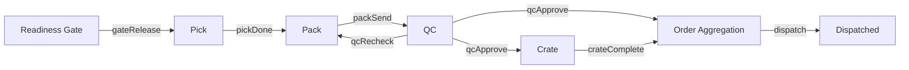

# items

**Fulfillment item.** One record per Sales Order item, carried through every Fulfillment stage by changing its stage.

21 rows in the sample data.

## Created by
- [[inquiryApprove]]

## Shown on
- [[Dashboard]]
- [[Readiness Gate]]
- [[Pick]]
- [[Pack]]
- [[QC Checklist]]
- [[Crate]]
- [[Order Aggregation]]

## Lifecycle (`stage`)



| From | To | Step |
| --- | --- | --- |
| Readiness Gate | Pick | [[gateRelease]] |
| Pick | Pack | [[pickDone]] |
| Pack | QC | [[packSend]] |
| QC | Crate | [[qcApprove]] |
| QC | Order Aggregation | [[qcApprove]] |
| Crate | Order Aggregation | [[crateComplete]] |
| QC | Pack | [[qcRecheck]] |
| Order Aggregation | Dispatched | [[dispatch]] |

QC goes to Crate only when the item needs crating. A rejected item stays in QC until [[qcRecheck]] sends it back to Pack.

Values seen in the sample data: `Pick`, `Readiness Gate`, `QC`, `Crate`, `Order Aggregation`, `Dispatched`.

## Fields
- `id`
- `soNo`
- `customer`
- `address`
- `name`
- `qty`
- `prNo`
- `supplier`
- `pac`
- `payment`
- `override`
- `picker`
- `packer`
- `checker`
- `forCrate`
- `crateStatus`
- `qcStatus`
- `stage`
- `received`
- `srNo`

## A sample row

```json
{
  "id": "it8",
  "soNo": "SO-16601",
  "customer": "Marco Villa",
  "address": "12 Sample St, Quezon City, Metro Manila, 1100, Philippines",
  "name": "LED Panel 60W",
  "qty": 20,
  "prNo": "PR-00001",
  "supplier": "Fenteng Lighting",
  "pac": "PAC-00001",
  "payment": "Paid",
  "override": null,
  "picker": "Ben Santos",
  "packer": "",
  "checker": "",
  "forCrate": false,
  "crateStatus": "",
  "qcStatus": "",
  "stage": "Pick",
  "received": true,
  "srNo": ""
}
```

Up: [[Data Model]].
