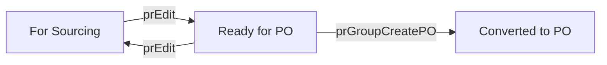

# prs

**Purchase Request.** One request per Sales Order item that must be bought from a supplier.

7 rows in the sample data.

## Created by
- [[inquiryApprove]]
- [[prCreate]]

## Shown on
- [[Dashboard]]
- [[Purchase Request]]

## Lifecycle (`status`)



| From | To | Step |
| --- | --- | --- |
| For Sourcing | Ready for PO | [[prEdit]] |
| Ready for PO | For Sourcing | [[prEdit]] |
| Ready for PO | Converted to PO | [[prGroupCreatePO]] |

The move between For Sourcing and Ready for PO is automatic. It is recomputed after [[prCreate]], [[prEdit]], [[prSetSrp]] and [[prResume]], see [[PR.READY]]. On Hold and Cancelled are a separate `hold` flag set by [[prHold]] and cleared by [[prResume]]; the status underneath never changes.

Values seen in the sample data: `Converted to PO`, `Ready for PO`, `For Sourcing`.

## Fields
- `id`
- `no`
- `soNo`
- `customer`
- `customerType`
- `salesOwner`
- `item`
- `sku`
- `description`
- `category`
- `qty`
- `unit`
- `supplier`
- `mode`
- `sourcingType`
- `priority`
- `targetDate`
- `price`
- `currency`
- `lead`
- `srpRate`
- `srpApproved`
- `inquiryNo`
- `quotes`
- `followedRecommendation`
- `overrideReason`
- `similarItem`
- `attachments`
- `status`
- `hold`
- `holdReason`
- `holdNotes`
- `holdDate`
- `holdFollowUp`
- `heldBy`
- `poNo`
- `createdAt`

## A sample row

```json
{
  "id": "pr7",
  "no": "PR-00001",
  "soNo": "SO-16601",
  "customer": "Marco Villa",
  "customerType": "Designer",
  "salesOwner": "HC Sales 1",
  "item": "LED Panel 60W",
  "sku": "SKU-0001",
  "description": "LED Panel 60W (sample catalog item)",
  "category": "Lighting",
  "qty": 20,
  "unit": "pcs",
  "supplier": "Fenteng Lighting",
  "mode": "Airfreight",
  "sourcingType": "Import",
  "priority": "MEDIUM",
  "targetDate": "2026-12-11",
  "price": 850,
  "currency": "CNY",
  "lead": "2 weeks",
  "srpRate": 1445,
  "srpApproved": 0,
  "inquiryNo": "INQ-00001",
  "quotes": [
    {
      "supplier": "Fenteng Lighting",
      "availability": "Confirmed",
      "initial": 850,
      "negotiated": 0,
      "final": 850,
      "leadTime": "2 weeks",
      "stage": "Final",
      "selected": true
    }
  ],
  "followedRecommendation": "",
  "overrideReason": "",
  "similarItem": false,
  "attachments": [],
  "status": "Converted to PO",
  "hold": "",
  "holdReason": "",
  "holdNotes": "",
  "holdDate": "",
  "holdFollowUp": "",
  "heldBy": "",
  "poNo": "PO-00001",
  "createdAt": "2026-11-11T08:00:00.000Z"
}
```

Up: [[Data Model]].
