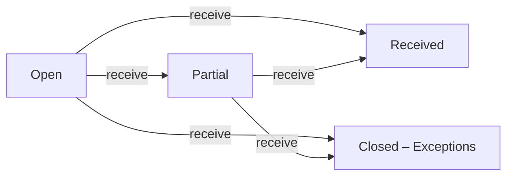

# receivings

**Receiving.** The count of goods off a shipment. One per shipment.

3 rows in the sample data.

## Created by
- [[poAcknowledge]]
- [[rrApprove]]

## Shown on
- [[Dashboard]]
- [[Receiving]]

## Lifecycle (`status`)



| From | To | Step |
| --- | --- | --- |
| Open | Partial | [[receive]] |
| Open | Received | [[receive]] |
| Partial | Received | [[receive]] |
| Open | Closed – Exceptions | [[receive]] |
| Partial | Closed – Exceptions | [[receive]] |

Values seen in the sample data: `Received`, `Open`, `Closed – Exceptions`.

## Fields
- `id`
- `no`
- `shipmentId`
- `shipmentNo`
- `poNo`
- `rrId`
- `supplier`
- `item`
- `prNos`
- `itemId`
- `expected`
- `accepted`
- `damaged`
- `missing`
- `status`
- `lastReceived`

## A sample row

```json
{
  "id": "rcv12",
  "no": "RCV-00001",
  "shipmentId": "shp11",
  "shipmentNo": "SHP-00001",
  "poNo": "PO-00001",
  "rrId": "",
  "supplier": "Fenteng Lighting",
  "item": "LED Panel 60W",
  "prNos": [
    "PR-00001"
  ],
  "itemId": "",
  "expected": 20,
  "accepted": 20,
  "damaged": 0,
  "missing": 0,
  "status": "Received",
  "lastReceived": "2026-11-11"
}
```

Up: [[Data Model]].
