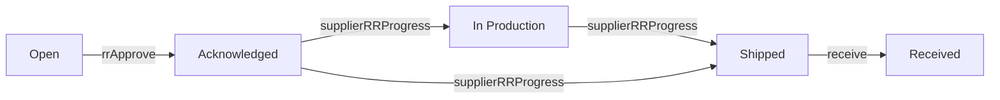

# rrs

**Replacement Request.** A request for a supplier to replace goods from an exception.

4 rows in the sample data.

## Created by
- [[exceptionCreateRR]]

## Shown on
- [[Procurement Dashboard]]
- [[Receiving]]
- [[Replacement Request]]
- [[Tony Fan - Replacement Request]]
- [[Fenteng Lighting - Replacement Request]]

## Lifecycle (`status`)



| From | To | Step |
| --- | --- | --- |
| Open | Acknowledged | [[rrApprove]] |
| Acknowledged | In Production | [[supplierRRProgress]] |
| In Production | Shipped | [[supplierRRProgress]] |
| Acknowledged | Shipped | [[supplierRRProgress]] |
| Shipped | Received | [[receive]] |

Received comes only from the physical receipt of the replacement shipment. The supplier moves it from Acknowledged to In Production to Shipped, never backwards.

Values seen in the sample data: `Open`, `In Production`, `Shipped`.

## Fields
- `id`
- `no`
- `excNo`
- `excId`
- `source`
- `supplier`
- `item`
- `qty`
- `status`
- `expShip`
- `eta`
- `raisedOn`
- `createdOn`

## A sample row

```json
{
  "id": "rr319",
  "no": "RR-00001",
  "excNo": "EXC-00002",
  "excId": "exc318",
  "source": "Procurement",
  "supplier": "Tony Fan",
  "item": "Opal Shade",
  "qty": 1,
  "status": "Open",
  "expShip": "",
  "eta": "",
  "raisedOn": "2026-11-11",
  "createdOn": "2026-11-11"
}
```

Up: [[Data Model]].
