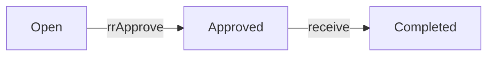

# rrs

**Replacement Request.** A request for a supplier to replace goods from an exception.

0 rows in the sample data.

## Created by
- [[exceptionCreateRR]]

## Shown on
- [[Replacement]]

## Lifecycle (`status`)



| From | To | Step |
| --- | --- | --- |
| Open | Approved | [[rrApprove]] |
| Approved | Completed | [[receive]] |

Values seen in the sample data: .

## Fields


## A sample row

```json
{}
```

Up: [[Data Model]].
