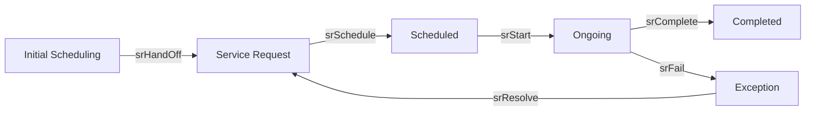

# serviceRequests

**Service Request.** A delivery job in Delivery Management, from Initial Scheduling to Completed.

8 rows in the sample data.

## Created by
- [[dispatch]]

## Shown on
- [[Supply Chain Analytic]]
- [[Forecast Setting]]
- [[Delivery Analytics]]
- [[Daily Team Availability]]
- [[Initial Scheduling]]
- [[Service Request]]
- [[Service Appointment]]
- [[Ongoing Service]]
- [[Archived]]
- [[Field Service Site Visits]]
- [[Sales Returns]]
- [[DMS Exception Queue]]
- [[Schedule Requests]]

## Lifecycle (`status`)



| From | To | Step |
| --- | --- | --- |
| Initial Scheduling | Service Request | [[srHandOff]] |
| Service Request | Scheduled | [[srSchedule]] |
| Scheduled | Ongoing | [[srStart]] |
| Ongoing | Completed | [[srComplete]] |
| Ongoing | Exception | [[srFail]] |
| Exception | Service Request | [[srResolve]] |

Values seen in the sample data: `Initial Scheduling`, `Service Request`, `Scheduled`, `Ongoing`, `Exception`, `Completed`.

## Fields
- `id`
- `no`
- `soNo`
- `customer`
- `address`
- `itemId`
- `item`
- `qty`
- `pac`
- `type`
- `initialDate`
- `confirmMethod`
- `confirmNotes`
- `siteConfirmed`
- `status`
- `team`
- `scheduledDate`
- `priority`
- `exceptionReason`
- `resolution`
- `createdOn`
- `startedOn`
- `completedOn`

## A sample row

```json
{
  "id": "sr166",
  "no": "SR-00001",
  "soNo": "SO-16614",
  "customer": "Quin Abad",
  "address": "12 Sample St, Quezon City, Metro Manila, 1100, Philippines",
  "itemId": "it164",
  "item": "Wall Washer",
  "qty": 2,
  "pac": "PAC-00008",
  "type": "Delivery",
  "initialDate": "",
  "confirmMethod": "",
  "confirmNotes": "",
  "siteConfirmed": false,
  "status": "Initial Scheduling",
  "team": "",
  "scheduledDate": "",
  "priority": false,
  "exceptionReason": "",
  "resolution": "",
  "createdOn": "2026-11-11"
}
```

Up: [[Data Model]].
