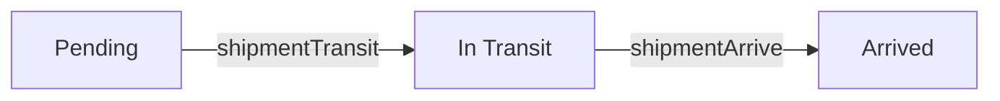

# shipments

**Shipment.** A supplier shipment on its way to the warehouse. Replacement shipments carry an RR number instead of a PO.

11 rows in the sample data.

## Created by
- [[poAcknowledge]]
- [[rrApprove]]
- [[receivingCreate]]
- [[supplierAckPO]]
- [[supplierApproveRR]]

## Shown on
- [[Supply Chain Analytic]]
- [[Procurement Dashboard]]
- [[Purchase Order]]
- [[Shipments]]
- [[Receiving]]
- [[Forecast Setting]]
- [[Tony Fan - Shipments]]
- [[Fenteng Lighting - Shipments]]

## Lifecycle (`status`)



| From | To | Step |
| --- | --- | --- |
| Pending | In Transit | [[shipmentTransit]] |
| In Transit | Arrived | [[shipmentArrive]] |

Values seen in the sample data: `Arrived`, `In Transit`, `Pending`.

## Fields
- `id`
- `no`
- `poId`
- `poNo`
- `rrNo`
- `supplier`
- `mode`
- `item`
- `qty`
- `prNos`
- `etd`
- `eta`
- `dateShipped`
- `status`
- `createdOn`

## A sample row

```json
{
  "id": "shp11",
  "no": "SHP-00001",
  "poId": "po10",
  "poNo": "PO-00001",
  "rrNo": "",
  "supplier": "Fenteng Lighting",
  "mode": "Airfreight",
  "item": "LED Panel 60W",
  "qty": 20,
  "prNos": [
    "PR-00001"
  ],
  "etd": "2026-10-22",
  "eta": "2026-11-09",
  "dateShipped": "2026-11-11",
  "status": "Arrived",
  "createdOn": "2026-11-11"
}
```

Up: [[Data Model]].
