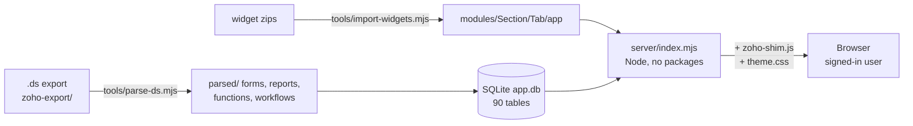

# Current system: the app outside Zoho

Updated 2026-11-12. The goal is to **fully replace Zoho Creator**. Today the original Zoho widgets run unchanged on our own server, saving to our own database, behind a login. Zoho's server-side logic (Deluge) is being ported piece by piece: see [[00 - Port Status]]. What changed and when: [[00 - Change Log]]. The look: [[00 - Design System]].

## How it fits together



- **Widgets are the real Zoho widget source**, one folder per tab: `modules/<Section>/<Tab>/app/`. The server serves them with Zoho's SDK swapped for `server/public/zoho-shim.js`, so every `ZOHO.CREATOR.*` call goes to the server (`getRecords`, `addRecords`, `updateRecordById`, `deleteRecordById`, `invokeCustomApi`, `FILE.uploadFile`/`readFile`).
- **Database:** one SQLite file. A table per Zoho form, generated from `zoho-export/parsed/forms/*.json`; Zoho criteria strings (`(ID == 5 && Status == "New")`) are compiled in `server/db.mjs`.
- **Custom APIs** (what Zoho's `invokeCustomApi` called) live in `server/custom-apis.mjs`. 3 of 21 are ported.
- **Sections and tabs** (6 sections, 42 tabs + 3 hidden pages) are listed in `server/pages.json`, generated by `tools/import-widgets.mjs`.

## Sign-in and users

- Everything except `/login`, `/healthz` and the theme files needs a signed-in user.
- Passwords: scrypt hashes. Session: random token in an `HttpOnly` cookie (`hc_session`, 14 days, `Secure` on HTTPS); only its SHA-256 is stored.
- 8 wrong passwords from one address blocks sign-in for 15 minutes.
- Roles: **admin** and **user**. Admins open *Manage users* in the account menu to add users (a temporary password is shown once), reset passwords, make admin, turn off, or delete. New users and reset users must choose their own password at first sign-in.
- The signed-in user's email is what widgets see as the logged-in user (`window.HC_USER`), so the role rules in the widget code (HC Purchasing, HC Systems, HC Damage Officer…) keep working.
- Tables `_users` and `_sessions` sit in the same database. The first admin is created at first start from `ADMIN_EMAIL` / `ADMIN_PASSWORD`.

## Run it on a computer

```
$env:ADMIN_EMAIL='you@example.com'; $env:ADMIN_PASSWORD='a-long-password'; npm start    # PowerShell
```
Opens at `http://localhost:4000`. Data goes in `data/` (git-ignored). Needs Node 24 (built-in SQLite). Environment: `PORT`, `DATA_DIR`, `ADMIN_EMAIL`, `ADMIN_PASSWORD`, `ADMIN_NAME`.

## Hosted on Railway

| | |
|---|---|
| Address | `https://supply-chain-app-production.up.railway.app` |
| Project / service | `supply-chain-app` / `supply-chain-app` |
| Storage | a volume mounted at `/data` holds `app.db` and `uploads/`, so data survives redeploys |
| Variables | `DATA_DIR=/data`, `ADMIN_EMAIL`, `ADMIN_NAME`, `ADMIN_PASSWORD` (used only the first time), `RAILPACK_BUILD_CMD`, `RAILPACK_START_CMD` |
| Deploy | from the project folder: `railway up --detach --service supply-chain-app` (uploads this folder; it does **not** deploy from GitHub) |
| Excluded from upload | `.railwayignore`: old React app, vault, tools, the raw `.ds` (it holds an API key). Every rule starts with `/`, because an unanchored `index.html` once dropped every page |

> [!WARNING] Railway settings to know
> `railway.json` was removed because Railway stops supporting it on 2026-12-01; build and start commands now live in the variables above. The old health-check setting (`/healthz`) was in that file. The server still answers `/healthz`; set the health-check path in the Railway dashboard (Settings → Deploy) if you want it back.

## Open items

> [!NOTE] Next step
> The agreed direction is a cloud front door with Zoho Creator kept as the backend. Full plan and the list of questions still to clarify: [[Plan - Cloud Front Door (Zoho Backend)]].

- **No real data yet.** The live database is empty. Import from Zoho (read-only): the question *Development or Production?* is still unanswered.
- **Port the logic:** 41 Deluge functions, 165 form workflows, 6 schedules and 16 report-button functions ([[00 - Port Status]]). Biggest: the scheduling engine `dmsScheduleSlot`.
- **Integrations:** Zoho Books (addresses, items, estimates, sales returns) and the CMS app are not connected.
- **Secret in the Zoho export:** a Geoapify key is hardcoded in the `SA_Geocode_Address` workflow (and its note). Rotate it and move it into a variable.
- **Check against Zoho:** the *Analytic* tab uses the "Supply Chain Conversion" widget and *Forecast Setting* uses "Delivery Forecast" (matched by name); Forecast Setting looks for a report named differently from `All_Settings` in the `.ds`.
- **Not committed yet:** login, redesign, Railway files and these notes are only on this computer and Railway; GitHub still has commit `f320e2a`.

## Where things are

| Path | What |
|---|---|
| `server/` | the app server, database layer, sign-in, custom APIs, pages |
| `modules/` | widget source per section/tab, plus a README per section |
| `zoho-export/` | the `.ds` file and everything parsed from it |
| `vault/Deluge Scripts (Obsidian)/` | these notes (Deluge scripts per module) |
| `vault/` (other folders) | notes on the earlier React prototype in `src/`, generated by `npm run vault` |
| `PRODUCT.md`, `DESIGN.md`, `.impeccable/` | product and design records |
| `tools/` | `parse-ds`, `import-widgets`, `build-module-readmes`, `build-vault` |

Regenerate after a new `.ds` export or updated widget zips:
```
node tools/parse-ds.mjs
node tools/import-widgets.mjs
node tools/build-module-readmes.mjs     # also rewrites 00 - Port Status.md
```
