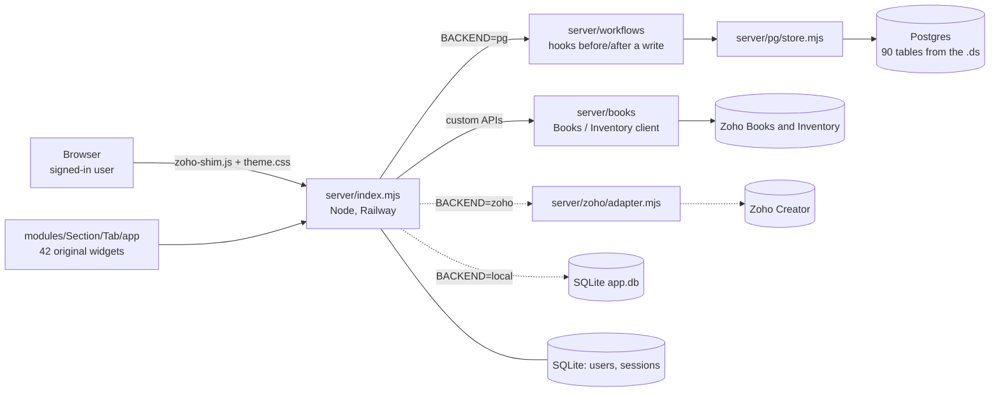

# Current system: the app outside Zoho

Updated 2026-11-12. The supply chain app in Zoho Creator is no longer used (it stays untouched as a fallback). Our app, hosted on **Railway**, is becoming the only system: the widgets, the redesign, sign-in and users already live here, and the business data is moving to **Postgres**. Zoho Creator is only a bridge and the source of the data export; Zoho Books and Inventory stay and are called directly by our server. Direction and phases: [[Plan - Full Migration Off Zoho Creator]]. Port tracking: [[00 - Port Status]]; what is still to port, by section: [[00 - Port Checklist]]; the plan to finish Procurement: [[Plan - Finish Procurement]]. History: [[00 - Change Log]]. How to port the next piece: [[00 - Porting a Workflow]]. How a widget action reaches Zoho through the adapter: [[00 - Actions Execution & Zoho Adapter Routing]].

## Three backends, one switch

`BACKEND` chooses where the widgets' data calls go. The widgets cannot tell the difference.

| `BACKEND` | Business data lives in | Use |
|---|---|---|
| `pg` | **Postgres** (`DATABASE_URL`) | the target: ported workflows and custom APIs run here |
| `zoho` (still the default) | Zoho Creator, through the adapter | the bridge: reads and writes the old app (Development or Production) |
| `local` | SQLite `app.db` | offline test mode |

Users and sessions stay in SQLite (`_users`, `_sessions`) whatever the backend.



- **Widgets are the real Zoho widget source**, one folder per tab: `modules/<Section>/<Tab>/app/`. The server serves them with Zoho's SDK swapped for `server/public/zoho-shim.js`, so every `ZOHO.CREATOR.*` call goes to the server.
- **Postgres layer (`server/pg/`):** `schema.mjs` builds one table per Zoho form from `zoho-export/parsed/`; `store.mjs` reads and writes (Postgres filters and pages, lookups are resolved in one query per lookup form, shown the way Zoho's display format says); `import.mjs` loads a backup. Record IDs are `BIGINT` in the database and always strings in JavaScript, because a Zoho ID has 19 digits and does not fit a JavaScript number.
- **Workflow hooks (`server/workflows/`):** the Zoho form workflows that run on API writes ("on validate" before, "on success" after) are ported as hooks around the store. Ported so far: 8 Inquiry and 14 Purchase Request workflows ([[00 - Port Status]], `server/workflows/ported.json`).
- **Books and Inventory (`server/books/`):** a client with its own OAuth refresh token (`ZOHO_BOOKS_*`) and the ported custom APIs `create_books_contact`, `add_item_by_id`, `create_estimate`. Not configured yet, so they answer "Zoho Books is not configured".
- **Zoho adapter (`server/zoho/`):** translates widget calls to Zoho Creator REST v2.1 with a 15-second cache, token refresh and a queue that protects Zoho's rate limits. Its custom API calls still run the local ports, not Zoho.
- **Sections and tabs:** 6 sections, 42 tabs + 3 hidden pages listed in `server/pages.json`.

## Sign-in and users

- Everything except `/login`, `/healthz` and the theme files needs a signed-in user.
- Passwords: scrypt hashes. Session: random token in an `HttpOnly` cookie (`hc_session`, 14 days, `Secure` on HTTPS); only its SHA-256 is stored.
- 8 wrong passwords from one address blocks sign-in for 15 minutes.
- Roles: **admin** and **user**. Admins open *Manage users* in the account menu to add users (a temporary password is shown once), reset passwords, make admin, turn off, or delete. New users and reset users must choose their own password at first sign-in. The account menu also shows an admin which data source is running ("Data: Postgres").
- The signed-in user's email is what widgets see as the logged-in user (`window.HC_USER`), so the role rules in the widget code (HC Purchasing, HC Systems, HC Damage Officer…) keep working.
- The first admin is created at first start from `ADMIN_EMAIL` / `ADMIN_PASSWORD`.

## Run it on a computer

Needs Node 24. Copy `.env.example` to `.env` for variables (it is git-ignored and loaded automatically), or keep Zoho credentials in `server/zoho-credentials.json`.

| Command | What |
|---|---|
| `npm run dev:pg` | **the whole app on a local Postgres, nothing to install.** Starts PGlite (Postgres in WebAssembly) kept in `data/pglite`, loads the newest backup from `data/zoho-backup` the first time, then starts the server with `BACKEND=pg`. Opens at `http://localhost:4000` (`PORT` to change it, `DEV_PG_PORT` for the database port, 5544 by default) |
| `npm start` / `npm run dev` | the server with `BACKEND` as set (default `zoho`) |
| `node tools/export-zoho-data.mjs` | read-only backup of every Zoho form into `data/zoho-backup/<env>-<time>/` (`ZOHO_ENV` chooses Development or Production) |
| `node tools/import-zoho-backup.mjs <dir>` | loads a backup into the Postgres in `DATABASE_URL`; `--dry-run`, `--replace`, `--only=Form_A,Form_B` |
| `npm test` | all tests (the Postgres ones run on PGlite, no server needed) |

Environment: `PORT`, `DATA_DIR`, `ADMIN_EMAIL`, `ADMIN_PASSWORD`, `ADMIN_NAME`, `BACKEND`, `DATABASE_URL`, the `ZOHO_*` Creator variables, the `ZOHO_BOOKS_*` Books variables, `TONY_PORTAL_EMAIL`, `FENTENG_PORTAL_EMAIL`, `APP_BASE_URL`. All are listed in `.env.example`.

## Hosted on Railway

| | |
|---|---|
| Address | `https://supply-chain-app-production.up.railway.app` |
| Project / services | `supply-chain-app` with the app service `supply-chain-app` and a `Postgres` service (created 2026-11-12, **empty**) |
| Storage | a volume mounted at `/data` holds `app.db` and `uploads/`, so users and uploads survive redeploys |
| Variables (app) | `DATA_DIR=/data`, `ADMIN_EMAIL`, `ADMIN_NAME`, `ADMIN_PASSWORD` (used only the first time), `RAILPACK_BUILD_CMD`, `RAILPACK_START_CMD`. **No** `ZOHO_*`, `BACKEND` or `DATABASE_URL` yet |
| Deploy | from the project folder: `railway up --detach --service supply-chain-app` (uploads this folder; it does **not** deploy from GitHub) |
| Excluded from upload | `.railwayignore`: old React app, vault, tools, the raw `.ds` (it holds an API key). Every rule starts with `/`, because an unanchored `index.html` once dropped every page |

> [!WARNING] Railway settings to know
> `railway.json` was removed because Railway stops supporting it on 2026-12-01; build and start commands now live in the variables above. The old health-check setting (`/healthz`) was in that file. The server still answers `/healthz`; set the health-check path in the Railway dashboard (Settings → Deploy) if you want it back.
>
> To run on Railway with Postgres: set `BACKEND=pg` and `DATABASE_URL` to the reference `${{Postgres.DATABASE_URL}}`. To import data from a PC, turn on the **TCP Proxy** of the Postgres service (dashboard → Postgres → Settings → Networking) and use its public URL as `DATABASE_URL` for `tools/import-zoho-backup.mjs`.

## Open items

- **Data:** only the Zoho *Development* export (3,663 rows over 88 forms, test data) has been loaded, and only on a PC. Not loaded into the Railway Postgres. The *Production* export is to be taken before each module's cutover. 2 forms (`Pick_Up_Request_Form`, `Shipment_Order_Form`) have no report the API can read, and 34 forms may be missing columns a report does not show.
- **Files and images:** their fields still hold Zoho API paths (`/api/v2.1/...`); they must be downloaded into our storage.
- **Port the logic:** [[00 - Port Status]] has the counts. Next stages: Purchase Request, Purchase Order, Shipments, Receiving, then Fulfillment and Delivery. Biggest single piece: the scheduling engine `dmsScheduleSlot`.
- **Not verified against Zoho:** the ported Inquiry workflows follow the Deluge scripts literally, quirks included; whether Zoho behaves the same is to be checked on Zoho Development. No live Books call has been made (the Books OAuth client is still to be created).
- **Secret in the Zoho export:** a Geoapify key is hardcoded in the `SA_Geocode_Address` workflow (and its note). Rotate it and move it into a variable.
- **Check against Zoho:** the *Analytic* tab uses the "Supply Chain Conversion" widget and *Forecast Setting* uses "Delivery Forecast" (matched by name); Forecast Setting looks for a report named differently from `All_Settings` in the `.ds`.
- **Not pushed:** the work is committed on the local branch `feature/postgres-data-layer`; nothing of it is on GitHub or deployed to Railway yet.

## Where things are

| Path | What |
|---|---|
| `server/` | the app server, sign-in, custom APIs, pages |
| `server/pg/`, `server/workflows/`, `server/books/` | Postgres layer, ported workflows and hooks, Books client and APIs |
| `server/model.mjs`, `server/criteria.mjs` | the form model from the export and the Zoho criteria compiler, shared by SQLite and Postgres |
| `modules/` | widget source per section/tab, plus a README per section |
| `zoho-export/` | the `.ds` file and everything parsed from it |
| `data/` (git-ignored) | `app.db`, `pglite/`, `uploads/`, `zoho-backup/` |
| `vault/Deluge Scripts (Obsidian)/` | these notes (Deluge scripts per module) |
| `vault/Plans/` | the plans |
| `vault/` (other folders) | notes on the earlier React prototype in `src/`, generated by `npm run vault` |
| `PRODUCT.md`, `DESIGN.md`, `.impeccable/` | product and design records |
| `tools/` | `parse-ds`, `import-widgets`, `build-module-readmes`, `build-vault`, `export-zoho-data`, `import-zoho-backup`, `dev-pg`, `smoke-zoho-reports` |

Regenerate after a new `.ds` export or updated widget zips:
```
node tools/parse-ds.mjs
node tools/import-widgets.mjs
node tools/build-module-readmes.mjs     # also rewrites 00 - Port Status.md
```
