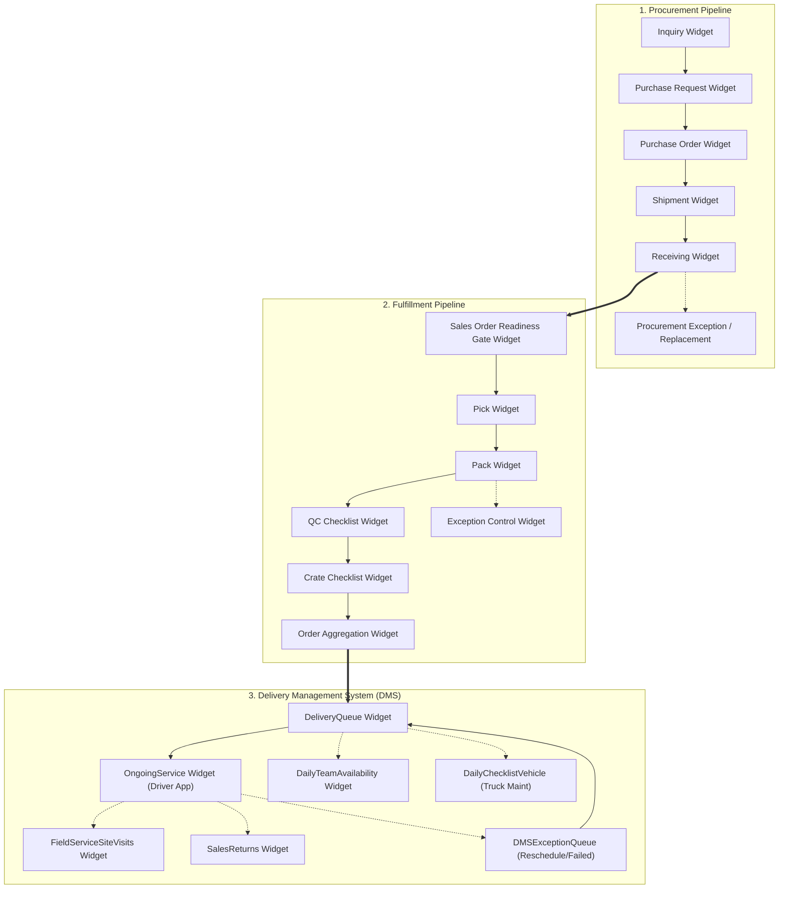

# 🗺️ Supply Chain App — Widget & Deluge System Map

This is the central directory linking every **Widget**, **Frontend HTML Interface**, **Swimlane Process Flow**, and **Deluge Script** across the entire Home Cartel Supply Chain System.

> [!SUCCESS] Current state (2026-11-12)
> All of these widgets now run locally and on Railway, behind a login: see [[00 - Current System]]. Which Deluge scripts still only run in Zoho: [[00 - Port Status]]. Widget source: `modules/<Section>/<Tab>/app/`. The `file:///C:/Users/Enduser/...` links below are from the original author's computer and do not open here.

---

## 🔄 End-to-End Supply Chain Flow

---

## 🧩 Master Widget Directory & Deluge Mapping

Below is the complete mapping showing which **Frontend HTML** and **Deluge Scripts** power each widget.

| Module | Widget Name | Frontend HTML UI | Connected Scripts | Stage / Role |
| :--- | :--- | :--- | :---: | :--- |
| **Procurement** | [[Procurement/Inquiry/Widget/Inquiry Widget\|Inquiry Widget]] | [`Widget/Proc/Inquiry/app/index.html`](file:///C:/Users/Enduser/Desktop/Deluge script/Procurement/Inquiry/Widget/app/index.html) | **42 scripts** | `Stage 1: Inquiry` |
| **Procurement** | [[Procurement/Purchase Request/Widget/Purchase Request Widget\|Purchase Request Widget]] | [`Widget/Proc/Purchase Request/app/index.html`](file:///C:/Users/Enduser/Desktop/Deluge script/Procurement/Purchase Request/Widget/app/index.html) | **52 scripts** | `Stage 2: Purchase Request (PR)` |
| **Procurement** | [[Procurement/Purchase Order/Widget/Purchase Order Widget\|Purchase Order Widget]] | [`Widget/Proc/Purchase Order`](file:///C:/Users/Enduser/Desktop/Deluge script/Procurement/Purchase Order/Widget) | **21 scripts** | `Stage 3: Purchase Order (PO)` |
| **Procurement** | [[Procurement/Shipments/Widget/Shipment Widget\|Shipment Widget]] | [`Widget/Proc/Shipment`](file:///C:/Users/Enduser/Desktop/Deluge script/Procurement/Shipments/Widget) | **22 scripts** | `Stage 4: Shipment Tracking` |
| **Procurement** | [[Procurement/Receiving/Widget/Receiving Widget\|Receiving Widget]] | [`Widget/Proc/Receiving`](file:///C:/Users/Enduser/Desktop/Deluge script/Procurement/Receiving/Widget) | **19 scripts** | `Stage 5: Warehouse Receiving & Bin Allocation` |
| **Procurement** | [[Procurement/Exceptions/Widget/Procurement Exception Widget\|Procurement Exception Widget]] | [`Widget/Proc/Exception/app/index.html`](file:///C:/Users/Enduser/Desktop/Deluge script/Procurement/Exceptions/Widget/app/index.html) | **0 scripts** | `Procurement Exceptions` |
| **Procurement** | [[Procurement/Replacement/Widget/Replacement Widget\|Replacement Widget]] | [`Widget/Proc/Replacement/app/index.html`](file:///C:/Users/Enduser/Desktop/Deluge script/Procurement/Replacement/Widget/app/index.html) | **17 scripts** | `Supplier Replacements` |
| **Procurement** | [[Procurement/Dashboard/Widget/Procurement Dashboard Widget\|Procurement Dashboard Widget]] | [`Widget/Proc/Procurement Dashboard/app/index.html`](file:///C:/Users/Enduser/Desktop/Deluge script/Procurement/Dashboard/Widget/app/index.html) | **0 scripts** | `Procurement Analytics` |
| **Supplier Portal** | [[Procurement/Supplier - Tony Fan/Widget/Supplier Portal - Tony Fan\|Supplier Portal - Tony Fan]] | [`Widget/Proc/Supplier - Tony Fan/Tony Inq/_extract_tmp/app/index.html`](file:///C:/Users/Enduser/Desktop/Deluge script/Procurement/Supplier - Tony Fan/Widget/Tony Inq/_extract_tmp/app/index.html) | **3 scripts** | `External Supplier Portal` |
| **Supplier Portal** | [[Procurement/Supplier - Fenteng/Widget/Supplier Portal - Fenteng\|Supplier Portal - Fenteng]] | [`Widget/Proc/Supplier -Fenteng/Fengteng Inq/_extract_tmp/app/index.html`](file:///C:/Users/Enduser/Desktop/Deluge script/Procurement/Supplier - Fenteng/Widget/Fengteng Inq/_extract_tmp/app/index.html) | **3 scripts** | `External Supplier Portal` |
| **Fulfillment** | [[Fulfillment/Order Readiness/Widget/Sales Order Readiness Gate Widget\|Sales Order Readiness Gate Widget]] | [`Widget/Fulfillment/Sales Order Readiness Gate/app/index.html`](file:///C:/Users/Enduser/Desktop/Deluge script/Fulfillment/Order Readiness/Widget/app/index.html) | **17 scripts** | `Stage 1: Readiness Gate` |
| **Fulfillment** | [[Fulfillment/Pick/Widget/Pick Widget\|Pick Widget]] | [`Widget/Fulfillment/Pick/app/index.html`](file:///C:/Users/Enduser/Desktop/Deluge script/Fulfillment/Pick/Widget/app/index.html) | **13 scripts** | `Stage 2: Pick Stage` |
| **Fulfillment** | [[Fulfillment/Pack/Widget/Pack Widget\|Pack Widget]] | [`Widget/Fulfillment/Pack/app/index.html`](file:///C:/Users/Enduser/Desktop/Deluge script/Fulfillment/Pack/Widget/app/index.html) | **19 scripts** | `Stage 3: Pack Stage` |
| **Fulfillment** | [[Fulfillment/QC Checklist/Widget/QC Checklist Widget\|QC Checklist Widget]] | [`Widget/Fulfillment/QC Checklist/app/index.html`](file:///C:/Users/Enduser/Desktop/Deluge script/Fulfillment/QC Checklist/Widget/app/index.html) | **21 scripts** | `Stage 4: Quality Control` |
| **Fulfillment** | [[Fulfillment/Crate/Widget/Crate Checklist Widget\|Crate Checklist Widget]] | [`Widget/Fulfillment/Crate Checklist/app/index.html`](file:///C:/Users/Enduser/Desktop/Deluge script/Fulfillment/Crate/Widget/app/index.html) | **6 scripts** | `Stage 5: Wooden Crating` |
| **Fulfillment** | [[Fulfillment/Order Aggregation/Widget/Order Aggregation Widget\|Order Aggregation Widget]] | [`Widget/Fulfillment/Order Aggregation`](file:///C:/Users/Enduser/Desktop/Deluge script/Fulfillment/Order Aggregation/Widget) | **7 scripts** | `Stage 6: Order Aggregation` |
| **Fulfillment** | [[Fulfillment/Exception Control/Widget/Exception Control Widget\|Exception Control Widget]] | [`Widget/Fulfillment/Exception Control/app/index.html`](file:///C:/Users/Enduser/Desktop/Deluge script/Fulfillment/Exception Control/Widget/app/index.html) | **4 scripts** | `Fulfillment Exceptions` |
| **Fulfillment** | [[Fulfillment/KANBAN/Widget/KANBAN Widget\|KANBAN Widget]] | [`Widget/Fulfillment/KANBAN/app/index.html`](file:///C:/Users/Enduser/Desktop/Deluge script/Fulfillment/KANBAN/Widget/app/index.html) | **6 scripts** | `Fulfillment Visual Board` |
| **Fulfillment** | [[Fulfillment/Pre-Order/Widget/Pre Order Report Widget\|Pre Order Report Widget]] | [`Widget/Fulfillment/Pre Order Report/app/index.html`](file:///C:/Users/Enduser/Desktop/Deluge script/Fulfillment/Pre-Order/Widget/app/index.html) | **7 scripts** | `Pre-Order Fulfillment` |
| **Fulfillment** | [[Fulfillment/SO Report/Widget/SO Report Widget\|SO Report Widget]] | [`Widget/Fulfillment/SO Report/app/index.html`](file:///C:/Users/Enduser/Desktop/Deluge script/Fulfillment/SO Report/Widget/app/index.html) | **2 scripts** | `Sales Order Overview` |
| **Fulfillment** | [[Fulfillment/Scoreboard/Widget/Scoreboard Widget\|Scoreboard Widget]] | [`Widget/Fulfillment/Scoreboard/app/index.html`](file:///C:/Users/Enduser/Desktop/Deluge script/Fulfillment/Scoreboard/Widget/app/index.html) | **0 scripts** | `Fulfillment Metrics` |
| **Fulfillment** | [[Fulfillment/Transfer Item/Widget/Transfer Warehouse Widget\|Transfer Warehouse Widget]] | [`Widget/Fulfillment/Transfer Warehouse/app/index.html`](file:///C:/Users/Enduser/Desktop/Deluge script/Fulfillment/Transfer Item/Widget/app/index.html) | **0 scripts** | `Inter-Warehouse Transfers` |
| **Fulfillment** | [[Fulfillment/Warehouse Request/Widget/Warehouse Request Widget\|Warehouse Request Widget]] | [`Widget/Fulfillment/Warehouse Request/app/index.html`](file:///C:/Users/Enduser/Desktop/Deluge script/Fulfillment/Warehouse Request/Widget/app/index.html) | **2 scripts** | `Warehouse Item Requests` |
| **Delivery Management System (DMS)** | [[Delivery Management/_Retired/DeliveryQueue Widget\|DeliveryQueue Widget]] | [`Widget/DMS/DeliveryQueue/_extract_check/app/index.html`](file:///C:/Users/Enduser/Desktop/Deluge script/Fulfillment/Pack/Widget/app/index.html) | **93 scripts** | `Stage 1: Delivery Scheduling & Queue` |
| **Delivery Management System (DMS)** | [[Delivery Management/DMS Exception Queue/Widget/DMSExceptionQueue Widget\|DMSExceptionQueue Widget]] | [`Widget/DMS/DMSExceptionQueue/_extract_tmp/app/index.html`](file:///C:/Users/Enduser/Desktop/Deluge script/Delivery Management/DMS Exception Queue/Widget/_extract_tmp/app/index.html) | **11 scripts** | `DMS Exceptions & Reschedules` |
| **Delivery Management System (DMS)** | [[Delivery Management/Truck Maintenance/Widget/DailyChecklistVehicle Widget\|DailyChecklistVehicle Widget]] | [`Widget/DMS/DailyChecklistVehicle/app/index.html`](file:///C:/Users/Enduser/Desktop/Deluge script/Delivery Management/Truck Maintenance/Widget/app/index.html) | **5 scripts** | `Fleet & Vehicle Maintenance` |
| **Delivery Management System (DMS)** | [[Delivery Management/Daily Team Availability/Widget/DailyTeamAvailability Widget\|DailyTeamAvailability Widget]] | [`_scratch_dta.html`](file:///C:/Users/Enduser/Desktop/Deluge script/Delivery Management/Daily Team Availability/Widget/DailyTeamAvailability.zip) | **2 scripts** | `Driver & Team Roster` |
| **Delivery Management System (DMS)** | [[Delivery Management/Ongoing Service/Widget/OngoingService Widget\|OngoingService Widget]] | [`Widget/DMS/OngoingService/app/index.html`](file:///C:/Users/Enduser/Desktop/Deluge script/Delivery Management/Ongoing Service/Widget/app/index.html) | **0 scripts** | `Stage 2: In-Transit & Field Delivery` |
| **Delivery Management System (DMS)** | [[Delivery Management/Field Service Site Visits/Widget/FieldServiceSiteVisits Widget\|FieldServiceSiteVisits Widget]] | [`Widget/DMS/FieldServiceSiteVisits/_extract_src/app/index.html`](file:///C:/Users/Enduser/Desktop/Deluge script/Delivery Management/Field Service Site Visits/Widget/_extract_src/app/index.html) | **3 scripts** | `Site Confirmation & Technical Inspection` |
| **Delivery Management System (DMS)** | [[Delivery Management/Sales Returns/Widget/SalesReturns Widget\|SalesReturns Widget]] | [`Widget/DMS/SalesReturns/_extract_src/app/index.html`](file:///C:/Users/Enduser/Desktop/Deluge script/Delivery Management/Sales Returns/Widget/_extract_src/app/index.html) | **6 scripts** | `Returns & Reverse Logistics` |
| **Delivery Management System (DMS)** | [[Delivery Management/Schedule Requests/Widget/ScheduleRequest Widget\|ScheduleRequest Widget]] | [`Widget/DMS/ScheduleRequest/_extract_tmp/app/dms-schedule-request.html`](file:///C:/Users/Enduser/Desktop/Deluge script/Delivery Management/Schedule Requests/Widget/_extract_tmp/app/dms-schedule-request.html) | **0 scripts** | `Client Schedule Requests` |
| **Delivery Management System (DMS)** | [[Delivery Management/Delivery Analytics/Widget/DeliveryAnalytics Widget\|DeliveryAnalytics Widget]] | [`Widget/DMS/DeliveryAnalytics/_extract_tmp/app/index.html`](file:///C:/Users/Enduser/Desktop/Deluge script/Delivery Management/Delivery Analytics/Widget/_extract_tmp/app/index.html) | **0 scripts** | `DMS Analytics` |
| **Cross-Module Utilities** | [[_Shared/Widget/Supply Chain Conversion Widget\|Supply Chain Conversion Widget]] | [`Widget/Supply Chain Conversion/app/index.html`](file:///C:/Users/Enduser/Desktop/Deluge script/_Shared/Widget/Supply Chain Conversion/app/index.html) | **0 scripts** | `Currency & Unit Conversions` |
| **ERP Integrations** | [[_Shared/Deluge/Zoho Books & Inventory Core Sync\|Zoho Books & Inventory Core Sync]] | *(Direct ERP Integration)* | **20 scripts** | `Core Zoho Books / Inventory Automation` |

---

## 🌐 Process Flows, Swimlanes & Architecture HTML

All architecture and swimlane diagrams exported for the system:

| Diagram / Process Flow | Module | Connected Widgets | Open in Browser |
| :--- | :--- | :--- | :--- |
| [[_Shared/Docs/02 - Architecture, Blueprints & Swimlanes/Supply Chain Swimlane Diagram\|Supply Chain Swimlane Diagram]] | `Full System Overview` | 8 widgets | [Launch ↗](file:///C:/Users/Enduser/Desktop/Deluge script/_Shared/Docs/Supply_Chain_Swimlane_2026-09-01.html) |
| [[_Shared/Docs/02 - Architecture, Blueprints & Swimlanes/Procurement Swimlane Diagram\|Procurement Swimlane Diagram]] | `Procurement` | 6 widgets | [Launch ↗](file:///C:/Users/Enduser/Desktop/Deluge script/_Shared/Docs/Procurement_Swimlane_2026-09-01.html) |
| [[_Shared/Docs/02 - Architecture, Blueprints & Swimlanes/Procurement End-to-End Process Flow\|Procurement End-to-End Process Flow]] | `Procurement` | 4 widgets | [Launch ↗](file:///C:/Users/Enduser/Desktop/Deluge script/_Shared/Docs/Procurement_Process_Flow_2026-09-01.html) |
| [[_Shared/Docs/02 - Architecture, Blueprints & Swimlanes/Supply Chain App — Business Process Blueprint\|Supply Chain App — Business Process Blueprint]] | `Full System Overview` | 4 widgets | [Launch ↗](file:///C:/Users/Enduser/Desktop/Deluge script/_Shared/Docs/01_Business_Process_Blueprint.html) |
| [[_Shared/Docs/02 - Architecture, Blueprints & Swimlanes/Supply Chain App — Deployment Sprint Plan\|Supply Chain App — Deployment Sprint Plan]] | `Sprint & Deployment` | 3 widgets | [Launch ↗](file:///C:/Users/Enduser/Desktop/Deluge script/_Shared/Docs/Supply_Chain_App_Deployment_Sprint_Plan_2026-09-01.html) |
| [[_Shared/Docs/02 - Architecture, Blueprints & Swimlanes/Supply Chain App — Deployment Sprint Report\|Supply Chain App — Deployment Sprint Report]] | `Sprint & Deployment` | 3 widgets | [Launch ↗](file:///C:/Users/Enduser/Desktop/Deluge script/_Shared/Docs/Supply_Chain_App_Deployment_Sprint_Report_2026-09-01.html) |
| [[_Shared/Docs/02 - Architecture, Blueprints & Swimlanes/Delivery Confirmation Policy — Client Not On Site\|Delivery Confirmation Policy — Client Not On Site]] | `Delivery Management System (DMS)` | 3 widgets | [Launch ↗](file:///C:/Users/Enduser/Desktop/Deluge script/_Shared/Docs/Proposals/Delivery_Confirmation_Policy_Not_On_Site.html) |
| [[_Shared/Docs/02 - Architecture, Blueprints & Swimlanes/Remote Client Signature — Proposal\|Remote Client Signature — Proposal]] | `Delivery Management System (DMS)` | 2 widgets | [Launch ↗](file:///C:/Users/Enduser/Desktop/Deluge script/_Shared/Docs/Proposals/Remote_Client_Signature_Proposal.html) |
| [[_Shared/Docs/02 - Architecture, Blueprints & Swimlanes/Remote Client Signature — Concept Demo\|Remote Client Signature — Concept Demo]] | `Delivery Management System (DMS)` | 1 widgets | [Launch ↗](file:///C:/Users/Enduser/Desktop/Deluge script/_Shared/Docs/Proposals/Remote_Client_Signature_Demo.html) |

---

---

## 📚 Operations Manuals, Blueprints & PDF Guides

All official staff manuals, architecture blueprints, and Zoho developer guides connected to the system:

👉 **Full Catalog:** [[_Shared/Docs/00 - Manuals & PDF Documentation Index|00 - Manuals & PDF Documentation Index]]

| Manual / Guide | Module | Type | Format | Open Document |
| :--- | :--- | :--- | :--- | :--- |
| [[_Shared/Docs/01 - Staff & Operations Manuals/Delivery Management System Manual (Tagalog)\|Delivery Management System Manual (Tagalog)]] | `Delivery Management System (DMS)` | `Staff Operations Manual` | `PDF` | [Launch ↗](file:///C:/Users/Enduser/Desktop/Deluge script/_Shared/Docs/Delivery Management System Manual TL.pdf) |
| [[_Shared/Docs/01 - Staff & Operations Manuals/Delivery Management System Manual (English)\|Delivery Management System Manual (English)]] | `Delivery Management System (DMS)` | `Staff Operations Manual` | `PDF` | [Launch ↗](file:///C:/Users/Enduser/Desktop/Deluge script/_Shared/Docs/Delivery Management System Manual.pdf) |
| [[_Shared/Docs/01 - Staff & Operations Manuals/DMS System Guide\|DMS System Guide]] | `Delivery Management System (DMS)` | `System Overview Manual` | `PDF` | [Launch ↗](file:///C:/Users/Enduser/Desktop/Deluge script/_Shared/Docs/DMS System.pdf) |
| [[_Shared/Docs/01 - Staff & Operations Manuals/Fulfillment System Manual (English)\|Fulfillment System Manual (English)]] | `Fulfillment` | `Staff Operations Manual` | `PDF` | [Launch ↗](file:///C:/Users/Enduser/Desktop/Deluge script/_Shared/Docs/Fufillment System.pdf) |
| [[_Shared/Docs/01 - Staff & Operations Manuals/Fulfillment System Manual (Tagalog)\|Fulfillment System Manual (Tagalog)]] | `Fulfillment` | `Staff Operations Manual` | `PDF` | [Launch ↗](file:///C:/Users/Enduser/Desktop/Deluge script/_Shared/Docs/Fulfillment System (Tagalog).pdf) |
| [[_Shared/Docs/01 - Staff & Operations Manuals/Fulfillment Mobile Phone Manual\|Fulfillment Mobile Phone Manual]] | `Fulfillment` | `Mobile Staff Manual` | `PDF` | [Launch ↗](file:///C:/Users/Enduser/Desktop/Deluge script/_Shared/Docs/FF Phone Manual.pdf) |
| [[_Shared/Docs/01 - Staff & Operations Manuals/Procurement System Manual\|Procurement System Manual]] | `Procurement` | `Staff Operations Manual` | `PDF` | [Launch ↗](file:///C:/Users/Enduser/Desktop/Deluge script/_Shared/Docs/Procurement System.pdf) |
| [[_Shared/Docs/01 - Staff & Operations Manuals/Inquiry Operations Manual (English)\|Inquiry Operations Manual (English)]] | `Procurement` | `Staff Operations Manual` | `PDF` | [Launch ↗](file:///C:/Users/Enduser/Desktop/Deluge script/_Shared/Docs/Inquiry Manual EN.pdf) |
| [[_Shared/Docs/01 - Staff & Operations Manuals/Inquiry Operations Manual\|Inquiry Operations Manual]] | `Procurement` | `Staff Operations Manual` | `PDF` | [Launch ↗](file:///C:/Users/Enduser/Desktop/Deluge script/_Shared/Docs/Inquiry Manual.pdf) |
| [[_Shared/Docs/01 - Staff & Operations Manuals/Supplier Portal Operations Manual (2026-08-24)\|Supplier Portal Operations Manual (2026-08-24)]] | `Supplier Portal` | `Supplier Operations Manual` | `PDF` | [Launch ↗](file:///C:/Users/Enduser/Desktop/Deluge script/_Shared/Docs/Supply_Chain_App_Supplier_Portal_Manual_2026-08-24.pdf) |
| [[_Shared/Docs/01 - Staff & Operations Manuals/Tony Fan Supplier Portal Guide\|Tony Fan Supplier Portal Guide]] | `Supplier Portal` | `Supplier Portal Manual` | `PDF` | [Launch ↗](file:///C:/Users/Enduser/Desktop/Deluge script/_Shared/Docs/Tony System.pdf) |
| [[_Shared/Docs/01 - Staff & Operations Manuals/Tony Fan Portal Guide (Chinese)\|Tony Fan Portal Guide (Chinese)]] | `Supplier Portal` | `Supplier Portal Manual` | `PDF` | [Launch ↗](file:///C:/Users/Enduser/Desktop/Deluge script/_Shared/Docs/Portal Ch.pdf) |
| [[_Shared/Docs/01 - Staff & Operations Manuals/Tony Fan Portal Guide (English)\|Tony Fan Portal Guide (English)]] | `Supplier Portal` | `Supplier Portal Manual` | `PDF` | [Launch ↗](file:///C:/Users/Enduser/Desktop/Deluge script/_Shared/Docs/Portal Eng.pdf) |
| [[_Shared/Docs/01 - Staff & Operations Manuals/Tony Fan Portal Walkthrough Script\|Tony Fan Portal Walkthrough Script]] | `Supplier Portal` | `Training Walkthrough` | `PDF` | [Launch ↗](file:///C:/Users/Enduser/Desktop/Deluge script/Procurement/Supplier - Tony Fan/Widget/Tony_Fan_Supplier_Portal_Walkthrough_Script.pdf) |
| [[_Shared/Docs/01 - Staff & Operations Manuals/Tony Fan Portal UAT Test Plan\|Tony Fan Portal UAT Test Plan]] | `Supplier Portal` | `UAT Test Plan` | `PDF` | [Launch ↗](file:///C:/Users/Enduser/Desktop/Deluge script/_Shared/Docs/Tony_Portal_UAT_Test_Plan.pdf) |
| [[_Shared/Docs/01 - Staff & Operations Manuals/Fenteng Lighting Supplier Portal Guide\|Fenteng Lighting Supplier Portal Guide]] | `Supplier Portal` | `Supplier Portal Manual` | `PDF` | [Launch ↗](file:///C:/Users/Enduser/Desktop/Deluge script/_Shared/Docs/Fenteng System.pdf) |
| [[_Shared/Docs/01 - Staff & Operations Manuals/Supply Chain App UAT Manual\|Supply Chain App UAT Manual]] | `Full System Overview` | `UAT Manual` | `DOCX` | [Launch ↗](file:///C:/Users/Enduser/Desktop/Deluge script/_Shared/Docs/Supply_Chain_App_UAT_Manual_2026-08-20.docx) |
| [[_Shared/Docs/02 - Architecture, Blueprints & Swimlanes/Business Process Blueprint (PDF)\|Business Process Blueprint (PDF)]] | `Full System Overview` | `Technical Architecture Blueprint` | `PDF` | [Launch ↗](file:///C:/Users/Enduser/Desktop/Deluge script/_Shared/Docs/01_Business_Process_Blueprint.pdf) |
| [[_Shared/Docs/02 - Architecture, Blueprints & Swimlanes/End-to-End Process Flow Swimlane (PDF)\|End-to-End Process Flow Swimlane (PDF)]] | `Full System Overview` | `Swimlane Process Diagram` | `PDF` | [Launch ↗](file:///C:/Users/Enduser/Desktop/Deluge script/_Shared/Docs/02_End_to_End_Process_Flow_Swimlane.pdf) |
| [[_Shared/Docs/02 - Architecture, Blueprints & Swimlanes/Supply Chain Swimlane Diagram (PDF)\|Supply Chain Swimlane Diagram (PDF)]] | `Full System Overview` | `Swimlane Process Diagram` | `PDF` | [Launch ↗](file:///C:/Users/Enduser/Desktop/Deluge script/_Shared/Docs/Supply_Chain_Swimlane_2026-09-01.html) |
| [[_Shared/Docs/02 - Architecture, Blueprints & Swimlanes/Procurement Swimlane Diagram (PDF)\|Procurement Swimlane Diagram (PDF)]] | `Procurement` | `Swimlane Process Diagram` | `PDF` | [Launch ↗](file:///C:/Users/Enduser/Desktop/Deluge script/_Shared/Docs/Procurement_Swimlane_2026-09-01.pdf) |
| [[_Shared/Docs/02 - Architecture, Blueprints & Swimlanes/Procurement End-to-End Process Flow (PDF)\|Procurement End-to-End Process Flow (PDF)]] | `Procurement` | `Process Flow Diagram` | `PDF` | [Launch ↗](file:///C:/Users/Enduser/Desktop/Deluge script/_Shared/Docs/Procurement_Process_Flow_2026-09-01.pdf) |
| [[_Shared/Docs/02 - Architecture, Blueprints & Swimlanes/Delivery Confirmation Policy — Client Not On Site (PDF)\|Delivery Confirmation Policy — Client Not On Site (PDF)]] | `Delivery Management System (DMS)` | `Operational Policy` | `PDF` | [Launch ↗](file:///C:/Users/Enduser/Desktop/Deluge script/_Shared/Docs/Proposals/Delivery_Confirmation_Policy_Not_On_Site.pdf) |
| [[_Shared/Docs/02 - Architecture, Blueprints & Swimlanes/Remote Client Signature Proposal (PDF)\|Remote Client Signature Proposal (PDF)]] | `Delivery Management System (DMS)` | `Feature Proposal` | `PDF` | [Launch ↗](file:///C:/Users/Enduser/Desktop/Deluge script/_Shared/Docs/Proposals/Remote_Client_Signature_Proposal.pdf) |
| [[_Shared/Docs/02 - Architecture, Blueprints & Swimlanes/Exception Flagging Proposal (PDF)\|Exception Flagging Proposal (PDF)]] | `Fulfillment` | `Feature Proposal` | `PDF` | [Launch ↗](file:///C:/Users/Enduser/Desktop/Deluge script/_Shared/Docs/Exception_Flagging_Proposal_2026-09-07.pdf) |
| [[_Shared/Docs/03 - Sprint, UAT & Quality Reports/Deployment Sprint Plan (2026-09-01)\|Deployment Sprint Plan (2026-09-01)]] | `Sprint & Deployment` | `Sprint Plan` | `PDF` | [Launch ↗](file:///C:/Users/Enduser/Desktop/Deluge script/_Shared/Docs/Supply_Chain_App_Deployment_Sprint_Plan_2026-09-01.pdf) |
| [[_Shared/Docs/03 - Sprint, UAT & Quality Reports/Deployment Sprint Report (2026-09-01)\|Deployment Sprint Report (2026-09-01)]] | `Sprint & Deployment` | `Sprint Report` | `PDF` | [Launch ↗](file:///C:/Users/Enduser/Desktop/Deluge script/_Shared/Docs/Supply_Chain_App_Deployment_Sprint_Report_2026-09-01.pdf) |
| [[_Shared/Docs/03 - Sprint, UAT & Quality Reports/Supply Chain App Sprint Checklist (Excel)\|Supply Chain App Sprint Checklist (Excel)]] | `Sprint & Deployment` | `Checklist Spreadsheet` | `XLSX` | [Launch ↗](file:///C:/Users/Enduser/Desktop/Deluge script/_Shared/Docs/Supply_Chain_App_Sprint_Checklist_2026-09-01.xlsx) |
| [[_Shared/Docs/03 - Sprint, UAT & Quality Reports/Supply Chain App User Deployment Sprint (Excel)\|Supply Chain App User Deployment Sprint (Excel)]] | `Sprint & Deployment` | `Deployment Spreadsheet` | `XLSX` | [Launch ↗](file:///C:/Users/Enduser/Desktop/Deluge script/_Shared/Docs/Supply_Chain_App_User_Deployment_Sprint_2026-09-01.xlsx) |
| [[_Shared/Docs/03 - Sprint, UAT & Quality Reports/Supply Chain App Findings Report (2026-08-24)\|Supply Chain App Findings Report (2026-08-24)]] | `Quality Assurance` | `Audit & QA Report` | `PDF` | [Launch ↗](file:///C:/Users/Enduser/Desktop/Deluge script/_Shared/Docs/Supply_Chain_App_Findings_Report_2026-08-24.pdf) |
| [[_Shared/Docs/03 - Sprint, UAT & Quality Reports/Supply Chain App Health Report (2026-08-15)\|Supply Chain App Health Report (2026-08-15)]] | `Quality Assurance` | `Health & Performance Report` | `PDF` | [Launch ↗](file:///C:/Users/Enduser/Desktop/Deluge script/_Shared/Docs/Supply_Chain_App_Health_Report_2026-08-15.pdf) |
| [[_Shared/Docs/03 - Sprint, UAT & Quality Reports/Supply Chain App UAT Report (2026-08-20)\|Supply Chain App UAT Report (2026-08-20)]] | `Quality Assurance` | `UAT Sign-off Report` | `PDF` | [Launch ↗](file:///C:/Users/Enduser/Desktop/Deluge script/_Shared/Docs/Supply_Chain_App_UAT_Report_2026-08-20.pdf) |
| [[_Shared/Docs/04 - Zoho Reference Guides/Zoho Books — AI Features & Invoices\|Zoho Books — AI Features & Invoices]] | `Zoho Technical Documentation` | `Official Reference Manual` | `PDF` | [Launch ↗](file:///C:/Users/Enduser/Desktop/Deluge script/_Shared/Docs/Zoho Books (AI Features-Invoices).pdf) |
| [[_Shared/Docs/04 - Zoho Reference Guides/Zoho Books — Payment Received & Accounting\|Zoho Books — Payment Received & Accounting]] | `Zoho Technical Documentation` | `Official Reference Manual` | `PDF` | [Launch ↗](file:///C:/Users/Enduser/Desktop/Deluge script/_Shared/Docs/Zoho Books (Payment Received-Accountant).pdf) |
| [[_Shared/Docs/04 - Zoho Reference Guides/Zoho Books — Projects & Timesheet Approval\|Zoho Books — Projects & Timesheet Approval]] | `Zoho Technical Documentation` | `Official Reference Manual` | `PDF` | [Launch ↗](file:///C:/Users/Enduser/Desktop/Deluge script/_Shared/Docs/Zoho Books (Projects - Timesheet Approval).pdf) |
| [[_Shared/Docs/04 - Zoho Reference Guides/Zoho Books — Developer & Data Management\|Zoho Books — Developer & Data Management]] | `Zoho Technical Documentation` | `Official Reference Manual` | `PDF` | [Launch ↗](file:///C:/Users/Enduser/Desktop/Deluge script/_Shared/Docs/Zoho Books - (Started - Developer & Data).pdf) |
| [[_Shared/Docs/04 - Zoho Reference Guides/Zoho Inventory — Customers, Vendors & Purchase Transactions\|Zoho Inventory — Customers, Vendors & Purchase Transactions]] | `Zoho Technical Documentation` | `Official Reference Manual` | `PDF` | [Launch ↗](file:///C:/Users/Enduser/Desktop/Deluge script/_Shared/Docs/Zoho Inventory (Customers & Vendors - Purchases Transactions).pdf) |
| [[_Shared/Docs/04 - Zoho Reference Guides/Zoho Inventory — Purchase Returns & Migrations\|Zoho Inventory — Purchase Returns & Migrations]] | `Zoho Technical Documentation` | `Official Reference Manual` | `PDF` | [Launch ↗](file:///C:/Users/Enduser/Desktop/Deluge script/_Shared/Docs/Zoho Inventory (Purchase Returns-Migrations).pdf) |
| [[_Shared/Docs/04 - Zoho Reference Guides/Zoho Inventory — Warehouses & Stock Management\|Zoho Inventory — Warehouses & Stock Management]] | `Zoho Technical Documentation` | `Official Reference Manual` | `PDF` | [Launch ↗](file:///C:/Users/Enduser/Desktop/Deluge script/_Shared/Docs/Zoho Inventory(Started - Warehouses).pdf) |
| [[_Shared/Docs/04 - Zoho Reference Guides/Deluge Scripting — Basic Guide\|Deluge Scripting — Basic Guide]] | `Zoho Technical Documentation` | `Language Reference` | `PDF` | [Launch ↗](file:///C:/Users/Enduser/Desktop/Deluge script/_Shared/Docs/Deluge (Basic)_1783407671-compressed.pdf) |
| [[_Shared/Docs/04 - Zoho Reference Guides/Deluge Scripting — Intermediate Part 1\|Deluge Scripting — Intermediate Part 1]] | `Zoho Technical Documentation` | `Language Reference` | `PDF` | [Launch ↗](file:///C:/Users/Enduser/Desktop/Deluge script/_Shared/Docs/Deluge Intermediate part 1.pdf) |
| [[_Shared/Docs/04 - Zoho Reference Guides/Deluge Scripting — Intermediate Part 2\|Deluge Scripting — Intermediate Part 2]] | `Zoho Technical Documentation` | `Language Reference` | `PDF` | [Launch ↗](file:///C:/Users/Enduser/Desktop/Deluge script/_Shared/Docs/Deluge Intermediate part 2.pdf) |
| [[_Shared/Docs/04 - Zoho Reference Guides/Deluge Scripting — Intermediate Last Part\|Deluge Scripting — Intermediate Last Part]] | `Zoho Technical Documentation` | `Language Reference` | `PDF` | [Launch ↗](file:///C:/Users/Enduser/Desktop/Deluge script/_Shared/Docs/deluge intermediate last part.pdf) |
| [[_Shared/Docs/04 - Zoho Reference Guides/Deluge Scripting — Advance Part 1\|Deluge Scripting — Advance Part 1]] | `Zoho Technical Documentation` | `Language Reference` | `PDF` | [Launch ↗](file:///C:/Users/Enduser/Desktop/Deluge script/_Shared/Docs/deluge advanve part 1.pdf) |
| [[_Shared/Docs/04 - Zoho Reference Guides/Deluge Scripting — Advance Part 2\|Deluge Scripting — Advance Part 2]] | `Zoho Technical Documentation` | `Language Reference` | `PDF` | [Launch ↗](file:///C:/Users/Enduser/Desktop/Deluge script/_Shared/Docs/deluge advance part 2.pdf) |
| [[_Shared/Docs/04 - Zoho Reference Guides/Deluge Scripting — Advance Part 3\|Deluge Scripting — Advance Part 3]] | `Zoho Technical Documentation` | `Language Reference` | `PDF` | [Launch ↗](file:///C:/Users/Enduser/Desktop/Deluge script/_Shared/Docs/deluge advance part 3.pdf) |
| [[_Shared/Docs/04 - Zoho Reference Guides/Deluge Scripting — Advance Part 4\|Deluge Scripting — Advance Part 4]] | `Zoho Technical Documentation` | `Language Reference` | `PDF` | [Launch ↗](file:///C:/Users/Enduser/Desktop/Deluge script/_Shared/Docs/deluge advance part 4.pdf) |
| [[_Shared/Docs/04 - Zoho Reference Guides/Deluge Scripting — Advance Last Part\|Deluge Scripting — Advance Last Part]] | `Zoho Technical Documentation` | `Language Reference` | `PDF` | [Launch ↗](file:///C:/Users/Enduser/Desktop/Deluge script/_Shared/Docs/deluge advance last part.pdf) |
| [[_Shared/Docs/04 - Zoho Reference Guides/Zoho Developer API Reference\|Zoho Developer API Reference]] | `Zoho Technical Documentation` | `API Documentation` | `PDF` | [Launch ↗](file:///C:/Users/Enduser/Desktop/Deluge script/_Shared/Docs/Zoho Developer_API.pdf) |

---

## 📊 Inventory Totals
> Counted after the 2026-11-06 module reorganisation, which removed 140 duplicate copies of the same scripts.

> Counted after the 2026-11-06 module reorganisation, which removed 140 duplicate copies of the same scripts.

- **Total Operations Manuals & PDFs:** 49

- **Total Registered Widgets:** 34
- **Total Connected Deluge Scripts:** 278
- **Total Architecture Swimlanes / HTML Flows:** 9
