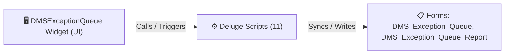

# 🧩 DMSExceptionQueue Widget

> [!INFO] Widget Overview
> - **Module:** `Delivery Management System (DMS)`
> - **System Stage:** `DMS Exceptions & Reschedules`
> - **Frontend UI File:** [`Widget/DMS/DMSExceptionQueue/_extract_tmp/app/index.html`](file:///C:/Users/Enduser/Desktop/Deluge script/Delivery Management/DMS Exception Queue/Widget/_extract_tmp/app/index.html)
> - **Creator Forms & Reports:** `DMS_Exception_Queue`, `DMS_Exception_Queue_Report`
> - **Total Deluge Scripts Connected:** **11**

---

## 📖 Description & Purpose
Manages failed deliveries, reschedule requests, client not on site exceptions, and prioritized requeues.

---

## 🔄 Architecture & Data Flow

---

## 💻 Frontend HTML Interface
- **HTML Path:** [`Widget/DMS/DMSExceptionQueue/_extract_tmp/app/index.html`](file:///C:/Users/Enduser/Desktop/Deluge script/Delivery Management/DMS Exception Queue/Widget/_extract_tmp/app/index.html)
- **Window Title:** `DMS Exception Queue`

---

## ⚙️ Backing Deluge Scripts (11)

The following Deluge scripts directly power or listen to this widget's lifecycle events:

| Script Name | Source File | Category | Lines |
| :--- | :--- | :--- | :--- |
| [[Delivery Management/_Deluge/dms_exception_queue|dms_exception_queue]] | `dms_exception_queue.txt` | `02 - Main DelugeScripts` | 339 |
| [[Delivery Management/_Deluge/dms_exception_queue|dms_exception_queue]] | `DMS\DelugeScripts\dms_exception_queue.txt` | `05 - Widget Scripts` | 339 |
| [[Delivery Management/_Deluge/dms_exception_queue|dms_exception_queue]] | `NEw/DelugeScripts\dms_exception_queue.txt` | `06 - Archive (Deluge Script & NEw)` | 339 |
| [[Delivery Management/_Deluge/Deluge/dms_field_work_reschedule|dms_field_work_reschedule]] | `dms_field_work_reschedule.txt` | `02 - Main DelugeScripts` | 154 |
| [[Delivery Management/_Deluge/Deluge/dms_field_work_reschedule|dms_field_work_reschedule]] | `DMS\DelugeScripts\dms_field_work_reschedule.txt` | `05 - Widget Scripts` | 154 |
| [[Delivery Management/_Deluge/Deluge/dms_field_work_reschedule|dms_field_work_reschedule]] | `NEw/DelugeScripts\dms_field_work_reschedule.txt` | `06 - Archive (Deluge Script & NEw)` | 154 |
| [[Delivery Management/_Deluge/Deluge/dms_reschedule_custom_api|dms_reschedule_custom_api]] | `dms_reschedule_custom_api.txt` | `02 - Main DelugeScripts` | 470 |
| [[Delivery Management/_Deluge/Deluge/dms_reschedule_custom_api|dms_reschedule_custom_api]] | `DMS\DelugeScripts\dms_reschedule_custom_api.txt` | `05 - Widget Scripts` | 470 |
| [[Delivery Management/_Deluge/Deluge/dms_reschedule_custom_api|dms_reschedule_custom_api]] | `NEw/DelugeScripts\dms_reschedule_custom_api.txt` | `06 - Archive (Deluge Script & NEw)` | 470 |
| [[_Shared/Notifications/Deluge/Notify_on_DMS_Exception_Raised|Notify_on_DMS_Exception_Raised]] | `Deluge Script/Notification\Notify_on_DMS_Exception_Raised.txt` | `06 - Archive (Deluge Script & NEw)` | 89 |
| [[Delivery Management/_Deluge/Deluge/PASTE_ReSchedule_ReportActionItem|PASTE_ReSchedule_ReportActionItem]] | `DMS\PASTE_ReSchedule_ReportActionItem.txt` | `05 - Widget Scripts` | 269 |

---

## 📋 Associated Creator Forms & Reports
- `DMS_Exception_Queue`
- `DMS_Exception_Queue_Report`

---

## 📚 Associated Manuals & PDF Documentation

| Manual / Document | Type | Size |
| :--- | :--- | :--- |
| [[_Shared/Docs/01 - Staff & Operations Manuals/Delivery Management System Manual (Tagalog)|Delivery Management System Manual (Tagalog)]] | `Staff Operations Manual` | `9.7 MB` |
| [[_Shared/Docs/01 - Staff & Operations Manuals/Delivery Management System Manual (English)|Delivery Management System Manual (English)]] | `Staff Operations Manual` | `9.7 MB` |
| [[_Shared/Docs/02 - Architecture, Blueprints & Swimlanes/Delivery Confirmation Policy — Client Not On Site (PDF)|Delivery Confirmation Policy — Client Not On Site (PDF)]] | `Operational Policy` | `107.0 KB` |
| [[_Shared/Docs/02 - Architecture, Blueprints & Swimlanes/Exception Flagging Proposal (PDF)|Exception Flagging Proposal (PDF)]] | `Feature Proposal` | `222.6 KB` |
