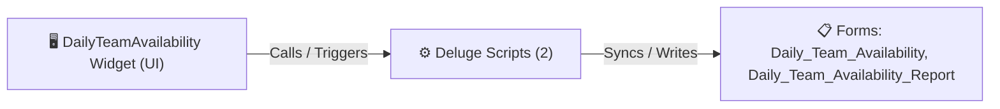

# 🧩 DailyTeamAvailability Widget

> [!INFO] Widget Overview
> - **Module:** `Delivery Management System (DMS)`
> - **System Stage:** `Driver & Team Roster`
> - **Frontend UI File:** [`_scratch_dta.html`](file:///C:/Users/Enduser/Desktop/Deluge script/Delivery Management/Daily Team Availability/Widget/DailyTeamAvailability.zip)
> - **Creator Forms & Reports:** `Daily_Team_Availability`, `Daily_Team_Availability_Report`
> - **Total Deluge Scripts Connected:** **2**

---

## 📖 Description & Purpose
Driver and delivery helper schedules, daily capacity planning, and shift management.

---

## 🔄 Architecture & Data Flow

---

## 💻 Frontend HTML Interface
- **HTML Path:** [`_scratch_dta.html`](file:///C:/Users/Enduser/Desktop/Deluge script/Delivery Management/Daily Team Availability/Widget/DailyTeamAvailability.zip)
- **Window Title:** `Daily Team Availability`

---

## ⚙️ Backing Deluge Scripts (2)

The following Deluge scripts directly power or listen to this widget's lifecycle events:

| Script Name | Source File | Category | Lines |
| :--- | :--- | :--- | :--- |
| [[Delivery Management/_Deluge/Deluge/schedule_test_settings_form|schedule_test_settings_form]] | `schedule_test_settings_form.txt` | `02 - Main DelugeScripts` | 58 |
| [[Delivery Management/_Deluge/Deluge/schedule_test_settings_form|schedule_test_settings_form]] | `NEw/DelugeScripts\schedule_test_settings_form.txt` | `06 - Archive (Deluge Script & NEw)` | 58 |

---

## 📋 Associated Creator Forms & Reports
- `Daily_Team_Availability`
- `Daily_Team_Availability_Report`

---

## 📚 Associated Manuals & PDF Documentation

| Manual / Document | Type | Size |
| :--- | :--- | :--- |
| [[_Shared/Docs/01 - Staff & Operations Manuals/DMS System Guide|DMS System Guide]] | `System Overview Manual` | `1.3 MB` |
