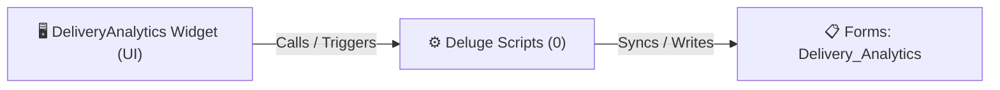

# 🧩 DeliveryAnalytics Widget

> [!INFO] Widget Overview
> - **Module:** `Delivery Management System (DMS)`
> - **System Stage:** `DMS Analytics`
> - **Frontend UI File:** [`Widget/DMS/DeliveryAnalytics/_extract_tmp/app/index.html`](file:///C:/Users/Enduser/Desktop/Deluge script/Delivery Management/Delivery Analytics/Widget/_extract_tmp/app/index.html)
> - **Creator Forms & Reports:** `Delivery_Analytics`
> - **Total Deluge Scripts Connected:** **0**

---

## 📖 Description & Purpose
On-time delivery rates, fuel efficiency, driver performance, and failed delivery statistics.

---

## 🔄 Architecture & Data Flow

---

## 💻 Frontend HTML Interface
- **HTML Path:** [`Widget/DMS/DeliveryAnalytics/_extract_tmp/app/index.html`](file:///C:/Users/Enduser/Desktop/Deluge script/Delivery Management/Delivery Analytics/Widget/_extract_tmp/app/index.html)
- **Window Title:** `Delivery Analytics`

---

## ⚙️ Backing Deluge Scripts (0)

The following Deluge scripts directly power or listen to this widget's lifecycle events:

| Script Name | Source File | Category | Lines |
| :--- | :--- | :--- | :--- |
| *(No dedicated scripts classified directly)* | - | - | - |

---

## 📋 Associated Creator Forms & Reports
- `Delivery_Analytics`
