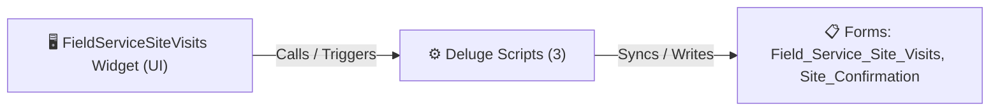

# 🧩 FieldServiceSiteVisits Widget

> [!INFO] Widget Overview
> - **Module:** `Delivery Management System (DMS)`
> - **System Stage:** `Site Confirmation & Technical Inspection`
> - **Frontend UI File:** [`Widget/DMS/FieldServiceSiteVisits/_extract_src/app/index.html`](file:///C:/Users/Enduser/Desktop/Deluge script/Delivery Management/Field Service Site Visits/Widget/_extract_src/app/index.html)
> - **Creator Forms & Reports:** `Field_Service_Site_Visits`, `Site_Confirmation`
> - **Total Deluge Scripts Connected:** **3**

---

## 📖 Description & Purpose
Coordinates ocular site inspections, elevator/stairwell accessibility checks before delivery.

---

## 🔄 Architecture & Data Flow

---

## 💻 Frontend HTML Interface
- **HTML Path:** [`Widget/DMS/FieldServiceSiteVisits/_extract_src/app/index.html`](file:///C:/Users/Enduser/Desktop/Deluge script/Delivery Management/Field Service Site Visits/Widget/_extract_src/app/index.html)
- **Window Title:** `Field Service Site Visits`

---

## ⚙️ Backing Deluge Scripts (3)

The following Deluge scripts directly power or listen to this widget's lifecycle events:

| Script Name | Source File | Category | Lines |
| :--- | :--- | :--- | :--- |
| [[Delivery Management/_Deluge/Deluge/dms_site_confirmation|dms_site_confirmation]] | `dms_site_confirmation.txt` | `02 - Main DelugeScripts` | 308 |
| [[Delivery Management/_Deluge/Deluge/dms_site_confirmation|dms_site_confirmation]] | `DMS\DelugeScripts\dms_site_confirmation.txt` | `05 - Widget Scripts` | 308 |
| [[Delivery Management/_Deluge/Deluge/dms_site_confirmation|dms_site_confirmation]] | `NEw/DelugeScripts\dms_site_confirmation.txt` | `06 - Archive (Deluge Script & NEw)` | 308 |

---

## 📋 Associated Creator Forms & Reports
- `Field_Service_Site_Visits`
- `Site_Confirmation`
