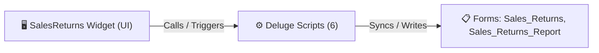

# 🧩 SalesReturns Widget

> [!INFO] Widget Overview
> - **Module:** `Delivery Management System (DMS)`
> - **System Stage:** `Returns & Reverse Logistics`
> - **Frontend UI File:** [`Widget/DMS/SalesReturns/_extract_src/app/index.html`](file:///C:/Users/Enduser/Desktop/Deluge script/Delivery Management/Sales Returns/Widget/_extract_src/app/index.html)
> - **Creator Forms & Reports:** `Sales_Returns`, `Sales_Returns_Report`
> - **Total Deluge Scripts Connected:** **6**

---

## 📖 Description & Purpose
Handles customer returns picked up during delivery, inspections, and pushing Sales Returns to Zoho Books.

---

## 🔄 Architecture & Data Flow

---

## 💻 Frontend HTML Interface
- **HTML Path:** [`Widget/DMS/SalesReturns/_extract_src/app/index.html`](file:///C:/Users/Enduser/Desktop/Deluge script/Delivery Management/Sales Returns/Widget/_extract_src/app/index.html)
- **Window Title:** `Sales Returns`

---

## ⚙️ Backing Deluge Scripts (6)

The following Deluge scripts directly power or listen to this widget's lifecycle events:

| Script Name | Source File | Category | Lines |
| :--- | :--- | :--- | :--- |
| [[Delivery Management/_Deluge/Deluge/dms_sales_returns_form|dms_sales_returns_form]] | `dms_sales_returns_form.txt` | `02 - Main DelugeScripts` | 244 |
| [[Delivery Management/_Deluge/Deluge/dms_sales_returns_form|dms_sales_returns_form]] | `DMS\DelugeScripts\dms_sales_returns_form.txt` | `05 - Widget Scripts` | 244 |
| [[Delivery Management/_Deluge/Deluge/dms_sales_returns_form|dms_sales_returns_form]] | `NEw/DelugeScripts\dms_sales_returns_form.txt` | `06 - Archive (Deluge Script & NEw)` | 244 |
| [[Delivery Management/_Deluge/Deluge/sales_return_to_books|sales_return_to_books]] | `sales_return_to_books.txt` | `02 - Main DelugeScripts` | 341 |
| [[Delivery Management/_Deluge/Deluge/sales_return_to_books|sales_return_to_books]] | `DMS\DelugeScripts\sales_return_to_books.txt` | `05 - Widget Scripts` | 341 |
| [[Delivery Management/_Deluge/Deluge/sales_return_to_books|sales_return_to_books]] | `NEw/DelugeScripts\sales_return_to_books.txt` | `06 - Archive (Deluge Script & NEw)` | 341 |

---

## 📋 Associated Creator Forms & Reports
- `Sales_Returns`
- `Sales_Returns_Report`

---

## 📚 Associated Manuals & PDF Documentation

| Manual / Document | Type | Size |
| :--- | :--- | :--- |
| [[_Shared/Docs/04 - Zoho Reference Guides/Zoho Inventory — Purchase Returns & Migrations|Zoho Inventory — Purchase Returns & Migrations]] | `Official Reference Manual` | `6.9 MB` |
