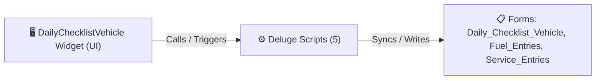

# 🧩 DailyChecklistVehicle Widget

> [!INFO] Widget Overview
> - **Module:** `Delivery Management System (DMS)`
> - **System Stage:** `Fleet & Vehicle Maintenance`
> - **Frontend UI File:** [`Widget/DMS/DailyChecklistVehicle/app/index.html`](file:///C:/Users/Enduser/Desktop/Deluge script/Delivery Management/Truck Maintenance/Widget/app/index.html)
> - **Creator Forms & Reports:** `Daily_Checklist_Vehicle`, `Fuel_Entries`, `Service_Entries`
> - **Total Deluge Scripts Connected:** **5**

---

## 📖 Description & Purpose
Pre-trip vehicle checklists, fuel entries, odometer logging, and maintenance records.

---

## 🔄 Architecture & Data Flow

---

## 💻 Frontend HTML Interface
- **HTML Path:** [`Widget/DMS/DailyChecklistVehicle/app/index.html`](file:///C:/Users/Enduser/Desktop/Deluge script/Delivery Management/Truck Maintenance/Widget/app/index.html)
- **Window Title:** `Truck Maintenance`

---

## ⚙️ Backing Deluge Scripts (5)

The following Deluge scripts directly power or listen to this widget's lifecycle events:

| Script Name | Source File | Category | Lines |
| :--- | :--- | :--- | :--- |
| [[Fulfillment/QC Checklist/Deluge/_variants/Widget-Scripts/checker_checklist_qc_sync|checker_checklist_qc_sync]] | `DMS\DelugeScripts\checker_checklist_qc_sync.txt` | `05 - Widget Scripts` | 1114 |
| [[Fulfillment/QC Checklist/Deluge/_variants/Widget-Scripts/checker_checklist_qc_sync|checker_checklist_qc_sync]] | `DMS\DelugeScripts\production\checker_checklist_qc_sync.txt` | `05 - Widget Scripts` | 836 |
| [[Delivery Management/Truck Maintenance/Deluge/Fuel_Entries|Fuel_Entries]] | `Fuel_Entries` | `01 - Root Workflows` | 212 |
| [[Delivery Management/_Deluge/Deluge/PASTE_DailyChecklistStatusOnAdd|PASTE_DailyChecklistStatusOnAdd]] | `DMS\PASTE_DailyChecklistStatusOnAdd.txt` | `05 - Widget Scripts` | 45 |
| [[Delivery Management/Truck Maintenance/Deluge/Service_Entries|Service_Entries]] | `Service_Entries` | `01 - Root Workflows` | 228 |

---

## 📋 Associated Creator Forms & Reports
- `Daily_Checklist_Vehicle`
- `Fuel_Entries`
- `Service_Entries`

---

## 📚 Associated Manuals & PDF Documentation

| Manual / Document | Type | Size |
| :--- | :--- | :--- |
| [[_Shared/Docs/01 - Staff & Operations Manuals/Delivery Management System Manual (Tagalog)|Delivery Management System Manual (Tagalog)]] | `Staff Operations Manual` | `9.7 MB` |
| [[_Shared/Docs/01 - Staff & Operations Manuals/Delivery Management System Manual (English)|Delivery Management System Manual (English)]] | `Staff Operations Manual` | `9.7 MB` |
