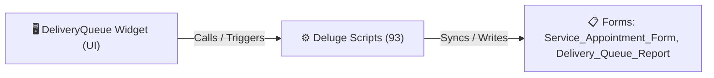

# 🧩 DeliveryQueue Widget

> [!INFO] Widget Overview
> - **Module:** `Delivery Management System (DMS)`
> - **System Stage:** `Stage 1: Delivery Scheduling & Queue`
> - **Frontend UI File:** [`Widget/DMS/DeliveryQueue/_extract_check/app/index.html`](file:///C:/Users/Enduser/Desktop/Deluge script/Fulfillment/Pack/Widget/app/index.html)
> - **Creator Forms & Reports:** `Service_Appointment_Form`, `Delivery_Queue_Report`
> - **Total Deluge Scripts Connected:** **93**

---

## 📖 Description & Purpose
Master delivery queue, scheduling engine, truck slot assignment, priority tagging, and dispatch planning.

---

## 🔄 Architecture & Data Flow

---

## 💻 Frontend HTML Interface
- **HTML Path:** [`Widget/DMS/DeliveryQueue/_extract_check/app/index.html`](file:///C:/Users/Enduser/Desktop/Deluge script/Fulfillment/Pack/Widget/app/index.html)
- **Window Title:** `Delivery Queue`

---

## ⚙️ Backing Deluge Scripts (93)

The following Deluge scripts directly power or listen to this widget's lifecycle events:

| Script Name | Source File | Category | Lines |
| :--- | :--- | :--- | :--- |
| [[Procurement/Purchase Order/Deluge/_variants/Widget-Scripts/acknowledge_po_custom_api|acknowledge_po_custom_api]] | `DMS\DelugeScripts\acknowledge_po_custom_api.txt` | `05 - Widget Scripts` | 732 |
| [[Delivery Management/_Deluge/Deluge/ACTION2_ASAP_OVERRIDE_PASTE_DITO|ACTION2_ASAP_OVERRIDE_PASTE_DITO]] | `DMS\ACTION2_ASAP_OVERRIDE_PASTE_DITO.txt` | `05 - Widget Scripts` | 159 |
| [[Delivery Management/_Deluge/Deluge/ACTION3_PASTE_DITO|ACTION3_PASTE_DITO]] | `DMS\ACTION3_PASTE_DITO.txt` | `05 - Widget Scripts` | 34 |
| [[_Shared/Deluge/Deluge/add_item_by_id_custom_api|add_item_by_id_custom_api]] | `DMS\DelugeScripts\add_item_by_id_custom_api.txt` | `05 - Widget Scripts` | 381 |
| [[_Shared/Deluge/Deluge/ApplyNow|ApplyNow]] | `DMS\DelugeScripts\ApplyNow.txt` | `05 - Widget Scripts` | 432 |
| [[Procurement/Replacement/Deluge/approve_rr_custom_api|approve_rr_custom_api]] | `DMS\DelugeScripts\approve_rr_custom_api.txt` | `05 - Widget Scripts` | 179 |
| [[Procurement/Replacement/Deluge/approve_rr_supplier|approve_rr_supplier]] | `DMS\DelugeScripts\approve_rr_supplier.txt` | `05 - Widget Scripts` | 183 |
| [[Procurement/Inquiry/Deluge/books_estimate_sync|books_estimate_sync]] | `DMS\DelugeScripts\books_estimate_sync.txt` | `05 - Widget Scripts` | 177 |
| [[Procurement/Inquiry/Deluge/books_estimate_sync|books_estimate_sync]] | `DMS\DelugeScripts\production\books_estimate_sync.txt` | `05 - Widget Scripts` | 181 |
| [[Procurement/Replacement/Deluge/clone_shipment_for_replacement|clone_shipment_for_replacement]] | `DMS\DelugeScripts\clone_shipment_for_replacement.txt` | `05 - Widget Scripts` | 782 |
| [[Procurement/Inquiry/Deluge/_variants/Widget-Scripts/create_estimate_custom_api|create_estimate_custom_api]] | `DMS\DelugeScripts\create_estimate_custom_api.txt` | `05 - Widget Scripts` | 450 |
| [[Procurement/Inquiry/Deluge/_variants/Widget-Scripts/create_estimates_button|create_estimates_button]] | `DMS\DelugeScripts\create_estimates_button.txt` | `05 - Widget Scripts` | 476 |
| [[Procurement/Inquiry/Deluge/_variants/Widget-Scripts/create_estimates_inq_action|create_estimates_inq_action]] | `DMS\DelugeScripts\create_estimates_inq_action.txt` | `05 - Widget Scripts` | 354 |
| [[Procurement/Replacement/Deluge/_variants/Widget-Scripts/create_rr_button|create_rr_button]] | `DMS\DelugeScripts\create_rr_button.txt` | `05 - Widget Scripts` | 772 |
| [[Procurement/Replacement/Deluge/_variants/Widget-Scripts/create_rr_custom_api|create_rr_custom_api]] | `DMS\DelugeScripts\create_rr_custom_api.txt` | `05 - Widget Scripts` | 711 |
| [[Delivery Management/_Deluge/Deluge/dms_create_shipment_order|dms_create_shipment_order]] | `dms_create_shipment_order.txt` | `02 - Main DelugeScripts` | 287 |
| [[Delivery Management/_Deluge/Deluge/dms_create_shipment_order|dms_create_shipment_order]] | `DMS\DelugeScripts\dms_create_shipment_order.txt` | `05 - Widget Scripts` | 287 |
| [[Delivery Management/_Deluge/Deluge/dms_create_shipment_order|dms_create_shipment_order]] | `NEw/DelugeScripts\dms_create_shipment_order.txt` | `06 - Archive (Deluge Script & NEw)` | 287 |
| [[Delivery Management/_Deluge/Deluge/dms_field_work_completion_sync|dms_field_work_completion_sync]] | `dms_field_work_completion_sync.txt` | `02 - Main DelugeScripts` | 311 |
| [[Delivery Management/_Deluge/Deluge/dms_field_work_completion_sync|dms_field_work_completion_sync]] | `DMS\DelugeScripts\dms_field_work_completion_sync.txt` | `05 - Widget Scripts` | 311 |
| [[Delivery Management/_Deluge/Deluge/dms_field_work_completion_sync|dms_field_work_completion_sync]] | `NEw/DelugeScripts\dms_field_work_completion_sync.txt` | `06 - Archive (Deluge Script & NEw)` | 311 |
| [[Delivery Management/_Deluge/Deluge/dms_location_route_geocode|dms_location_route_geocode]] | `dms_location_route_geocode.txt` | `02 - Main DelugeScripts` | 267 |
| [[Delivery Management/_Deluge/Deluge/dms_location_route_geocode|dms_location_route_geocode]] | `DMS\DelugeScripts\dms_location_route_geocode.txt` | `05 - Widget Scripts` | 267 |
| [[Delivery Management/_Deluge/Deluge/dms_location_route_geocode|dms_location_route_geocode]] | `NEw/DelugeScripts\dms_location_route_geocode.txt` | `06 - Archive (Deluge Script & NEw)` | 267 |
| [[Delivery Management/_Deluge/Deluge/dms_scheduling_engine|dms_scheduling_engine]] | `dms_scheduling_engine.txt` | `02 - Main DelugeScripts` | 1650 |
| [[Delivery Management/_Deluge/Deluge/dms_scheduling_engine|dms_scheduling_engine]] | `DMS\DelugeScripts\dms_scheduling_engine.txt` | `05 - Widget Scripts` | 1650 |
| [[Delivery Management/_Deluge/Deluge/dms_scheduling_engine|dms_scheduling_engine]] | `NEw/DelugeScripts\dms_scheduling_engine.txt` | `06 - Archive (Deluge Script & NEw)` | 1650 |
| [[_Shared/Deluge/Deluge/edit_counter_scripts|edit_counter_scripts]] | `DMS\DelugeScripts\edit_counter_scripts.txt` | `05 - Widget Scripts` | 589 |
| [[_Shared/Deluge/Deluge/_variants/Widget-Scripts/error|error]] | `DMS\DelugeScripts\error.txt` | `05 - Widget Scripts` | 307 |
| [[_Shared/Notifications/Deluge/ff_notifications_all_modules|ff_notifications_all_modules]] | `DMS\DelugeScripts\ff_notifications_all_modules.txt` | `05 - Widget Scripts` | 250 |
| [[_Shared/Notifications/Deluge/ff_notifications_all_modules|ff_notifications_all_modules]] | `DMS\DelugeScripts\production\ff_notifications_all_modules.txt` | `05 - Widget Scripts` | 255 |
| [[_Shared/Notifications/Deluge/ff_notifications_inline_patches|ff_notifications_inline_patches]] | `DMS\DelugeScripts\ff_notifications_inline_patches.txt` | `05 - Widget Scripts` | 238 |
| [[_Shared/Notifications/Deluge/ff_notifications_inline_patches|ff_notifications_inline_patches]] | `DMS\DelugeScripts\production\ff_notifications_inline_patches.txt` | `05 - Widget Scripts` | 243 |
| [[_Shared/Deluge/Deluge/finalization_scripts|finalization_scripts]] | `DMS\DelugeScripts\finalization_scripts.txt` | `05 - Widget Scripts` | 212 |
| [[_Shared/Deluge/Deluge/get_subform_file_custom_api|get_subform_file_custom_api]] | `DMS\DelugeScripts\get_subform_file_custom_api.txt` | `05 - Widget Scripts` | 282 |
| [[Procurement/Inquiry/Deluge/inquiry_autofill_product_image|inquiry_autofill_product_image]] | `DMS\DelugeScripts\inquiry_autofill_product_image.txt` | `05 - Widget Scripts` | 61 |
| [[Procurement/Inquiry/Deluge/inquiry_check_readiness|inquiry_check_readiness]] | `DMS\DelugeScripts\inquiry_check_readiness.txt` | `05 - Widget Scripts` | 274 |
| [[Procurement/Inquiry/Deluge/inquiry_generate_inq_no|inquiry_generate_inq_no]] | `DMS\DelugeScripts\inquiry_generate_inq_no.txt` | `05 - Widget Scripts` | 91 |
| [[_Shared/Deluge/_Unlabelled/IPAPASTE_KO_2026-09-16|IPAPASTE_KO_2026-09-16]] | `IPAPASTE_KO_2026-09-16.txt` | `01 - Root Workflows` | 1670 |
| [[_Shared/Deluge/Deluge/lookatthis|lookatthis]] | `DMS\DelugeScripts\lookatthis.txt` | `05 - Widget Scripts` | 5 |
| [[Procurement/Supplier - Fenteng/Deluge/paste-approveRRFenteng|paste-approveRRFenteng]] | `DMS\DelugeScripts\paste-approveRRFenteng.txt` | `05 - Widget Scripts` | 42 |
| [[Procurement/Supplier - Tony Fan/Deluge/paste-approveRRTony|paste-approveRRTony]] | `DMS\DelugeScripts\paste-approveRRTony.txt` | `05 - Widget Scripts` | 42 |
| [[Procurement/Replacement/Deluge/paste-cloneShipmentForReplacement|paste-cloneShipmentForReplacement]] | `DMS\DelugeScripts\paste-cloneShipmentForReplacement.txt` | `05 - Widget Scripts` | 419 |
| [[Procurement/Receiving/Deluge/paste-createBinReceivingWidget|paste-createBinReceivingWidget]] | `DMS\DelugeScripts\paste-createBinReceivingWidget.txt` | `05 - Widget Scripts` | 1854 |
| [[Procurement/Shipments/Deluge/paste-shipments_auto_create_supplier_shipment|paste-shipments_auto_create_supplier_shipment]] | `DMS\DelugeScripts\paste-shipments_auto_create_supplier_shipment.txt` | `05 - Widget Scripts` | 42 |
| [[Delivery Management/_Deluge/Deluge/PASTE_Action1_SA_Scheduling_Engine|PASTE_Action1_SA_Scheduling_Engine]] | `DMS\PASTE_Action1_SA_Scheduling_Engine.txt` | `05 - Widget Scripts` | 443 |
| [[Delivery Management/_Docs/PASTE_FieldWorkCompletionSync|PASTE_FieldWorkCompletionSync]] | `DMS\PASTE_FieldWorkCompletionSync.txt` | `05 - Widget Scripts` | 196 |
| [[Delivery Management/_Deluge/PASTE_reScheduleDelivery_2026-09-17|PASTE_reScheduleDelivery_2026-09-17]] | `PASTE_reScheduleDelivery_2026-09-17.txt` | `01 - Root Workflows` | 381 |
| [[Procurement/Purchase Request/Deluge/_variants/Widget-Scripts/PR1_Created_Edited_Routing|PR1_Created_Edited_Routing]] | `DMS\DelugeScripts\PR1_Created_Edited_Routing.txt` | `05 - Widget Scripts` | 563 |
| [[Procurement/Purchase Order/Deluge/_variants/Widget-Scripts/pr_approve_po_custom_api|pr_approve_po_custom_api]] | `DMS\DelugeScripts\pr_approve_po_custom_api.txt` | `05 - Widget Scripts` | 1735 |
| [[Procurement/Purchase Request/Deluge/_variants/Widget-Scripts/pr_check_readiness|pr_check_readiness]] | `DMS\DelugeScripts\pr_check_readiness.txt` | `05 - Widget Scripts` | 155 |
| [[Procurement/Purchase Request/Deluge/pr_sync_supplier_load_balancing|pr_sync_supplier_load_balancing]] | `DMS\DelugeScripts\pr_sync_supplier_load_balancing.txt` | `05 - Widget Scripts` | 243 |
| [[Procurement/Purchase Request/Deluge/_variants/Widget-Scripts/pr_sync_supplier_selected|pr_sync_supplier_selected]] | `DMS\DelugeScripts\pr_sync_supplier_selected.txt` | `05 - Widget Scripts` | 162 |
| [[Procurement/Purchase Order/Deluge/_variants/Widget-Scripts/pr_to_po_grouping|pr_to_po_grouping]] | `DMS\DelugeScripts\pr_to_po_grouping.txt` | `05 - Widget Scripts` | 2056 |
| [[Fulfillment/Pre-Order/Deluge/preorder_create_package|preorder_create_package]] | `DMS\DelugeScripts\preorder_create_package.txt` | `05 - Widget Scripts` | 1270 |
| [[Fulfillment/Order Readiness/Deluge/preorder_to_readiness_gate|preorder_to_readiness_gate]] | `DMS\DelugeScripts\preorder_to_readiness_gate.txt` | `05 - Widget Scripts` | 167 |
| [[Procurement/Purchase Order/Deluge/purchase_order_scripts|purchase_order_scripts]] | `DMS\DelugeScripts\purchase_order_scripts.txt` | `05 - Widget Scripts` | 894 |
| [[Procurement/Purchase Request/Deluge/purchase_request1_full_workflow_dump|purchase_request1_full_workflow_dump]] | `DMS\DelugeScripts\purchase_request1_full_workflow_dump.txt` | `05 - Widget Scripts` | 410 |
| [[Procurement/Purchase Request/Deluge/purchase_request_scripts|purchase_request_scripts]] | `DMS\DelugeScripts\purchase_request_scripts.txt` | `05 - Widget Scripts` | 173 |
| [[Procurement/Purchase Request/Deluge/purchase_request_scripts1|purchase_request_scripts1]] | `DMS\DelugeScripts\purchase_request_scripts1.txt` | `05 - Widget Scripts` | 662 |
| [[Procurement/Receiving/Deluge/receiving_bin_location_choices|receiving_bin_location_choices]] | `DMS\DelugeScripts\receiving_bin_location_choices.txt` | `05 - Widget Scripts` | 115 |
| [[Procurement/Receiving/Deluge/receiving_check_fulfillment_ready|receiving_check_fulfillment_ready]] | `DMS\DelugeScripts\receiving_check_fulfillment_ready.txt` | `05 - Widget Scripts` | 65 |
| [[Procurement/Receiving/Deluge/receiving_create_bin_receiving|receiving_create_bin_receiving]] | `DMS\DelugeScripts\receiving_create_bin_receiving.txt` | `05 - Widget Scripts` | 2370 |
| [[Procurement/Receiving/Deluge/receiving_shipment_populate|receiving_shipment_populate]] | `DMS\DelugeScripts\receiving_shipment_populate.txt` | `05 - Widget Scripts` | 432 |
| [[Procurement/Receiving/Deluge/receiving_status_workflow|receiving_status_workflow]] | `DMS\DelugeScripts\receiving_status_workflow.txt` | `05 - Widget Scripts` | 161 |
| [[Procurement/Receiving/Deluge/_variants/Widget-Scripts/receiving_sync_shipment_arrived|receiving_sync_shipment_arrived]] | `DMS\DelugeScripts\receiving_sync_shipment_arrived.txt` | `05 - Widget Scripts` | 212 |
| [[Procurement/Receiving/Deluge/receiving_sync_shipment_mode|receiving_sync_shipment_mode]] | `DMS\DelugeScripts\receiving_sync_shipment_mode.txt` | `05 - Widget Scripts` | 76 |
| [[Procurement/Receiving/Deluge/_variants/Widget-Scripts/receiving_validations_and_damage_missing|receiving_validations_and_damage_missing]] | `DMS\DelugeScripts\receiving_validations_and_damage_missing.txt` | `05 - Widget Scripts` | 680 |
| [[Procurement/Receiving/Deluge/receiving_widget_custom_api|receiving_widget_custom_api]] | `DMS\DelugeScripts\receiving_widget_custom_api.txt` | `05 - Widget Scripts` | 2320 |
| [[Fulfillment/Order Readiness/Deluge/release_records_to_pick1_sync|release_records_to_pick1_sync]] | `DMS\DelugeScripts\release_records_to_pick1_sync.txt` | `05 - Widget Scripts` | 199 |
| [[Delivery Management/_Deluge/Deluge/schedule_test_settings_form|schedule_test_settings_form]] | `DMS\DelugeScripts\schedule_test_settings_form.txt` | `05 - Widget Scripts` | 58 |
| [[Procurement/Shipments/Deluge/shipment_delay_status_schedule|shipment_delay_status_schedule]] | `DMS\DelugeScripts\shipment_delay_status_schedule.txt` | `05 - Widget Scripts` | 198 |
| [[Procurement/Receiving/Deluge/shipment_populate_receiving|shipment_populate_receiving]] | `DMS\DelugeScripts\shipment_populate_receiving.txt` | `05 - Widget Scripts` | 161 |
| [[Procurement/Shipments/Deluge/shipment_previous_status|shipment_previous_status]] | `DMS\DelugeScripts\shipment_previous_status.txt` | `05 - Widget Scripts` | 42 |
| [[Procurement/Shipments/Deluge/_variants/Widget-Scripts/shipment_status_back_sync|shipment_status_back_sync]] | `DMS\DelugeScripts\shipment_status_back_sync.txt` | `05 - Widget Scripts` | 181 |
| [[Procurement/Shipments/Deluge/shipments_auto_create_supplier_shipment|shipments_auto_create_supplier_shipment]] | `DMS\DelugeScripts\shipments_auto_create_supplier_shipment.txt` | `05 - Widget Scripts` | 133 |
| [[Procurement/Receiving/Deluge/shipments_sync_shipment_mode_to_receiving|shipments_sync_shipment_mode_to_receiving]] | `DMS\DelugeScripts\shipments_sync_shipment_mode_to_receiving.txt` | `05 - Widget Scripts` | 76 |
| [[_Shared/Deluge/_Unlabelled/Deluge/sideUpdateScript|sideUpdateScript]] | `DMS\DelugeScripts\sideUpdateScript.txt` | `05 - Widget Scripts` | 382 |
| [[Procurement/Purchase Request/Deluge/sideUpdateScriptPR|sideUpdateScriptPR]] | `DMS\DelugeScripts\sideUpdateScriptPR.txt` | `05 - Widget Scripts` | 120 |
| [[Fulfillment/SO Report/Deluge/_variants/Widget-Scripts/so_fulfillment_sync|so_fulfillment_sync]] | `DMS\DelugeScripts\so_fulfillment_sync.txt` | `05 - Widget Scripts` | 1224 |
| [[Fulfillment/SO Report/Deluge/_variants/Widget-Scripts/so_fulfillment_sync|so_fulfillment_sync]] | `DMS\DelugeScripts\production\so_fulfillment_sync.txt` | `05 - Widget Scripts` | 627 |
| [[Fulfillment/Order Readiness/Deluge/_variants/Widget-Scripts/so_fulfillment_to_readiness_gate|so_fulfillment_to_readiness_gate]] | `DMS\DelugeScripts\so_fulfillment_to_readiness_gate.txt` | `05 - Widget Scripts` | 267 |
| [[Fulfillment/KANBAN/Deluge/_variants/Widget-Scripts/so_kanban_sync|so_kanban_sync]] | `DMS\DelugeScripts\so_kanban_sync.txt` | `05 - Widget Scripts` | 989 |
| [[Fulfillment/KANBAN/Deluge/_variants/Widget-Scripts/so_kanban_sync|so_kanban_sync]] | `DMS\DelugeScripts\production\so_kanban_sync.txt` | `05 - Widget Scripts` | 986 |
| [[Procurement/Purchase Request/Deluge/so_to_pr_scripts|so_to_pr_scripts]] | `DMS\DelugeScripts\so_to_pr_scripts.txt` | `05 - Widget Scripts` | 217 |
| [[Procurement/Purchase Request/Deluge/_variants/Widget-Scripts/so_to_pr_scripts_NewScripts|so_to_pr_scripts_NewScripts]] | `DMS\DelugeScripts\so_to_pr_scripts_NewScripts.txt` | `05 - Widget Scripts` | 1036 |
| [[Procurement/Purchase Request/Deluge/_variants/Widget-Scripts/so_to_pr_scripts_NewScripts|so_to_pr_scripts_NewScripts]] | `DMS\DelugeScripts\production\so_to_pr_scripts_NewScripts.txt` | `05 - Widget Scripts` | 1034 |
| [[Procurement/Inquiry/Deluge/stage_inquiry_changed_actions|stage_inquiry_changed_actions]] | `DMS\DelugeScripts\stage_inquiry_changed_actions.txt` | `05 - Widget Scripts` | 261 |
| [[Procurement/Inquiry/Deluge/supplier1_workflow_changes|supplier1_workflow_changes]] | `DMS\DelugeScripts\supplier1_workflow_changes.txt` | `05 - Widget Scripts` | 298 |
| [[Procurement/Inquiry/Deluge/supplier_quotes_last_edited_scripts|supplier_quotes_last_edited_scripts]] | `DMS\DelugeScripts\supplier_quotes_last_edited_scripts.txt` | `05 - Widget Scripts` | 320 |
| [[Procurement/Shipments/Deluge/supplier_shipment_forms|supplier_shipment_forms]] | `DMS\DelugeScripts\supplier_shipment_forms.txt` | `05 - Widget Scripts` | 276 |
| [[Procurement/Shipments/Deluge/supplier_shipment_sync|supplier_shipment_sync]] | `DMS\DelugeScripts\supplier_shipment_sync.txt` | `05 - Widget Scripts` | 488 |
| [[Delivery Management/_Deluge/UPDATE_FleetDecision_2026-09-16|UPDATE_FleetDecision_2026-09-16]] | `UPDATE_FleetDecision_2026-09-16.txt` | `01 - Root Workflows` | 1699 |

---

## 📋 Associated Creator Forms & Reports
- `Service_Appointment_Form`
- `Delivery_Queue_Report`

---

## 📚 Associated Manuals & PDF Documentation

| Manual / Document | Type | Size |
| :--- | :--- | :--- |
| [[_Shared/Docs/01 - Staff & Operations Manuals/Delivery Management System Manual (Tagalog)|Delivery Management System Manual (Tagalog)]] | `Staff Operations Manual` | `9.7 MB` |
| [[_Shared/Docs/01 - Staff & Operations Manuals/Delivery Management System Manual (English)|Delivery Management System Manual (English)]] | `Staff Operations Manual` | `9.7 MB` |
| [[_Shared/Docs/01 - Staff & Operations Manuals/DMS System Guide|DMS System Guide]] | `System Overview Manual` | `1.3 MB` |
| [[_Shared/Docs/01 - Staff & Operations Manuals/Supply Chain App UAT Manual|Supply Chain App UAT Manual]] | `UAT Manual` | `1.6 MB` |
| [[_Shared/Docs/02 - Architecture, Blueprints & Swimlanes/Business Process Blueprint (PDF)|Business Process Blueprint (PDF)]] | `Technical Architecture Blueprint` | `761.9 KB` |
| [[_Shared/Docs/02 - Architecture, Blueprints & Swimlanes/End-to-End Process Flow Swimlane (PDF)|End-to-End Process Flow Swimlane (PDF)]] | `Swimlane Process Diagram` | `804.6 KB` |
| [[_Shared/Docs/02 - Architecture, Blueprints & Swimlanes/Supply Chain Swimlane Diagram (PDF)|Supply Chain Swimlane Diagram (PDF)]] | `Swimlane Process Diagram` | `804.6 KB` |
| [[_Shared/Docs/02 - Architecture, Blueprints & Swimlanes/Delivery Confirmation Policy — Client Not On Site (PDF)|Delivery Confirmation Policy — Client Not On Site (PDF)]] | `Operational Policy` | `107.0 KB` |
| [[_Shared/Docs/02 - Architecture, Blueprints & Swimlanes/Remote Client Signature Proposal (PDF)|Remote Client Signature Proposal (PDF)]] | `Feature Proposal` | `111.6 KB` |
| [[_Shared/Docs/03 - Sprint, UAT & Quality Reports/Deployment Sprint Plan (2026-09-01)|Deployment Sprint Plan (2026-09-01)]] | `Sprint Plan` | `203.1 KB` |
| [[_Shared/Docs/03 - Sprint, UAT & Quality Reports/Deployment Sprint Report (2026-09-01)|Deployment Sprint Report (2026-09-01)]] | `Sprint Report` | `170.2 KB` |
| [[_Shared/Docs/03 - Sprint, UAT & Quality Reports/Supply Chain App Sprint Checklist (Excel)|Supply Chain App Sprint Checklist (Excel)]] | `Checklist Spreadsheet` | `6.9 KB` |
| [[_Shared/Docs/03 - Sprint, UAT & Quality Reports/Supply Chain App User Deployment Sprint (Excel)|Supply Chain App User Deployment Sprint (Excel)]] | `Deployment Spreadsheet` | `14.0 KB` |
| [[_Shared/Docs/03 - Sprint, UAT & Quality Reports/Supply Chain App Findings Report (2026-08-24)|Supply Chain App Findings Report (2026-08-24)]] | `Audit & QA Report` | `745.0 KB` |
| [[_Shared/Docs/03 - Sprint, UAT & Quality Reports/Supply Chain App UAT Report (2026-08-20)|Supply Chain App UAT Report (2026-08-20)]] | `UAT Sign-off Report` | `95.8 KB` |
