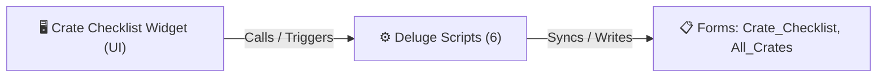

# 🧩 Crate Checklist Widget

> [!INFO] Widget Overview
> - **Module:** `Fulfillment`
> - **System Stage:** `Stage 5: Wooden Crating`
> - **Frontend UI File:** [`Widget/Fulfillment/Crate Checklist/app/index.html`](file:///C:/Users/Enduser/Desktop/Deluge script/Fulfillment/Crate/Widget/app/index.html)
> - **Creator Forms & Reports:** `Crate_Checklist`, `All_Crates`
> - **Total Deluge Scripts Connected:** **6**

---

## 📖 Description & Purpose
Manages wooden crating requirements for fragile / oversized products prior to aggregation.

---

## 🔄 Architecture & Data Flow

---

## 💻 Frontend HTML Interface
- **HTML Path:** [`Widget/Fulfillment/Crate Checklist/app/index.html`](file:///C:/Users/Enduser/Desktop/Deluge script/Fulfillment/Crate/Widget/app/index.html)
- **Window Title:** `Crate Checklist`

---

## ⚙️ Backing Deluge Scripts (6)

The following Deluge scripts directly power or listen to this widget's lifecycle events:

| Script Name | Source File | Category | Lines |
| :--- | :--- | :--- | :--- |
| [[Fulfillment/Crate/Deluge/crate_checklist_to_order_aggregation_sync|crate_checklist_to_order_aggregation_sync]] | `crate_checklist_to_order_aggregation_sync.txt` | `03 - Sidequest` | 161 |
| [[Fulfillment/Crate/Deluge/_variants/Archive-NEw/crate_checklist_to_order_aggregation_sync|crate_checklist_to_order_aggregation_sync]] | `Deluge Script/crate_checklist_to_order_aggregation_sync.txt` | `06 - Archive (Deluge Script & NEw)` | 286 |
| [[Fulfillment/Crate/IDE/form Crate_Checklist|form Crate_Checklist]] | `Crate\form Crate_Checklist.txt` | `04 - Application IDE` | 262 |
| [[Fulfillment/Crate/IDE/form Crate_Checklist|form Crate_Checklist]] | `Deluge Script/Application IDE\Crate\form Crate_Checklist.txt` | `06 - Archive (Deluge Script & NEw)` | 262 |
| [[Fulfillment/Crate/IDE/list All_Crates|list All_Crates]] | `Crate\list All_Crates.txt` | `04 - Application IDE` | 125 |
| [[Fulfillment/Crate/IDE/list All_Crates|list All_Crates]] | `Deluge Script/Application IDE\Crate\list All_Crates.txt` | `06 - Archive (Deluge Script & NEw)` | 125 |

---

## 📋 Associated Creator Forms & Reports
- `Crate_Checklist`
- `All_Crates`

---

## 📚 Associated Manuals & PDF Documentation

| Manual / Document | Type | Size |
| :--- | :--- | :--- |
| [[_Shared/Docs/01 - Staff & Operations Manuals/Fulfillment System Manual (English)|Fulfillment System Manual (English)]] | `Staff Operations Manual` | `1.6 MB` |
| [[_Shared/Docs/01 - Staff & Operations Manuals/Fulfillment System Manual (Tagalog)|Fulfillment System Manual (Tagalog)]] | `Staff Operations Manual` | `852.8 KB` |
