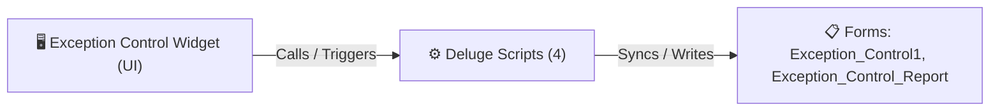

# 🧩 Exception Control Widget

> [!INFO] Widget Overview
> - **Module:** `Fulfillment`
> - **System Stage:** `Fulfillment Exceptions`
> - **Frontend UI File:** [`Widget/Fulfillment/Exception Control/app/index.html`](file:///C:/Users/Enduser/Desktop/Deluge script/Fulfillment/Exception Control/Widget/app/index.html)
> - **Creator Forms & Reports:** `Exception_Control1`, `Exception_Control_Report`
> - **Total Deluge Scripts Connected:** **4**

---

## 📖 Description & Purpose
Captures picking shortages, damaged items found during packing/QC, and routes to replacement or refund.

---

## 🔄 Architecture & Data Flow

---

## 💻 Frontend HTML Interface
- **HTML Path:** [`Widget/Fulfillment/Exception Control/app/index.html`](file:///C:/Users/Enduser/Desktop/Deluge script/Fulfillment/Exception Control/Widget/app/index.html)
- **Window Title:** `Exception Control`

---

## ⚙️ Backing Deluge Scripts (4)

The following Deluge scripts directly power or listen to this widget's lifecycle events:

| Script Name | Source File | Category | Lines |
| :--- | :--- | :--- | :--- |
| [[Procurement/Exceptions/IDE/form Exception_Control1|form Exception_Control1]] | `Exception\form Exception_Control1.txt` | `04 - Application IDE` | 379 |
| [[Procurement/Exceptions/IDE/form Exception_Control1|form Exception_Control1]] | `Deluge Script/Application IDE\Exception\form Exception_Control1.txt` | `06 - Archive (Deluge Script & NEw)` | 379 |
| [[Procurement/Exceptions/IDE/list Exception_Control_Report|list Exception_Control_Report]] | `Exception\list Exception_Control_Report.txt` | `04 - Application IDE` | 163 |
| [[Procurement/Exceptions/IDE/list Exception_Control_Report|list Exception_Control_Report]] | `Deluge Script/Application IDE\Exception\list Exception_Control_Report.txt` | `06 - Archive (Deluge Script & NEw)` | 163 |

---

## 📋 Associated Creator Forms & Reports
- `Exception_Control1`
- `Exception_Control_Report`

---

## 📚 Associated Manuals & PDF Documentation

| Manual / Document | Type | Size |
| :--- | :--- | :--- |
| [[_Shared/Docs/02 - Architecture, Blueprints & Swimlanes/Exception Flagging Proposal (PDF)|Exception Flagging Proposal (PDF)]] | `Feature Proposal` | `222.6 KB` |
