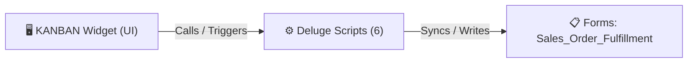

# 🧩 KANBAN Widget

> [!INFO] Widget Overview
> - **Module:** `Fulfillment`
> - **System Stage:** `Fulfillment Visual Board`
> - **Frontend UI File:** [`Widget/Fulfillment/KANBAN/app/index.html`](file:///C:/Users/Enduser/Desktop/Deluge script/Fulfillment/KANBAN/Widget/app/index.html)
> - **Creator Forms & Reports:** `Sales_Order_Fulfillment`
> - **Total Deluge Scripts Connected:** **6**

---

## 📖 Description & Purpose
Interactive drag-and-drop Kanban board representing all stages of fulfillment.

---

## 🔄 Architecture & Data Flow

---

## 💻 Frontend HTML Interface
- **HTML Path:** [`Widget/Fulfillment/KANBAN/app/index.html`](file:///C:/Users/Enduser/Desktop/Deluge script/Fulfillment/KANBAN/Widget/app/index.html)
- **Window Title:** `Fulfillment - Kanban`

---

## ⚙️ Backing Deluge Scripts (6)

The following Deluge scripts directly power or listen to this widget's lifecycle events:

| Script Name | Source File | Category | Lines |
| :--- | :--- | :--- | :--- |
| [[Fulfillment/KANBAN/Deluge/so_kanban|so_kanban]] | `so_kanban` | `01 - Root Workflows` | 969 |
| [[Fulfillment/KANBAN/Deluge/_variants/Main-DelugeScripts/so_kanban_sync|so_kanban_sync]] | `so_kanban_sync.txt` | `02 - Main DelugeScripts` | 967 |
| [[Fulfillment/KANBAN/Deluge/_variants/Main-DelugeScripts/so_kanban_sync|so_kanban_sync]] | `production\so_kanban_sync.txt` | `02 - Main DelugeScripts` | 964 |
| [[Fulfillment/KANBAN/Deluge/so_kanban_sync|so_kanban_sync]] | `so_kanban_sync.txt` | `03 - Sidequest` | 969 |
| [[Fulfillment/KANBAN/Deluge/_variants/Archive-NEw/so_kanban_sync|so_kanban_sync]] | `NEw/DelugeScripts\so_kanban_sync.txt` | `06 - Archive (Deluge Script & NEw)` | 989 |
| [[Fulfillment/KANBAN/Deluge/_variants/Archive-NEw/so_kanban_sync|so_kanban_sync]] | `NEw/DelugeScripts\production\so_kanban_sync.txt` | `06 - Archive (Deluge Script & NEw)` | 986 |

---

## 📋 Associated Creator Forms & Reports
- `Sales_Order_Fulfillment`
