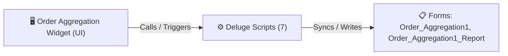

# 🧩 Order Aggregation Widget

> [!INFO] Widget Overview
> - **Module:** `Fulfillment`
> - **System Stage:** `Stage 6: Order Aggregation`
> - **Frontend UI File:** [`Widget/Fulfillment/Order Aggregation`](file:///C:/Users/Enduser/Desktop/Deluge script/Fulfillment/Order Aggregation/Widget)
> - **Creator Forms & Reports:** `Order_Aggregation1`, `Order_Aggregation1_Report`
> - **Total Deluge Scripts Connected:** **7**

---

## 📖 Description & Purpose
Consolidates multiple packages, crates, and items for a single sales order before dispatch.

---

## 🔄 Architecture & Data Flow

---

## 💻 Frontend HTML Interface
- **HTML Path:** [`Widget/Fulfillment/Order Aggregation`](file:///C:/Users/Enduser/Desktop/Deluge script/Fulfillment/Order Aggregation/Widget)
- **Window Title:** `Order Aggregation`

---

## ⚙️ Backing Deluge Scripts (7)

The following Deluge scripts directly power or listen to this widget's lifecycle events:

| Script Name | Source File | Category | Lines |
| :--- | :--- | :--- | :--- |
| [[Fulfillment/Order Aggregation/IDE/form Order_Aggregation1|form Order_Aggregation1]] | `Order Aggregation\form Order_Aggregation1.txt` | `04 - Application IDE` | 204 |
| [[Fulfillment/Order Aggregation/IDE/_variants/Archive-NEw/form Order_Aggregation1|form Order_Aggregation1]] | `Deluge Script/Application IDE\Order Aggregation\form Order_Aggregation1.txt` | `06 - Archive (Deluge Script & NEw)` | 196 |
| [[Fulfillment/Order Aggregation/IDE/list Order_Aggregation1_Report|list Order_Aggregation1_Report]] | `Order Aggregation\list Order_Aggregation1_Report.txt` | `04 - Application IDE` | 116 |
| [[Fulfillment/Order Aggregation/IDE/_variants/Archive-NEw/list Order_Aggregation1_Report|list Order_Aggregation1_Report]] | `Deluge Script/Application IDE\Order Aggregation\list Order_Aggregation1_Report.txt` | `06 - Archive (Deluge Script & NEw)` | 113 |
| [[Fulfillment/Order Aggregation/Deluge/order_aggregation1_dispatch_stage_sync|order_aggregation1_dispatch_stage_sync]] | `order_aggregation1_dispatch_stage_sync.txt` | `03 - Sidequest` | 113 |
| [[Fulfillment/Order Aggregation/Deluge/_variants/Archive-NEw/order_aggregation1_dispatch_stage_sync|order_aggregation1_dispatch_stage_sync]] | `Deluge Script/order_aggregation1_dispatch_stage_sync.txt` | `06 - Archive (Deluge Script & NEw)` | 109 |
| [[_Shared/Notifications/Deluge/OrderAgg_Notify_New_Record|OrderAgg_Notify_New_Record]] | `Deluge Script/Notification\OrderAgg_Notify_New_Record.txt` | `06 - Archive (Deluge Script & NEw)` | 30 |

---

## 📋 Associated Creator Forms & Reports
- `Order_Aggregation1`
- `Order_Aggregation1_Report`

---

## 📚 Associated Manuals & PDF Documentation

| Manual / Document | Type | Size |
| :--- | :--- | :--- |
| [[_Shared/Docs/01 - Staff & Operations Manuals/Fulfillment System Manual (English)|Fulfillment System Manual (English)]] | `Staff Operations Manual` | `1.6 MB` |
| [[_Shared/Docs/01 - Staff & Operations Manuals/Fulfillment System Manual (Tagalog)|Fulfillment System Manual (Tagalog)]] | `Staff Operations Manual` | `852.8 KB` |
| [[_Shared/Docs/02 - Architecture, Blueprints & Swimlanes/Supply Chain Swimlane Diagram (PDF)|Supply Chain Swimlane Diagram (PDF)]] | `Swimlane Process Diagram` | `804.6 KB` |
