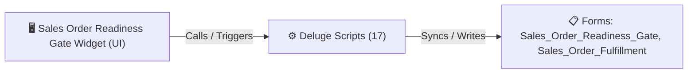

# 🧩 Sales Order Readiness Gate Widget

> [!INFO] Widget Overview
> - **Module:** `Fulfillment`
> - **System Stage:** `Stage 1: Readiness Gate`
> - **Frontend UI File:** [`Widget/Fulfillment/Sales Order Readiness Gate/app/index.html`](file:///C:/Users/Enduser/Desktop/Deluge script/Fulfillment/Order Readiness/Widget/app/index.html)
> - **Creator Forms & Reports:** `Sales_Order_Readiness_Gate`, `Sales_Order_Fulfillment`
> - **Total Deluge Scripts Connected:** **17**

---

## 📖 Description & Purpose
Evaluates stock availability, payment clearance, and releases sales orders to the warehouse picker.

---

## 🔄 Architecture & Data Flow

---

## 💻 Frontend HTML Interface
- **HTML Path:** [`Widget/Fulfillment/Sales Order Readiness Gate/app/index.html`](file:///C:/Users/Enduser/Desktop/Deluge script/Fulfillment/Order Readiness/Widget/app/index.html)
- **Window Title:** `Sales Order Readiness Gate`

---

## ⚙️ Backing Deluge Scripts (17)

The following Deluge scripts directly power or listen to this widget's lifecycle events:

| Script Name | Source File | Category | Lines |
| :--- | :--- | :--- | :--- |
| [[Fulfillment/Order Readiness/IDE/form Sales_Order_Readiness_Gate|form Sales_Order_Readiness_Gate]] | `Sales Order Readiness Gate\form Sales_Order_Readiness_Gate.txt` | `04 - Application IDE` | 267 |
| [[Fulfillment/Order Readiness/IDE/form Sales_Order_Readiness_Gate|form Sales_Order_Readiness_Gate]] | `Deluge Script/Application IDE\Sales Order Readiness Gate\form Sales_Order_Readiness_Gate.txt` | `06 - Archive (Deluge Script & NEw)` | 267 |
| [[Fulfillment/Order Readiness/Deluge/PO to Readiness|PO to Readiness]] | `PO to Readiness` | `03 - Sidequest` | 129 |
| [[Fulfillment/Order Readiness/Deluge/PO to Readiness|PO to Readiness]] | `Deluge Script/PO to Readiness` | `06 - Archive (Deluge Script & NEw)` | 129 |
| [[Fulfillment/Order Readiness/Deluge/preorder_to_readiness_gate|preorder_to_readiness_gate]] | `preorder_to_readiness_gate.txt` | `02 - Main DelugeScripts` | 167 |
| [[Fulfillment/Order Readiness/Deluge/preorder_to_readiness_gate|preorder_to_readiness_gate]] | `NEw/DelugeScripts\preorder_to_readiness_gate.txt` | `06 - Archive (Deluge Script & NEw)` | 167 |
| [[Fulfillment/Order Readiness/Deluge/readiness_gate_release_to_pick1_direct|readiness_gate_release_to_pick1_direct]] | `readiness_gate_release_to_pick1_direct.txt` | `03 - Sidequest` | 284 |
| [[Fulfillment/Order Readiness/Deluge/_variants/Archive-NEw/readiness_gate_release_to_pick1_direct|readiness_gate_release_to_pick1_direct]] | `Deluge Script/readiness_gate_release_to_pick1_direct.txt` | `06 - Archive (Deluge Script & NEw)` | 166 |
| [[Fulfillment/Order Readiness/Deluge/readiness_gate_release_to_picker|readiness_gate_release_to_picker]] | `readiness_gate_release_to_picker.txt` | `03 - Sidequest` | 201 |
| [[Fulfillment/Order Readiness/Deluge/readiness_gate_release_to_picker|readiness_gate_release_to_picker]] | `Deluge Script/readiness_gate_release_to_picker.txt` | `06 - Archive (Deluge Script & NEw)` | 201 |
| [[_Shared/Notifications/Deluge/ReadinessGate_Notify_New_Record|ReadinessGate_Notify_New_Record]] | `ReadinessGate_Notify_New_Record` | `01 - Root Workflows` | 12 |
| [[Fulfillment/Order Readiness/IDE/Sales_Order_Readiness_Gate_Report|Sales_Order_Readiness_Gate_Report]] | `Sales Order Readiness Gate\Sales_Order_Readiness_Gate_Report.txt` | `04 - Application IDE` | 146 |
| [[Fulfillment/Order Readiness/IDE/Sales_Order_Readiness_Gate_Report|Sales_Order_Readiness_Gate_Report]] | `Deluge Script/Application IDE\Sales Order Readiness Gate\Sales_Order_Readiness_Gate_Report.txt` | `06 - Archive (Deluge Script & NEw)` | 146 |
| [[Fulfillment/SO Report/Deluge/SO to Readiness|SO to Readiness]] | `SO to Readiness` | `03 - Sidequest` | 262 |
| [[Fulfillment/SO Report/Deluge/_variants/Archive-NEw/SO to Readiness|SO to Readiness]] | `Deluge Script/SO to Readiness` | `06 - Archive (Deluge Script & NEw)` | 191 |
| [[Fulfillment/Order Readiness/Deluge/so_fulfillment_to_readiness_gate|so_fulfillment_to_readiness_gate]] | `so_fulfillment_to_readiness_gate.txt` | `02 - Main DelugeScripts` | 215 |
| [[Fulfillment/Order Readiness/Deluge/_variants/Archive-NEw/so_fulfillment_to_readiness_gate|so_fulfillment_to_readiness_gate]] | `NEw/DelugeScripts\so_fulfillment_to_readiness_gate.txt` | `06 - Archive (Deluge Script & NEw)` | 267 |

---

## 📋 Associated Creator Forms & Reports
- `Sales_Order_Readiness_Gate`
- `Sales_Order_Fulfillment`

---

## 📚 Associated Manuals & PDF Documentation

| Manual / Document | Type | Size |
| :--- | :--- | :--- |
| [[_Shared/Docs/01 - Staff & Operations Manuals/Fulfillment System Manual (English)|Fulfillment System Manual (English)]] | `Staff Operations Manual` | `1.6 MB` |
| [[_Shared/Docs/01 - Staff & Operations Manuals/Fulfillment System Manual (Tagalog)|Fulfillment System Manual (Tagalog)]] | `Staff Operations Manual` | `852.8 KB` |
| [[_Shared/Docs/01 - Staff & Operations Manuals/Supply Chain App UAT Manual|Supply Chain App UAT Manual]] | `UAT Manual` | `1.6 MB` |
| [[_Shared/Docs/02 - Architecture, Blueprints & Swimlanes/Business Process Blueprint (PDF)|Business Process Blueprint (PDF)]] | `Technical Architecture Blueprint` | `761.9 KB` |
| [[_Shared/Docs/02 - Architecture, Blueprints & Swimlanes/Supply Chain Swimlane Diagram (PDF)|Supply Chain Swimlane Diagram (PDF)]] | `Swimlane Process Diagram` | `804.6 KB` |
| [[_Shared/Docs/03 - Sprint, UAT & Quality Reports/Deployment Sprint Plan (2026-09-01)|Deployment Sprint Plan (2026-09-01)]] | `Sprint Plan` | `203.1 KB` |
| [[_Shared/Docs/03 - Sprint, UAT & Quality Reports/Supply Chain App Findings Report (2026-08-24)|Supply Chain App Findings Report (2026-08-24)]] | `Audit & QA Report` | `745.0 KB` |
| [[_Shared/Docs/03 - Sprint, UAT & Quality Reports/Supply Chain App UAT Report (2026-08-20)|Supply Chain App UAT Report (2026-08-20)]] | `UAT Sign-off Report` | `95.8 KB` |
| [[_Shared/Docs/04 - Zoho Reference Guides/Zoho Books — Payment Received & Accounting|Zoho Books — Payment Received & Accounting]] | `Official Reference Manual` | `6.0 MB` |
