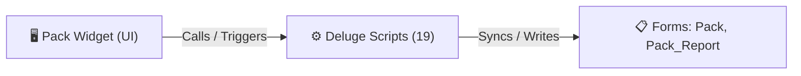

# 🧩 Pack Widget

> [!INFO] Widget Overview
> - **Module:** `Fulfillment`
> - **System Stage:** `Stage 3: Pack Stage`
> - **Frontend UI File:** [`Widget/Fulfillment/Pack/app/index.html`](file:///C:/Users/Enduser/Desktop/Deluge script/Fulfillment/Pack/Widget/app/index.html)
> - **Creator Forms & Reports:** `Pack`, `Pack_Report`
> - **Total Deluge Scripts Connected:** **19**

---

## 📖 Description & Purpose
Packers package picked items, generate packages, print box labels, and push to QC.

---

## 🔄 Architecture & Data Flow

---

## 💻 Frontend HTML Interface
- **HTML Path:** [`Widget/Fulfillment/Pack/app/index.html`](file:///C:/Users/Enduser/Desktop/Deluge script/Fulfillment/Pack/Widget/app/index.html)
- **Window Title:** `Pack Report`

---

## ⚙️ Backing Deluge Scripts (19)

The following Deluge scripts directly power or listen to this widget's lifecycle events:

| Script Name | Source File | Category | Lines |
| :--- | :--- | :--- | :--- |
| [[_Shared/Deluge/_Unlabelled/Deluge/check pac|check pac]] | `check pac` | `01 - Root Workflows` | 583 |
| [[Fulfillment/SO Report/Deluge/deletepackage|deletepackage]] | `deletepackage` | `01 - Root Workflows` | 55 |
| [[Fulfillment/SO Report/Deluge/deletepackageFF|deletepackageFF]] | `deletepackageFF` | `01 - Root Workflows` | 43 |
| [[_Shared/Notifications/Deluge/ff_notifications_all_modules|ff_notifications_all_modules]] | `ff_notifications_all_modules.txt` | `02 - Main DelugeScripts` | 250 |
| [[_Shared/Notifications/Deluge/ff_notifications_all_modules|ff_notifications_all_modules]] | `production\ff_notifications_all_modules.txt` | `02 - Main DelugeScripts` | 255 |
| [[_Shared/Notifications/Deluge/ff_notifications_all_modules|ff_notifications_all_modules]] | `NEw/DelugeScripts\ff_notifications_all_modules.txt` | `06 - Archive (Deluge Script & NEw)` | 250 |
| [[_Shared/Notifications/Deluge/ff_notifications_all_modules|ff_notifications_all_modules]] | `NEw/DelugeScripts\production\ff_notifications_all_modules.txt` | `06 - Archive (Deluge Script & NEw)` | 255 |
| [[Fulfillment/Pack/IDE/form Pack|form Pack]] | `Pack\form Pack.txt` | `04 - Application IDE` | 212 |
| [[Fulfillment/Pack/IDE/form Pack|form Pack]] | `Deluge Script/Application IDE\Pack\form Pack.txt` | `06 - Archive (Deluge Script & NEw)` | 212 |
| [[_Shared/Notifications/Deluge/notification_urls_ready_to_paste|notification_urls_ready_to_paste]] | `notification_urls_ready_to_paste.txt` | `03 - Sidequest` | 804 |
| [[_Shared/Notifications/Deluge/Notify_on_Created_Exception|Notify_on_Created_Exception]] | `Deluge Script/Notification\Notify_on_Created_Exception.txt` | `06 - Archive (Deluge Script & NEw)` | 29 |
| [[_Shared/Notifications/Deluge/Pack_Notify_New_Record|Pack_Notify_New_Record]] | `Deluge Script/Notification\Pack_Notify_New_Record.txt` | `06 - Archive (Deluge Script & NEw)` | 30 |
| [[Fulfillment/Pack/IDE/Pack_Report|Pack_Report]] | `Pack\Pack_Report.txt` | `04 - Application IDE` | 212 |
| [[Fulfillment/Pack/IDE/_variants/Archive-NEw/Pack_Report|Pack_Report]] | `Deluge Script/Application IDE\Pack\Pack_Report.txt` | `06 - Archive (Deluge Script & NEw)` | 124 |
| [[Fulfillment/SO Report/Deluge/PASTE_createPackageFF|PASTE_createPackageFF]] | `NEw/PASTE_createPackageFF.txt` | `06 - Archive (Deluge Script & NEw)` | 1163 |
| [[Fulfillment/SO Report/Deluge/PASTE_createPackageFF_NATIVE_TEST|PASTE_createPackageFF_NATIVE_TEST]] | `NEw/PASTE_createPackageFF_NATIVE_TEST.txt` | `06 - Archive (Deluge Script & NEw)` | 1249 |
| [[Fulfillment/SO Report/Deluge/PASTE_SyncPackageToFulfillment_Production|PASTE_SyncPackageToFulfillment_Production]] | `NEw/PASTE_SyncPackageToFulfillment_Production.txt` | `06 - Archive (Deluge Script & NEw)` | 358 |
| [[Fulfillment/SO Report/Deluge/syncpackagetofulfillment|syncpackagetofulfillment]] | `syncpackagetofulfillment.txt` | `03 - Sidequest` | 672 |
| [[Fulfillment/SO Report/Deluge/_variants/Archive-NEw/syncpackagetofulfillment|syncpackagetofulfillment]] | `Deluge Script/syncpackagetofulfillment.txt` | `06 - Archive (Deluge Script & NEw)` | 968 |

---

## 📋 Associated Creator Forms & Reports
- `Pack`
- `Pack_Report`

---

## 📚 Associated Manuals & PDF Documentation

| Manual / Document | Type | Size |
| :--- | :--- | :--- |
| [[_Shared/Docs/01 - Staff & Operations Manuals/Fulfillment System Manual (English)|Fulfillment System Manual (English)]] | `Staff Operations Manual` | `1.6 MB` |
| [[_Shared/Docs/01 - Staff & Operations Manuals/Fulfillment System Manual (Tagalog)|Fulfillment System Manual (Tagalog)]] | `Staff Operations Manual` | `852.8 KB` |
| [[_Shared/Docs/01 - Staff & Operations Manuals/Fulfillment Mobile Phone Manual|Fulfillment Mobile Phone Manual]] | `Mobile Staff Manual` | `2.0 MB` |
| [[_Shared/Docs/02 - Architecture, Blueprints & Swimlanes/End-to-End Process Flow Swimlane (PDF)|End-to-End Process Flow Swimlane (PDF)]] | `Swimlane Process Diagram` | `804.6 KB` |
