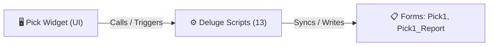

# 🧩 Pick Widget

> [!INFO] Widget Overview
> - **Module:** `Fulfillment`
> - **System Stage:** `Stage 2: Pick Stage`
> - **Frontend UI File:** [`Widget/Fulfillment/Pick/app/index.html`](file:///C:/Users/Enduser/Desktop/Deluge script/Fulfillment/Pick/Widget/app/index.html)
> - **Creator Forms & Reports:** `Pick1`, `Pick1_Report`
> - **Total Deluge Scripts Connected:** **13**

---

## 📖 Description & Purpose
Assigned warehouse pickers pick items from bins and advance orders to packing.

---

## 🔄 Architecture & Data Flow

---

## 💻 Frontend HTML Interface
- **HTML Path:** [`Widget/Fulfillment/Pick/app/index.html`](file:///C:/Users/Enduser/Desktop/Deluge script/Fulfillment/Pick/Widget/app/index.html)
- **Window Title:** `Pick Report`

---

## ⚙️ Backing Deluge Scripts (13)

The following Deluge scripts directly power or listen to this widget's lifecycle events:

| Script Name | Source File | Category | Lines |
| :--- | :--- | :--- | :--- |
| [[Fulfillment/Order Readiness/Deluge/assign_to_pick_gate|assign_to_pick_gate]] | `assign_to_pick_gate.txt` | `03 - Sidequest` | 54 |
| [[Fulfillment/Order Readiness/Deluge/assign_to_pick_gate|assign_to_pick_gate]] | `Deluge Script/assign_to_pick_gate.txt` | `06 - Archive (Deluge Script & NEw)` | 54 |
| [[Fulfillment/Pick/IDE/form Pick1|form Pick1]] | `Pick\form Pick1.txt` | `04 - Application IDE` | 210 |
| [[Fulfillment/Pick/IDE/form Pick1|form Pick1]] | `Deluge Script/Application IDE\Pick\form Pick1.txt` | `06 - Archive (Deluge Script & NEw)` | 210 |
| [[_Shared/Notifications/Deluge/Pick1_Notify_New_Record|Pick1_Notify_New_Record]] | `Deluge Script/Notification\Pick1_Notify_New_Record.txt` | `06 - Archive (Deluge Script & NEw)` | 30 |
| [[Fulfillment/Pick/IDE/Pick1_Report|Pick1_Report]] | `Pick\Pick1_Report.txt` | `04 - Application IDE` | 121 |
| [[Fulfillment/Pick/IDE/Pick1_Report|Pick1_Report]] | `Deluge Script/Application IDE\Pick\Pick1_Report.txt` | `06 - Archive (Deluge Script & NEw)` | 121 |
| [[Fulfillment/Pick/Deluge/pick1_to_pack_sync|pick1_to_pack_sync]] | `pick1_to_pack_sync.txt` | `03 - Sidequest` | 204 |
| [[Fulfillment/Pick/Deluge/pick1_to_pack_sync|pick1_to_pack_sync]] | `Deluge Script/pick1_to_pack_sync.txt` | `06 - Archive (Deluge Script & NEw)` | 204 |
| [[Fulfillment/Order Readiness/Deluge/_variants/Archive-NEw/release_records_to_pick1_sync|release_records_to_pick1_sync]] | `NEw/DelugeScripts\release_records_to_pick1_sync.txt` | `06 - Archive (Deluge Script & NEw)` | 146 |
| [[_Shared/Deluge/_Unlabelled/Deluge/Report|Report]] | `Report` | `01 - Root Workflows` | 104 |
| [[Fulfillment/SO Report/Deluge/sales_order_fulfillment_stage_sync|sales_order_fulfillment_stage_sync]] | `sales_order_fulfillment_stage_sync.txt` | `03 - Sidequest` | 34 |
| [[Fulfillment/SO Report/Deluge/sales_order_fulfillment_stage_sync|sales_order_fulfillment_stage_sync]] | `Deluge Script/sales_order_fulfillment_stage_sync.txt` | `06 - Archive (Deluge Script & NEw)` | 34 |

---

## 📋 Associated Creator Forms & Reports
- `Pick1`
- `Pick1_Report`

---

## 📚 Associated Manuals & PDF Documentation

| Manual / Document | Type | Size |
| :--- | :--- | :--- |
| [[_Shared/Docs/01 - Staff & Operations Manuals/Fulfillment System Manual (English)|Fulfillment System Manual (English)]] | `Staff Operations Manual` | `1.6 MB` |
| [[_Shared/Docs/01 - Staff & Operations Manuals/Fulfillment System Manual (Tagalog)|Fulfillment System Manual (Tagalog)]] | `Staff Operations Manual` | `852.8 KB` |
| [[_Shared/Docs/01 - Staff & Operations Manuals/Fulfillment Mobile Phone Manual|Fulfillment Mobile Phone Manual]] | `Mobile Staff Manual` | `2.0 MB` |
| [[_Shared/Docs/02 - Architecture, Blueprints & Swimlanes/End-to-End Process Flow Swimlane (PDF)|End-to-End Process Flow Swimlane (PDF)]] | `Swimlane Process Diagram` | `804.6 KB` |
