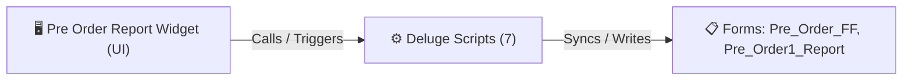

# 🧩 Pre Order Report Widget

> [!INFO] Widget Overview
> - **Module:** `Fulfillment`
> - **System Stage:** `Pre-Order Fulfillment`
> - **Frontend UI File:** [`Widget/Fulfillment/Pre Order Report/app/index.html`](file:///C:/Users/Enduser/Desktop/Deluge script/Fulfillment/Pre-Order/Widget/app/index.html)
> - **Creator Forms & Reports:** `Pre_Order_FF`, `Pre_Order1_Report`
> - **Total Deluge Scripts Connected:** **7**

---

## 📖 Description & Purpose
Tracks pre-orders, arrival milestones, and readiness for fulfillment when items land.

---

## 🔄 Architecture & Data Flow

---

## 💻 Frontend HTML Interface
- **HTML Path:** [`Widget/Fulfillment/Pre Order Report/app/index.html`](file:///C:/Users/Enduser/Desktop/Deluge script/Fulfillment/Pre-Order/Widget/app/index.html)
- **Window Title:** `Pre Order Report`

---

## ⚙️ Backing Deluge Scripts (7)

The following Deluge scripts directly power or listen to this widget's lifecycle events:

| Script Name | Source File | Category | Lines |
| :--- | :--- | :--- | :--- |
| [[Procurement/Purchase Request/Deluge/PR|PR]] | `PR` | `01 - Root Workflows` | 199 |
| [[Fulfillment/Pre-Order/IDE/Pre_Order1_Report|Pre_Order1_Report]] | `Pre Order\Pre_Order1_Report.txt` | `04 - Application IDE` | 168 |
| [[Fulfillment/Pre-Order/IDE/Pre_Order1_Report|Pre_Order1_Report]] | `Deluge Script/Application IDE\Pre Order\Pre_Order1_Report.txt` | `06 - Archive (Deluge Script & NEw)` | 168 |
| [[Fulfillment/Pre-Order/IDE/Pre_Order_FF|Pre_Order_FF]] | `Pre Order\Pre_Order_FF.txt` | `04 - Application IDE` | 254 |
| [[Fulfillment/Pre-Order/IDE/_variants/Archive-NEw/Pre_Order_FF|Pre_Order_FF]] | `Deluge Script/Application IDE\Pre Order\Pre_Order_FF.txt` | `06 - Archive (Deluge Script & NEw)` | 245 |
| [[Fulfillment/Pre-Order/Deluge/preorder_create_package|preorder_create_package]] | `preorder_create_package.txt` | `02 - Main DelugeScripts` | 1270 |
| [[Fulfillment/Pre-Order/Deluge/preorder_create_package|preorder_create_package]] | `NEw/DelugeScripts\preorder_create_package.txt` | `06 - Archive (Deluge Script & NEw)` | 1270 |

---

## 📋 Associated Creator Forms & Reports
- `Pre_Order_FF`
- `Pre_Order1_Report`
