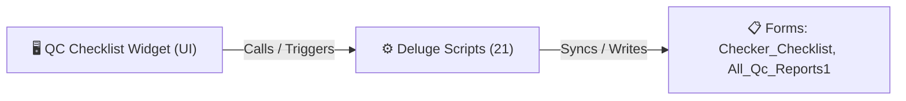

# 🧩 QC Checklist Widget

> [!INFO] Widget Overview
> - **Module:** `Fulfillment`
> - **System Stage:** `Stage 4: Quality Control`
> - **Frontend UI File:** [`Widget/Fulfillment/QC Checklist/app/index.html`](file:///C:/Users/Enduser/Desktop/Deluge script/Fulfillment/QC Checklist/Widget/app/index.html)
> - **Creator Forms & Reports:** `Checker_Checklist`, `All_Qc_Reports1`
> - **Total Deluge Scripts Connected:** **21**

---

## 📖 Description & Purpose
Quality checkers verify items against checklist criteria, approve or reject, and log photos.

---

## 🔄 Architecture & Data Flow

---

## 💻 Frontend HTML Interface
- **HTML Path:** [`Widget/Fulfillment/QC Checklist/app/index.html`](file:///C:/Users/Enduser/Desktop/Deluge script/Fulfillment/QC Checklist/Widget/app/index.html)
- **Window Title:** `QC Report`

---

## ⚙️ Backing Deluge Scripts (21)

The following Deluge scripts directly power or listen to this widget's lifecycle events:

| Script Name | Source File | Category | Lines |
| :--- | :--- | :--- | :--- |
| [[Fulfillment/QC Checklist/IDE/All_Qc_Reports1|All_Qc_Reports1]] | `Quality Check\All_Qc_Reports1.txt` | `04 - Application IDE` | 177 |
| [[Fulfillment/QC Checklist/IDE/_variants/Archive-NEw/All_Qc_Reports1|All_Qc_Reports1]] | `Deluge Script/Application IDE\Quality Check\All_Qc_Reports1.txt` | `06 - Archive (Deluge Script & NEw)` | 170 |
| [[Fulfillment/QC Checklist/Deluge/checker_checklist_item_to_replace_visibility|checker_checklist_item_to_replace_visibility]] | `checker_checklist_item_to_replace_visibility.txt` | `03 - Sidequest` | 148 |
| [[Fulfillment/QC Checklist/Deluge/checker_checklist_item_to_replace_visibility|checker_checklist_item_to_replace_visibility]] | `Deluge Script/checker_checklist_item_to_replace_visibility.txt` | `06 - Archive (Deluge Script & NEw)` | 148 |
| [[Fulfillment/QC Checklist/Deluge/checker_checklist_qc_approved_sync|checker_checklist_qc_approved_sync]] | `checker_checklist_qc_approved_sync.txt` | `03 - Sidequest` | 1080 |
| [[Fulfillment/QC Checklist/Deluge/_variants/Archive-NEw/checker_checklist_qc_approved_sync|checker_checklist_qc_approved_sync]] | `Deluge Script/checker_checklist_qc_approved_sync.txt` | `06 - Archive (Deluge Script & NEw)` | 638 |
| [[Fulfillment/QC Checklist/Deluge/checker_checklist_qc_sync|checker_checklist_qc_sync]] | `checker_checklist_qc_sync.txt` | `02 - Main DelugeScripts` | 1114 |
| [[Fulfillment/QC Checklist/Deluge/checker_checklist_qc_sync|checker_checklist_qc_sync]] | `production\checker_checklist_qc_sync.txt` | `02 - Main DelugeScripts` | 825 |
| [[Fulfillment/QC Checklist/Deluge/_variants/Archive-NEw/checker_checklist_qc_sync|checker_checklist_qc_sync]] | `NEw/DelugeScripts\checker_checklist_qc_sync.txt` | `06 - Archive (Deluge Script & NEw)` | 1114 |
| [[Fulfillment/QC Checklist/Deluge/_variants/Archive-NEw/checker_checklist_qc_sync|checker_checklist_qc_sync]] | `NEw/DelugeScripts\production\checker_checklist_qc_sync.txt` | `06 - Archive (Deluge Script & NEw)` | 836 |
| [[_Shared/Notifications/Deluge/ff_notifications_inline_patches|ff_notifications_inline_patches]] | `ff_notifications_inline_patches.txt` | `02 - Main DelugeScripts` | 238 |
| [[_Shared/Notifications/Deluge/ff_notifications_inline_patches|ff_notifications_inline_patches]] | `production\ff_notifications_inline_patches.txt` | `02 - Main DelugeScripts` | 243 |
| [[_Shared/Notifications/Deluge/ff_notifications_inline_patches|ff_notifications_inline_patches]] | `NEw/DelugeScripts\ff_notifications_inline_patches.txt` | `06 - Archive (Deluge Script & NEw)` | 238 |
| [[_Shared/Notifications/Deluge/ff_notifications_inline_patches|ff_notifications_inline_patches]] | `NEw/DelugeScripts\production\ff_notifications_inline_patches.txt` | `06 - Archive (Deluge Script & NEw)` | 243 |
| [[_Shared/Deluge/_Unlabelled/Deluge/Fix this|Fix this]] | `Fix this` | `01 - Root Workflows` | 995 |
| [[Fulfillment/QC Checklist/IDE/form Checker_Checklist|form Checker_Checklist]] | `Quality Check\form Checker_Checklist.txt` | `04 - Application IDE` | 406 |
| [[Fulfillment/QC Checklist/IDE/_variants/Archive-NEw/form Checker_Checklist|form Checker_Checklist]] | `Deluge Script/Application IDE\Quality Check\form Checker_Checklist.txt` | `06 - Archive (Deluge Script & NEw)` | 392 |
| [[Fulfillment/Pack/Deluge/pack_to_checker_checklist_sync|pack_to_checker_checklist_sync]] | `pack_to_checker_checklist_sync.txt` | `03 - Sidequest` | 205 |
| [[Fulfillment/Pack/Deluge/_variants/Archive-NEw/pack_to_checker_checklist_sync|pack_to_checker_checklist_sync]] | `Deluge Script/pack_to_checker_checklist_sync.txt` | `06 - Archive (Deluge Script & NEw)` | 242 |
| [[Fulfillment/QC Checklist/Deluge/PASTE_CheckerChecklistQCSync_Production|PASTE_CheckerChecklistQCSync_Production]] | `NEw/PASTE_CheckerChecklistQCSync_Production.txt` | `06 - Archive (Deluge Script & NEw)` | 1012 |
| [[_Shared/Notifications/Deluge/QC_Notify_New_Record|QC_Notify_New_Record]] | `QC_Notify_New_Record` | `01 - Root Workflows` | 12 |

---

## 📋 Associated Creator Forms & Reports
- `Checker_Checklist`
- `All_Qc_Reports1`

---

## 📚 Associated Manuals & PDF Documentation

| Manual / Document | Type | Size |
| :--- | :--- | :--- |
| [[_Shared/Docs/01 - Staff & Operations Manuals/Fulfillment System Manual (English)|Fulfillment System Manual (English)]] | `Staff Operations Manual` | `1.6 MB` |
| [[_Shared/Docs/01 - Staff & Operations Manuals/Fulfillment System Manual (Tagalog)|Fulfillment System Manual (Tagalog)]] | `Staff Operations Manual` | `852.8 KB` |
| [[_Shared/Docs/01 - Staff & Operations Manuals/Fulfillment Mobile Phone Manual|Fulfillment Mobile Phone Manual]] | `Mobile Staff Manual` | `2.0 MB` |
| [[_Shared/Docs/03 - Sprint, UAT & Quality Reports/Deployment Sprint Report (2026-09-01)|Deployment Sprint Report (2026-09-01)]] | `Sprint Report` | `170.2 KB` |
| [[_Shared/Docs/03 - Sprint, UAT & Quality Reports/Supply Chain App Sprint Checklist (Excel)|Supply Chain App Sprint Checklist (Excel)]] | `Checklist Spreadsheet` | `6.9 KB` |
