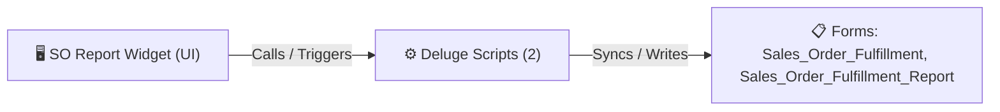

# 🧩 SO Report Widget

> [!INFO] Widget Overview
> - **Module:** `Fulfillment`
> - **System Stage:** `Sales Order Overview`
> - **Frontend UI File:** [`Widget/Fulfillment/SO Report/app/index.html`](file:///C:/Users/Enduser/Desktop/Deluge script/Fulfillment/SO Report/Widget/app/index.html)
> - **Creator Forms & Reports:** `Sales_Order_Fulfillment`, `Sales_Order_Fulfillment_Report`
> - **Total Deluge Scripts Connected:** **2**

---

## 📖 Description & Purpose
Comprehensive report of all sales order fulfillment statuses, line item completions, and timelines.

---

## 🔄 Architecture & Data Flow

---

## 💻 Frontend HTML Interface
- **HTML Path:** [`Widget/Fulfillment/SO Report/app/index.html`](file:///C:/Users/Enduser/Desktop/Deluge script/Fulfillment/SO Report/Widget/app/index.html)
- **Window Title:** `Sales Order Report`

---

## ⚙️ Backing Deluge Scripts (2)

The following Deluge scripts directly power or listen to this widget's lifecycle events:

| Script Name | Source File | Category | Lines |
| :--- | :--- | :--- | :--- |
| [[Fulfillment/SO Report/IDE/Sales_Order_Fulfillment_Report|Sales_Order_Fulfillment_Report]] | `Sales Order Fulfillment\Sales_Order_Fulfillment_Report.txt` | `04 - Application IDE` | 134 |
| [[Fulfillment/SO Report/IDE/Sales_Order_Fulfillment_Report|Sales_Order_Fulfillment_Report]] | `Deluge Script/Application IDE\Sales Order Fulfillment\Sales_Order_Fulfillment_Report.txt` | `06 - Archive (Deluge Script & NEw)` | 134 |

---

## 📋 Associated Creator Forms & Reports
- `Sales_Order_Fulfillment`
- `Sales_Order_Fulfillment_Report`
