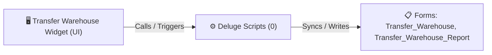

# 🧩 Transfer Warehouse Widget

> [!INFO] Widget Overview
> - **Module:** `Fulfillment`
> - **System Stage:** `Inter-Warehouse Transfers`
> - **Frontend UI File:** [`Widget/Fulfillment/Transfer Warehouse/app/index.html`](file:///C:/Users/Enduser/Desktop/Deluge script/Fulfillment/Transfer Item/Widget/app/index.html)
> - **Creator Forms & Reports:** `Transfer_Warehouse`, `Transfer_Warehouse_Report`
> - **Total Deluge Scripts Connected:** **0**

---

## 📖 Description & Purpose
Coordinates stock transfers between main warehouse, satellite hubs, and showrooms.

---

## 🔄 Architecture & Data Flow

---

## 💻 Frontend HTML Interface
- **HTML Path:** [`Widget/Fulfillment/Transfer Warehouse/app/index.html`](file:///C:/Users/Enduser/Desktop/Deluge script/Fulfillment/Transfer Item/Widget/app/index.html)
- **Window Title:** `Warehouse Request & Transfer Warehouse - Kanban`

---

## ⚙️ Backing Deluge Scripts (0)

The following Deluge scripts directly power or listen to this widget's lifecycle events:

| Script Name | Source File | Category | Lines |
| :--- | :--- | :--- | :--- |
| *(No dedicated scripts classified directly)* | - | - | - |

---

## 📋 Associated Creator Forms & Reports
- `Transfer_Warehouse`
- `Transfer_Warehouse_Report`

---

## 📚 Associated Manuals & PDF Documentation

| Manual / Document | Type | Size |
| :--- | :--- | :--- |
| [[_Shared/Docs/04 - Zoho Reference Guides/Zoho Inventory — Warehouses & Stock Management|Zoho Inventory — Warehouses & Stock Management]] | `Official Reference Manual` | `6.3 MB` |
