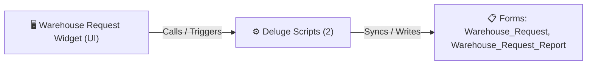

# 🧩 Warehouse Request Widget

> [!INFO] Widget Overview
> - **Module:** `Fulfillment`
> - **System Stage:** `Warehouse Item Requests`
> - **Frontend UI File:** [`Widget/Fulfillment/Warehouse Request/app/index.html`](file:///C:/Users/Enduser/Desktop/Deluge script/Fulfillment/Warehouse Request/Widget/app/index.html)
> - **Creator Forms & Reports:** `Warehouse_Request`, `Warehouse_Request_Report`
> - **Total Deluge Scripts Connected:** **2**

---

## 📖 Description & Purpose
Handles internal warehouse requests, sample pull-outs, and stock adjustments.

---

## 🔄 Architecture & Data Flow

---

## 💻 Frontend HTML Interface
- **HTML Path:** [`Widget/Fulfillment/Warehouse Request/app/index.html`](file:///C:/Users/Enduser/Desktop/Deluge script/Fulfillment/Warehouse Request/Widget/app/index.html)
- **Window Title:** `Warehouse Request - Kanban`

---

## ⚙️ Backing Deluge Scripts (2)

The following Deluge scripts directly power or listen to this widget's lifecycle events:

| Script Name | Source File | Category | Lines |
| :--- | :--- | :--- | :--- |
| [[Fulfillment/Warehouse Request/IDE/IDE Warehouse Request|IDE Warehouse Request]] | `IDE Warehouse Request` | `01 - Root Workflows` | 178 |
| [[Fulfillment/Warehouse Request/Deluge/warehouse_request_item_image_backfill|warehouse_request_item_image_backfill]] | `Deluge Script/warehouse_request_item_image_backfill.txt` | `06 - Archive (Deluge Script & NEw)` | 75 |

---

## 📋 Associated Creator Forms & Reports
- `Warehouse_Request`
- `Warehouse_Request_Report`
