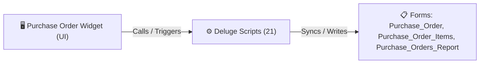

# 🧩 Purchase Order Widget

> [!INFO] Widget Overview
> - **Module:** `Procurement`
> - **System Stage:** `Stage 3: Purchase Order (PO)`
> - **Frontend UI File:** [`Widget/Proc/Purchase Order`](file:///C:/Users/Enduser/Desktop/Deluge script/Procurement/Purchase Order/Widget)
> - **Creator Forms & Reports:** `Purchase_Order`, `Purchase_Order_Items`, `Purchase_Orders_Report`
> - **Total Deluge Scripts Connected:** **21**

---

## 📖 Description & Purpose
Generates, reviews, approves, and dispatches POs to suppliers and Zoho Books.

---

## 🔄 Architecture & Data Flow

---

## 💻 Frontend HTML Interface
- **HTML Path:** [`Widget/Proc/Purchase Order`](file:///C:/Users/Enduser/Desktop/Deluge script/Procurement/Purchase Order/Widget)
- **Window Title:** `Purchase Orders`

---

## ⚙️ Backing Deluge Scripts (21)

The following Deluge scripts directly power or listen to this widget's lifecycle events:

| Script Name | Source File | Category | Lines |
| :--- | :--- | :--- | :--- |
| [[Procurement/Purchase Order/Deluge/acknowledge_po_custom_api|acknowledge_po_custom_api]] | `acknowledge_po_custom_api.txt` | `02 - Main DelugeScripts` | 763 |
| [[Procurement/Purchase Order/Deluge/_variants/Archive-NEw/acknowledge_po_custom_api|acknowledge_po_custom_api]] | `NEw/DelugeScripts\acknowledge_po_custom_api.txt` | `06 - Archive (Deluge Script & NEw)` | 732 |
| [[Procurement/Purchase Order/Deluge/approvePOMain_PASTE_THIS_2026-10-01|approvePOMain_PASTE_THIS_2026-10-01]] | `approvePOMain_PASTE_THIS_2026-10-01.txt` | `02 - Main DelugeScripts` | 288 |
| [[_Shared/Deluge/Deluge/get_subform_file_custom_api|get_subform_file_custom_api]] | `get_subform_file_custom_api.txt` | `02 - Main DelugeScripts` | 282 |
| [[_Shared/Deluge/Deluge/get_subform_file_custom_api|get_subform_file_custom_api]] | `NEw/DelugeScripts\get_subform_file_custom_api.txt` | `06 - Archive (Deluge Script & NEw)` | 282 |
| [[Procurement/Replacement/Deluge/hc_system_po_shipment_receiving_rr_setup|hc_system_po_shipment_receiving_rr_setup]] | `hc_system_po_shipment_receiving_rr_setup.txt` | `02 - Main DelugeScripts` | 9 |
| [[Delivery Management/_Deluge/In_Bound_Delivery|In_Bound_Delivery]] | `In_Bound_Delivery.txt` | `03 - Sidequest` | 630 |
| [[_Shared/Notifications/Deluge/Notify_Fenteng_on_Purchase_Order_added|Notify_Fenteng_on_Purchase_Order_added]] | `Deluge Script/Notification\Notify_Fenteng_on_Purchase_Order_added.txt` | `06 - Archive (Deluge Script & NEw)` | 39 |
| [[_Shared/Notifications/Deluge/Notify_Tony_on_Purchase_Order_added|Notify_Tony_on_Purchase_Order_added]] | `Deluge Script/Notification\Notify_Tony_on_Purchase_Order_added.txt` | `06 - Archive (Deluge Script & NEw)` | 53 |
| [[Procurement/Supplier - Tony Fan/Deluge/PASTE_ApprovePOFenteng_ApprovePOTony_Production|PASTE_ApprovePOFenteng_ApprovePOTony_Production]] | `NEw/PASTE_ApprovePOFenteng_ApprovePOTony_Production.txt` | `06 - Archive (Deluge Script & NEw)` | 1205 |
| [[Procurement/Purchase Order/Deluge/PASTE_ApprovePOMain_Production|PASTE_ApprovePOMain_Production]] | `NEw/PASTE_ApprovePOMain_Production.txt` | `06 - Archive (Deluge Script & NEw)` | 279 |
| [[Procurement/Purchase Order/Deluge/pr_approve_po_custom_api|pr_approve_po_custom_api]] | `pr_approve_po_custom_api.txt` | `02 - Main DelugeScripts` | 1728 |
| [[Procurement/Purchase Order/Deluge/_variants/Archive-NEw/pr_approve_po_custom_api|pr_approve_po_custom_api]] | `NEw/DelugeScripts\pr_approve_po_custom_api.txt` | `06 - Archive (Deluge Script & NEw)` | 1735 |
| [[Procurement/Purchase Order/Deluge/pr_to_po_grouping|pr_to_po_grouping]] | `pr_to_po_grouping.txt` | `02 - Main DelugeScripts` | 2049 |
| [[Procurement/Purchase Order/Deluge/_variants/Archive-NEw/pr_to_po_grouping|pr_to_po_grouping]] | `NEw/DelugeScripts\pr_to_po_grouping.txt` | `06 - Archive (Deluge Script & NEw)` | 2056 |
| [[Procurement/Purchase Order/Deluge/purchase_order_scripts|purchase_order_scripts]] | `purchase_order_scripts.txt` | `02 - Main DelugeScripts` | 894 |
| [[Procurement/Purchase Order/Deluge/purchase_order_scripts|purchase_order_scripts]] | `NEw/DelugeScripts\purchase_order_scripts.txt` | `06 - Archive (Deluge Script & NEw)` | 894 |
| [[Procurement/Receiving/Deluge/receiving_shipment_populate|receiving_shipment_populate]] | `receiving_shipment_populate.txt` | `02 - Main DelugeScripts` | 432 |
| [[Procurement/Receiving/Deluge/receiving_shipment_populate|receiving_shipment_populate]] | `NEw/DelugeScripts\receiving_shipment_populate.txt` | `06 - Archive (Deluge Script & NEw)` | 432 |
| [[Procurement/Receiving/Deluge/shipment_populate_receiving|shipment_populate_receiving]] | `shipment_populate_receiving.txt` | `02 - Main DelugeScripts` | 161 |
| [[Procurement/Receiving/Deluge/shipment_populate_receiving|shipment_populate_receiving]] | `NEw/DelugeScripts\shipment_populate_receiving.txt` | `06 - Archive (Deluge Script & NEw)` | 161 |

---

## 📋 Associated Creator Forms & Reports
- `Purchase_Order`
- `Purchase_Order_Items`
- `Purchase_Orders_Report`

---

## 📚 Associated Manuals & PDF Documentation

| Manual / Document | Type | Size |
| :--- | :--- | :--- |
| [[_Shared/Docs/01 - Staff & Operations Manuals/Procurement System Manual|Procurement System Manual]] | `Staff Operations Manual` | `1.7 MB` |
| [[_Shared/Docs/02 - Architecture, Blueprints & Swimlanes/Procurement Swimlane Diagram (PDF)|Procurement Swimlane Diagram (PDF)]] | `Swimlane Process Diagram` | `395.9 KB` |
| [[_Shared/Docs/02 - Architecture, Blueprints & Swimlanes/Procurement End-to-End Process Flow (PDF)|Procurement End-to-End Process Flow (PDF)]] | `Process Flow Diagram` | `242.1 KB` |
| [[_Shared/Docs/04 - Zoho Reference Guides/Zoho Inventory — Customers, Vendors & Purchase Transactions|Zoho Inventory — Customers, Vendors & Purchase Transactions]] | `Official Reference Manual` | `7.9 MB` |
