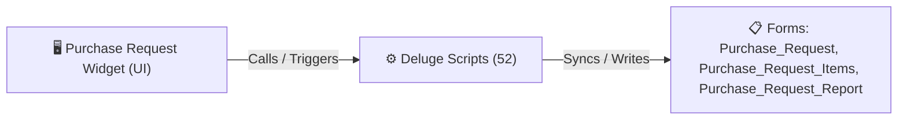

# 🧩 Purchase Request Widget

> [!INFO] Widget Overview
> - **Module:** `Procurement`
> - **System Stage:** `Stage 2: Purchase Request (PR)`
> - **Frontend UI File:** [`Widget/Proc/Purchase Request/app/index.html`](file:///C:/Users/Enduser/Desktop/Deluge script/Procurement/Purchase Request/Widget/app/index.html)
> - **Creator Forms & Reports:** `Purchase_Request`, `Purchase_Request_Items`, `Purchase_Request_Report`
> - **Total Deluge Scripts Connected:** **52**

---

## 📖 Description & Purpose
Evaluates supplier quotes, load balancing, supplier recommendation, and PR approvals.

---

## 🔄 Architecture & Data Flow

---

## 💻 Frontend HTML Interface
- **HTML Path:** [`Widget/Proc/Purchase Request/app/index.html`](file:///C:/Users/Enduser/Desktop/Deluge script/Procurement/Purchase Request/Widget/app/index.html)
- **Window Title:** `Purchase Requests`

---

## ⚙️ Backing Deluge Scripts (52)

The following Deluge scripts directly power or listen to this widget's lifecycle events:

| Script Name | Source File | Category | Lines |
| :--- | :--- | :--- | :--- |
| [[_Shared/Deluge/Deluge/ApplyNow|ApplyNow]] | `ApplyNow.txt` | `02 - Main DelugeScripts` | 432 |
| [[_Shared/Deluge/Deluge/ApplyNow|ApplyNow]] | `NEw/DelugeScripts\ApplyNow.txt` | `06 - Archive (Deluge Script & NEw)` | 432 |
| [[_Shared/Deluge/_Unlabelled/Deluge/Create PR|Create PR]] | `Create PR` | `01 - Root Workflows` | 199 |
| [[_Shared/Deluge/_Unlabelled/Deluge/Create PR (Fixed)|Create PR (Fixed)]] | `Create PR (Fixed)` | `01 - Root Workflows` | 227 |
| [[_Shared/Deluge/Deluge/Error|Error]] | `Error` | `01 - Root Workflows` | 37 |
| [[Procurement/Purchase Request/Deluge/hc_system_local_sourcing_setup|hc_system_local_sourcing_setup]] | `hc_system_local_sourcing_setup.txt` | `02 - Main DelugeScripts` | 472 |
| [[Procurement/Purchase Request/Deluge/hc_system_pr_sync_supplier_selected_guard|hc_system_pr_sync_supplier_selected_guard]] | `hc_system_pr_sync_supplier_selected_guard.txt` | `02 - Main DelugeScripts` | 7 |
| [[Procurement/Purchase Request/Deluge/hc_system_purchase_request_setup|hc_system_purchase_request_setup]] | `hc_system_purchase_request_setup.txt` | `02 - Main DelugeScripts` | 13 |
| [[_Shared/Deluge/Deluge/lookatthis|lookatthis]] | `lookatthis.txt` | `02 - Main DelugeScripts` | 5 |
| [[_Shared/Deluge/Deluge/lookatthis|lookatthis]] | `NEw/DelugeScripts\lookatthis.txt` | `06 - Archive (Deluge Script & NEw)` | 5 |
| [[_Shared/Notifications/Deluge/Notify_Fenteng_on_Purchase_Request_added|Notify_Fenteng_on_Purchase_Request_added]] | `Deluge Script/Notification\Notify_Fenteng_on_Purchase_Request_added.txt` | `06 - Archive (Deluge Script & NEw)` | 40 |
| [[_Shared/Notifications/Deluge/Notify_on_Purchase_Request_Add|Notify_on_Purchase_Request_Add]] | `Deluge Script/Notification\Notify_on_Purchase_Request_Add.txt` | `06 - Archive (Deluge Script & NEw)` | 40 |
| [[_Shared/Notifications/Deluge/Notify_Tony_on_Purchase_Request_added|Notify_Tony_on_Purchase_Request_added]] | `Deluge Script/Notification\Notify_Tony_on_Purchase_Request_added.txt` | `06 - Archive (Deluge Script & NEw)` | 42 |
| [[Procurement/Shipments/Deluge/PASTE_CreateShipmentOrder_Production|PASTE_CreateShipmentOrder_Production]] | `NEw/PASTE_CreateShipmentOrder_Production.txt` | `06 - Archive (Deluge Script & NEw)` | 213 |
| [[Procurement/Purchase Request/Deluge/PASTE_PR_Check_Readiness_Production|PASTE_PR_Check_Readiness_Production]] | `NEw/PASTE_PR_Check_Readiness_Production.txt` | `06 - Archive (Deluge Script & NEw)` | 93 |
| [[Procurement/Receiving/Deluge/PASTE_ReceivingSyncShipmentArrived_Production|PASTE_ReceivingSyncShipmentArrived_Production]] | `NEw/PASTE_ReceivingSyncShipmentArrived_Production.txt` | `06 - Archive (Deluge Script & NEw)` | 125 |
| [[Procurement/Shipments/Deluge/PASTE_ShipmentStatusBackSync_Production|PASTE_ShipmentStatusBackSync_Production]] | `NEw/PASTE_ShipmentStatusBackSync_Production.txt` | `06 - Archive (Deluge Script & NEw)` | 116 |
| [[Procurement/Inquiry/Deluge/PASTE_Stage_Supplier_Changed_Production|PASTE_Stage_Supplier_Changed_Production]] | `NEw/PASTE_Stage_Supplier_Changed_Production.txt` | `06 - Archive (Deluge Script & NEw)` | 154 |
| [[Procurement/Purchase Request/Deluge/PR1_Created_Edited_Routing|PR1_Created_Edited_Routing]] | `PR1_Created_Edited_Routing` | `01 - Root Workflows` | 216 |
| [[Procurement/Purchase Request/Deluge/_variants/Main-DelugeScripts/PR1_Created_Edited_Routing|PR1_Created_Edited_Routing]] | `PR1_Created_Edited_Routing.txt` | `02 - Main DelugeScripts` | 563 |
| [[Procurement/Purchase Request/Deluge/_variants/Archive-NEw/PR1_Created_Edited_Routing|PR1_Created_Edited_Routing]] | `NEw/DelugeScripts\PR1_Created_Edited_Routing.txt` | `06 - Archive (Deluge Script & NEw)` | 563 |
| [[Procurement/Purchase Request/Deluge/PR_Approved_Action1_LIVE_paste_here|PR_Approved_Action1_LIVE_paste_here]] | `PR_Approved_Action1_LIVE_paste_here.txt` | `02 - Main DelugeScripts` | 1507 |
| [[Procurement/Purchase Request/Deluge/PR_Approved_Action1_PASTE_THIS_2026-10-01|PR_Approved_Action1_PASTE_THIS_2026-10-01]] | `PR_Approved_Action1_PASTE_THIS_2026-10-01.txt` | `02 - Main DelugeScripts` | 276 |
| [[Procurement/Purchase Request/Deluge/PR_Check_Readiness|PR_Check_Readiness]] | `PR_Check_Readiness` | `01 - Root Workflows` | 105 |
| [[Procurement/Purchase Request/Deluge/_variants/Main-DelugeScripts/pr_check_readiness|pr_check_readiness]] | `pr_check_readiness.txt` | `02 - Main DelugeScripts` | 167 |
| [[Procurement/Purchase Request/Deluge/_variants/Archive-NEw/pr_check_readiness|pr_check_readiness]] | `NEw/DelugeScripts\pr_check_readiness.txt` | `06 - Archive (Deluge Script & NEw)` | 155 |
| [[Procurement/Shipments/Deluge/PR_Compute_Shipment_Timeline|PR_Compute_Shipment_Timeline]] | `PR_Compute_Shipment_Timeline` | `01 - Root Workflows` | 52 |
| [[Procurement/Purchase Request/Deluge/pr_sync_supplier_load_balancing|pr_sync_supplier_load_balancing]] | `pr_sync_supplier_load_balancing.txt` | `02 - Main DelugeScripts` | 243 |
| [[Procurement/Purchase Request/Deluge/pr_sync_supplier_load_balancing|pr_sync_supplier_load_balancing]] | `NEw/DelugeScripts\pr_sync_supplier_load_balancing.txt` | `06 - Archive (Deluge Script & NEw)` | 243 |
| [[Procurement/Purchase Request/Deluge/pr_sync_supplier_selected|pr_sync_supplier_selected]] | `pr_sync_supplier_selected` | `01 - Root Workflows` | 124 |
| [[Procurement/Purchase Request/Deluge/_variants/Main-DelugeScripts/pr_sync_supplier_selected|pr_sync_supplier_selected]] | `pr_sync_supplier_selected.txt` | `02 - Main DelugeScripts` | 182 |
| [[Procurement/Purchase Request/Deluge/_variants/Archive-NEw/pr_sync_supplier_selected|pr_sync_supplier_selected]] | `NEw/DelugeScripts\pr_sync_supplier_selected.txt` | `06 - Archive (Deluge Script & NEw)` | 162 |
| [[Procurement/Purchase Request/Deluge/purchase_request1_full_workflow_dump|purchase_request1_full_workflow_dump]] | `purchase_request1_full_workflow_dump.txt` | `02 - Main DelugeScripts` | 410 |
| [[Procurement/Purchase Request/Deluge/purchase_request1_full_workflow_dump|purchase_request1_full_workflow_dump]] | `NEw/DelugeScripts\purchase_request1_full_workflow_dump.txt` | `06 - Archive (Deluge Script & NEw)` | 410 |
| [[Procurement/Purchase Request/Deluge/purchase_request_scripts|purchase_request_scripts]] | `purchase_request_scripts.txt` | `02 - Main DelugeScripts` | 173 |
| [[Procurement/Purchase Request/Deluge/purchase_request_scripts|purchase_request_scripts]] | `NEw/DelugeScripts\purchase_request_scripts.txt` | `06 - Archive (Deluge Script & NEw)` | 173 |
| [[Procurement/Purchase Request/Deluge/purchase_request_scripts1|purchase_request_scripts1]] | `purchase_request_scripts1.txt` | `02 - Main DelugeScripts` | 662 |
| [[Procurement/Purchase Request/Deluge/purchase_request_scripts1|purchase_request_scripts1]] | `NEw/DelugeScripts\purchase_request_scripts1.txt` | `06 - Archive (Deluge Script & NEw)` | 662 |
| [[Procurement/Shipments/Deluge/shipment_previous_status|shipment_previous_status]] | `shipment_previous_status.txt` | `02 - Main DelugeScripts` | 42 |
| [[Procurement/Shipments/Deluge/shipment_previous_status|shipment_previous_status]] | `NEw/DelugeScripts\shipment_previous_status.txt` | `06 - Archive (Deluge Script & NEw)` | 42 |
| [[_Shared/Deluge/_Unlabelled/Deluge/sideUpdateScript|sideUpdateScript]] | `sideUpdateScript.txt` | `02 - Main DelugeScripts` | 382 |
| [[_Shared/Deluge/_Unlabelled/Deluge/sideUpdateScript|sideUpdateScript]] | `NEw/DelugeScripts\sideUpdateScript.txt` | `06 - Archive (Deluge Script & NEw)` | 382 |
| [[Procurement/Purchase Request/Deluge/sideUpdateScriptPR|sideUpdateScriptPR]] | `sideUpdateScriptPR.txt` | `02 - Main DelugeScripts` | 120 |
| [[Procurement/Purchase Request/Deluge/sideUpdateScriptPR|sideUpdateScriptPR]] | `NEw/DelugeScripts\sideUpdateScriptPR.txt` | `06 - Archive (Deluge Script & NEw)` | 120 |
| [[Procurement/Purchase Request/Deluge/so_to_pr_PASTE_THIS_2026-10-01|so_to_pr_PASTE_THIS_2026-10-01]] | `so_to_pr_PASTE_THIS_2026-10-01.txt` | `03 - Sidequest` | 1317 |
| [[Procurement/Purchase Request/Deluge/so_to_pr_scripts|so_to_pr_scripts]] | `so_to_pr_scripts.txt` | `02 - Main DelugeScripts` | 217 |
| [[Procurement/Purchase Request/Deluge/_variants/Archive-NEw/so_to_pr_scripts|so_to_pr_scripts]] | `NEw/DelugeScripts\so_to_pr_scripts.txt` | `06 - Archive (Deluge Script & NEw)` | 217 |
| [[Procurement/Purchase Request/Deluge/so_to_pr_scripts_NewScripts|so_to_pr_scripts_NewScripts]] | `so_to_pr_scripts_NewScripts.txt` | `02 - Main DelugeScripts` | 840 |
| [[Procurement/Purchase Request/Deluge/so_to_pr_scripts_NewScripts|so_to_pr_scripts_NewScripts]] | `production\so_to_pr_scripts_NewScripts.txt` | `02 - Main DelugeScripts` | 838 |
| [[Procurement/Purchase Request/Deluge/_variants/Archive-NEw/so_to_pr_scripts_NewScripts|so_to_pr_scripts_NewScripts]] | `NEw/DelugeScripts\so_to_pr_scripts_NewScripts.txt` | `06 - Archive (Deluge Script & NEw)` | 1036 |
| [[Procurement/Purchase Request/Deluge/_variants/Archive-NEw/so_to_pr_scripts_NewScripts|so_to_pr_scripts_NewScripts]] | `NEw/DelugeScripts\production\so_to_pr_scripts_NewScripts.txt` | `06 - Archive (Deluge Script & NEw)` | 1034 |
| [[_Shared/Notifications/Deluge/SOF_Notify_New_Record|SOF_Notify_New_Record]] | `SOF_Notify_New_Record` | `01 - Root Workflows` | 12 |

---

## 📋 Associated Creator Forms & Reports
- `Purchase_Request`
- `Purchase_Request_Items`
- `Purchase_Request_Report`

---

## 📚 Associated Manuals & PDF Documentation

| Manual / Document | Type | Size |
| :--- | :--- | :--- |
| [[_Shared/Docs/01 - Staff & Operations Manuals/Procurement System Manual|Procurement System Manual]] | `Staff Operations Manual` | `1.7 MB` |
| [[_Shared/Docs/02 - Architecture, Blueprints & Swimlanes/Procurement Swimlane Diagram (PDF)|Procurement Swimlane Diagram (PDF)]] | `Swimlane Process Diagram` | `395.9 KB` |
| [[_Shared/Docs/02 - Architecture, Blueprints & Swimlanes/Procurement End-to-End Process Flow (PDF)|Procurement End-to-End Process Flow (PDF)]] | `Process Flow Diagram` | `242.1 KB` |
