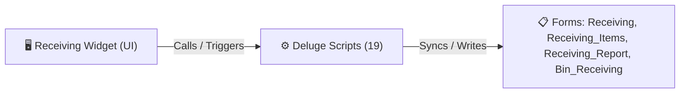

# 🧩 Receiving Widget

> [!INFO] Widget Overview
> - **Module:** `Procurement`
> - **System Stage:** `Stage 5: Warehouse Receiving & Bin Allocation`
> - **Frontend UI File:** [`Widget/Proc/Receiving`](file:///C:/Users/Enduser/Desktop/Deluge script/Procurement/Receiving/Widget)
> - **Creator Forms & Reports:** `Receiving`, `Receiving_Items`, `Receiving_Report`, `Bin_Receiving`
> - **Total Deluge Scripts Connected:** **19**

---

## 📖 Description & Purpose
Receives items into warehouse, counts accepted/damage/missing, and creates Zoho Books Purchase Receives and Bins.

---

## 🔄 Architecture & Data Flow

---

## 💻 Frontend HTML Interface
- **HTML Path:** [`Widget/Proc/Receiving`](file:///C:/Users/Enduser/Desktop/Deluge script/Procurement/Receiving/Widget)
- **Window Title:** `Warehouse Receiving`

---

## ⚙️ Backing Deluge Scripts (19)

The following Deluge scripts directly power or listen to this widget's lifecycle events:

| Script Name | Source File | Category | Lines |
| :--- | :--- | :--- | :--- |
| [[Procurement/Receiving/Deluge/Create_Bin_Receiving|Create_Bin_Receiving]] | `Create_Bin_Receiving` | `01 - Root Workflows` | 1847 |
| [[Procurement/Receiving/Deluge/createBinReceivingWidget|createBinReceivingWidget]] | `createBinReceivingWidget` | `01 - Root Workflows` | 1822 |
| [[_Shared/Notifications/Deluge/Notify_on_Receiving_Completed|Notify_on_Receiving_Completed]] | `Deluge Script/Notification\Notify_on_Receiving_Completed.txt` | `06 - Archive (Deluge Script & NEw)` | 32 |
| [[_Shared/Notifications/Deluge/Notify_on_Receiving_Quantity_Mismatch|Notify_on_Receiving_Quantity_Mismatch]] | `Deluge Script/Notification\Notify_on_Receiving_Quantity_Mismatch.txt` | `06 - Archive (Deluge Script & NEw)` | 32 |
| [[Procurement/Receiving/Deluge/paste-createBinReceivingWidget|paste-createBinReceivingWidget]] | `paste-createBinReceivingWidget.txt` | `02 - Main DelugeScripts` | 1854 |
| [[Procurement/Receiving/Deluge/paste-createBinReceivingWidget|paste-createBinReceivingWidget]] | `NEw/DelugeScripts\paste-createBinReceivingWidget.txt` | `06 - Archive (Deluge Script & NEw)` | 1854 |
| [[Procurement/Receiving/Deluge/PASTE_CreateBinReceivingWidget_Production|PASTE_CreateBinReceivingWidget_Production]] | `NEw/PASTE_CreateBinReceivingWidget_Production.txt` | `06 - Archive (Deluge Script & NEw)` | 1821 |
| [[Procurement/Receiving/Deluge/receiving_bin_location_choices|receiving_bin_location_choices]] | `receiving_bin_location_choices.txt` | `02 - Main DelugeScripts` | 115 |
| [[Procurement/Receiving/Deluge/receiving_bin_location_choices|receiving_bin_location_choices]] | `NEw/DelugeScripts\receiving_bin_location_choices.txt` | `06 - Archive (Deluge Script & NEw)` | 115 |
| [[Procurement/Receiving/Deluge/receiving_check_fulfillment_ready|receiving_check_fulfillment_ready]] | `receiving_check_fulfillment_ready.txt` | `02 - Main DelugeScripts` | 65 |
| [[Procurement/Receiving/Deluge/receiving_check_fulfillment_ready|receiving_check_fulfillment_ready]] | `NEw/DelugeScripts\receiving_check_fulfillment_ready.txt` | `06 - Archive (Deluge Script & NEw)` | 65 |
| [[Procurement/Receiving/Deluge/receiving_create_bin_receiving|receiving_create_bin_receiving]] | `receiving_create_bin_receiving.txt` | `02 - Main DelugeScripts` | 2370 |
| [[Procurement/Receiving/Deluge/receiving_create_bin_receiving|receiving_create_bin_receiving]] | `NEw/DelugeScripts\receiving_create_bin_receiving.txt` | `06 - Archive (Deluge Script & NEw)` | 2370 |
| [[Procurement/Receiving/Deluge/receiving_status_workflow|receiving_status_workflow]] | `receiving_status_workflow.txt` | `02 - Main DelugeScripts` | 161 |
| [[Procurement/Receiving/Deluge/receiving_status_workflow|receiving_status_workflow]] | `NEw/DelugeScripts\receiving_status_workflow.txt` | `06 - Archive (Deluge Script & NEw)` | 161 |
| [[Procurement/Receiving/Deluge/receiving_validations_and_damage_missing|receiving_validations_and_damage_missing]] | `receiving_validations_and_damage_missing.txt` | `02 - Main DelugeScripts` | 664 |
| [[Procurement/Receiving/Deluge/_variants/Archive-NEw/receiving_validations_and_damage_missing|receiving_validations_and_damage_missing]] | `NEw/DelugeScripts\receiving_validations_and_damage_missing.txt` | `06 - Archive (Deluge Script & NEw)` | 680 |
| [[Procurement/Receiving/Deluge/receiving_widget_custom_api|receiving_widget_custom_api]] | `receiving_widget_custom_api.txt` | `02 - Main DelugeScripts` | 2320 |
| [[Procurement/Receiving/Deluge/receiving_widget_custom_api|receiving_widget_custom_api]] | `NEw/DelugeScripts\receiving_widget_custom_api.txt` | `06 - Archive (Deluge Script & NEw)` | 2320 |

---

## 📋 Associated Creator Forms & Reports
- `Receiving`
- `Receiving_Items`
- `Receiving_Report`
- `Bin_Receiving`

---

## 📚 Associated Manuals & PDF Documentation

| Manual / Document | Type | Size |
| :--- | :--- | :--- |
| [[_Shared/Docs/01 - Staff & Operations Manuals/Procurement System Manual|Procurement System Manual]] | `Staff Operations Manual` | `1.7 MB` |
| [[_Shared/Docs/02 - Architecture, Blueprints & Swimlanes/Business Process Blueprint (PDF)|Business Process Blueprint (PDF)]] | `Technical Architecture Blueprint` | `761.9 KB` |
| [[_Shared/Docs/02 - Architecture, Blueprints & Swimlanes/Procurement Swimlane Diagram (PDF)|Procurement Swimlane Diagram (PDF)]] | `Swimlane Process Diagram` | `395.9 KB` |
| [[_Shared/Docs/03 - Sprint, UAT & Quality Reports/Supply Chain App Findings Report (2026-08-24)|Supply Chain App Findings Report (2026-08-24)]] | `Audit & QA Report` | `745.0 KB` |
| [[_Shared/Docs/04 - Zoho Reference Guides/Zoho Inventory — Customers, Vendors & Purchase Transactions|Zoho Inventory — Customers, Vendors & Purchase Transactions]] | `Official Reference Manual` | `7.9 MB` |
| [[_Shared/Docs/04 - Zoho Reference Guides/Zoho Inventory — Warehouses & Stock Management|Zoho Inventory — Warehouses & Stock Management]] | `Official Reference Manual` | `6.3 MB` |
