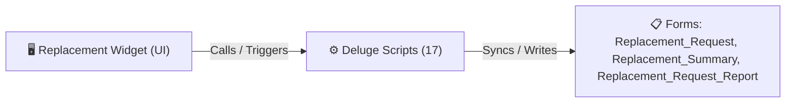

# 🧩 Replacement Widget

> [!INFO] Widget Overview
> - **Module:** `Procurement`
> - **System Stage:** `Supplier Replacements`
> - **Frontend UI File:** [`Widget/Proc/Replacement/app/index.html`](file:///C:/Users/Enduser/Desktop/Deluge script/Procurement/Replacement/Widget/app/index.html)
> - **Creator Forms & Reports:** `Replacement_Request`, `Replacement_Summary`, `Replacement_Request_Report`
> - **Total Deluge Scripts Connected:** **17**

---

## 📖 Description & Purpose
Handles replacement requests (RR) sent back to suppliers for damaged or defective items.

---

## 🔄 Architecture & Data Flow

---

## 💻 Frontend HTML Interface
- **HTML Path:** [`Widget/Proc/Replacement/app/index.html`](file:///C:/Users/Enduser/Desktop/Deluge script/Procurement/Replacement/Widget/app/index.html)
- **Window Title:** `Replacement Requests`

---

## ⚙️ Backing Deluge Scripts (17)

The following Deluge scripts directly power or listen to this widget's lifecycle events:

| Script Name | Source File | Category | Lines |
| :--- | :--- | :--- | :--- |
| [[Procurement/Replacement/Deluge/approve_rr_custom_api|approve_rr_custom_api]] | `approve_rr_custom_api.txt` | `02 - Main DelugeScripts` | 179 |
| [[Procurement/Replacement/Deluge/approve_rr_custom_api|approve_rr_custom_api]] | `NEw/DelugeScripts\approve_rr_custom_api.txt` | `06 - Archive (Deluge Script & NEw)` | 179 |
| [[Procurement/Replacement/Deluge/approve_rr_supplier|approve_rr_supplier]] | `approve_rr_supplier.txt` | `02 - Main DelugeScripts` | 183 |
| [[Procurement/Replacement/Deluge/approve_rr_supplier|approve_rr_supplier]] | `NEw/DelugeScripts\approve_rr_supplier.txt` | `06 - Archive (Deluge Script & NEw)` | 183 |
| [[Procurement/Replacement/Deluge/clone_shipment_for_replacement|clone_shipment_for_replacement]] | `clone_shipment_for_replacement.txt` | `02 - Main DelugeScripts` | 782 |
| [[Procurement/Replacement/Deluge/clone_shipment_for_replacement|clone_shipment_for_replacement]] | `NEw/DelugeScripts\clone_shipment_for_replacement.txt` | `06 - Archive (Deluge Script & NEw)` | 782 |
| [[Procurement/Replacement/Deluge/create_rr_button|create_rr_button]] | `create_rr_button.txt` | `02 - Main DelugeScripts` | 624 |
| [[Procurement/Replacement/Deluge/_variants/Archive-NEw/create_rr_button|create_rr_button]] | `NEw/DelugeScripts\create_rr_button.txt` | `06 - Archive (Deluge Script & NEw)` | 772 |
| [[Procurement/Replacement/Deluge/create_rr_custom_api|create_rr_custom_api]] | `create_rr_custom_api.txt` | `02 - Main DelugeScripts` | 566 |
| [[Procurement/Replacement/Deluge/_variants/Archive-NEw/create_rr_custom_api|create_rr_custom_api]] | `NEw/DelugeScripts\create_rr_custom_api.txt` | `06 - Archive (Deluge Script & NEw)` | 711 |
| [[_Shared/Notifications/Deluge/Notify_Fenteng_on_Replacement_Request_added|Notify_Fenteng_on_Replacement_Request_added]] | `Deluge Script/Notification\Notify_Fenteng_on_Replacement_Request_added.txt` | `06 - Archive (Deluge Script & NEw)` | 39 |
| [[_Shared/Notifications/Deluge/Notify_Tony_on_Replacement_Request_Added|Notify_Tony_on_Replacement_Request_Added]] | `Deluge Script/Notification\Notify_Tony_on_Replacement_Request_Added.txt` | `06 - Archive (Deluge Script & NEw)` | 53 |
| [[Procurement/Replacement/Deluge/paste-cloneShipmentForReplacement|paste-cloneShipmentForReplacement]] | `paste-cloneShipmentForReplacement.txt` | `02 - Main DelugeScripts` | 419 |
| [[Procurement/Replacement/Deluge/paste-cloneShipmentForReplacement|paste-cloneShipmentForReplacement]] | `NEw/DelugeScripts\paste-cloneShipmentForReplacement.txt` | `06 - Archive (Deluge Script & NEw)` | 419 |
| [[Fulfillment/SO Report/IDE/Sales_Order_Fulfillment|Sales_Order_Fulfillment]] | `Sales Order Fulfillment\Sales_Order_Fulfillment.txt` | `04 - Application IDE` | 243 |
| [[Fulfillment/SO Report/IDE/_variants/Archive-NEw/Sales_Order_Fulfillment|Sales_Order_Fulfillment]] | `Deluge Script/Application IDE\Sales Order Fulfillment\Sales_Order_Fulfillment.txt` | `06 - Archive (Deluge Script & NEw)` | 243 |
| [[_Shared/Deluge/Deluge/temp|temp]] | `temp.txt` | `03 - Sidequest` | 68 |

---

## 📋 Associated Creator Forms & Reports
- `Replacement_Request`
- `Replacement_Summary`
- `Replacement_Request_Report`

---

## 📚 Associated Manuals & PDF Documentation

| Manual / Document | Type | Size |
| :--- | :--- | :--- |
| [[_Shared/Docs/04 - Zoho Reference Guides/Zoho Inventory — Purchase Returns & Migrations|Zoho Inventory — Purchase Returns & Migrations]] | `Official Reference Manual` | `6.9 MB` |
