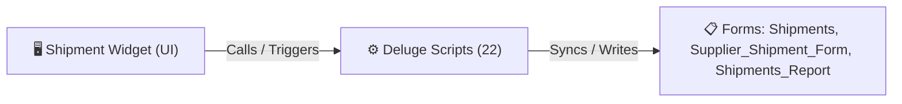

# 🧩 Shipment Widget

> [!INFO] Widget Overview
> - **Module:** `Procurement`
> - **System Stage:** `Stage 4: Shipment Tracking`
> - **Frontend UI File:** [`Widget/Proc/Shipment`](file:///C:/Users/Enduser/Desktop/Deluge script/Procurement/Shipments/Widget)
> - **Creator Forms & Reports:** `Shipments`, `Supplier_Shipment_Form`, `Shipments_Report`
> - **Total Deluge Scripts Connected:** **22**

---

## 📖 Description & Purpose
Tracks incoming supplier shipments, ETAs, delays, and container/airfreight updates.

---

## 🔄 Architecture & Data Flow

---

## 💻 Frontend HTML Interface
- **HTML Path:** [`Widget/Proc/Shipment`](file:///C:/Users/Enduser/Desktop/Deluge script/Procurement/Shipments/Widget)
- **Window Title:** `Shipment Tracking`

---

## ⚙️ Backing Deluge Scripts (22)

The following Deluge scripts directly power or listen to this widget's lifecycle events:

| Script Name | Source File | Category | Lines |
| :--- | :--- | :--- | :--- |
| [[_Shared/Notifications/Deluge/Notify_Fenteng_on_Shipment_Added|Notify_Fenteng_on_Shipment_Added]] | `Deluge Script/Notification\Notify_Fenteng_on_Shipment_Added.txt` | `06 - Archive (Deluge Script & NEw)` | 39 |
| [[_Shared/Notifications/Deluge/Notify_Tony_on_Shipment_added|Notify_Tony_on_Shipment_added]] | `Deluge Script/Notification\Notify_Tony_on_Shipment_added.txt` | `06 - Archive (Deluge Script & NEw)` | 53 |
| [[Procurement/Shipments/Deluge/paste-shipments_auto_create_supplier_shipment|paste-shipments_auto_create_supplier_shipment]] | `paste-shipments_auto_create_supplier_shipment.txt` | `02 - Main DelugeScripts` | 42 |
| [[Procurement/Shipments/Deluge/paste-shipments_auto_create_supplier_shipment|paste-shipments_auto_create_supplier_shipment]] | `NEw/DelugeScripts\paste-shipments_auto_create_supplier_shipment.txt` | `06 - Archive (Deluge Script & NEw)` | 42 |
| [[Procurement/Supplier - Fenteng/Deluge/PASTE_Fenteng_Shipment_Sync|PASTE_Fenteng_Shipment_Sync]] | `NEw/PASTE_Fenteng_Shipment_Sync.txt` | `06 - Archive (Deluge Script & NEw)` | 175 |
| [[Procurement/Supplier - Tony Fan/Deluge/PASTE_Tony_Shipment_Sync|PASTE_Tony_Shipment_Sync]] | `NEw/PASTE_Tony_Shipment_Sync.txt` | `06 - Archive (Deluge Script & NEw)` | 175 |
| [[Procurement/Receiving/Deluge/receiving_sync_shipment_arrived|receiving_sync_shipment_arrived]] | `receiving_sync_shipment_arrived.txt` | `02 - Main DelugeScripts` | 133 |
| [[Procurement/Receiving/Deluge/_variants/Archive-NEw/receiving_sync_shipment_arrived|receiving_sync_shipment_arrived]] | `NEw/DelugeScripts\receiving_sync_shipment_arrived.txt` | `06 - Archive (Deluge Script & NEw)` | 212 |
| [[Procurement/Receiving/Deluge/receiving_sync_shipment_mode|receiving_sync_shipment_mode]] | `receiving_sync_shipment_mode.txt` | `02 - Main DelugeScripts` | 76 |
| [[Procurement/Receiving/Deluge/receiving_sync_shipment_mode|receiving_sync_shipment_mode]] | `NEw/DelugeScripts\receiving_sync_shipment_mode.txt` | `06 - Archive (Deluge Script & NEw)` | 76 |
| [[Procurement/Shipments/Deluge/shipment_delay_status_schedule|shipment_delay_status_schedule]] | `shipment_delay_status_schedule.txt` | `02 - Main DelugeScripts` | 198 |
| [[Procurement/Shipments/Deluge/shipment_delay_status_schedule|shipment_delay_status_schedule]] | `NEw/DelugeScripts\shipment_delay_status_schedule.txt` | `06 - Archive (Deluge Script & NEw)` | 198 |
| [[Procurement/Shipments/Deluge/shipment_status_back_sync|shipment_status_back_sync]] | `shipment_status_back_sync.txt` | `02 - Main DelugeScripts` | 122 |
| [[Procurement/Shipments/Deluge/_variants/Archive-NEw/shipment_status_back_sync|shipment_status_back_sync]] | `NEw/DelugeScripts\shipment_status_back_sync.txt` | `06 - Archive (Deluge Script & NEw)` | 181 |
| [[Procurement/Shipments/Deluge/shipments_auto_create_supplier_shipment|shipments_auto_create_supplier_shipment]] | `shipments_auto_create_supplier_shipment.txt` | `02 - Main DelugeScripts` | 133 |
| [[Procurement/Shipments/Deluge/shipments_auto_create_supplier_shipment|shipments_auto_create_supplier_shipment]] | `NEw/DelugeScripts\shipments_auto_create_supplier_shipment.txt` | `06 - Archive (Deluge Script & NEw)` | 133 |
| [[Procurement/Receiving/Deluge/shipments_sync_shipment_mode_to_receiving|shipments_sync_shipment_mode_to_receiving]] | `shipments_sync_shipment_mode_to_receiving.txt` | `02 - Main DelugeScripts` | 76 |
| [[Procurement/Receiving/Deluge/shipments_sync_shipment_mode_to_receiving|shipments_sync_shipment_mode_to_receiving]] | `NEw/DelugeScripts\shipments_sync_shipment_mode_to_receiving.txt` | `06 - Archive (Deluge Script & NEw)` | 76 |
| [[Procurement/Shipments/Deluge/supplier_shipment_forms|supplier_shipment_forms]] | `supplier_shipment_forms.txt` | `02 - Main DelugeScripts` | 276 |
| [[Procurement/Shipments/Deluge/supplier_shipment_forms|supplier_shipment_forms]] | `NEw/DelugeScripts\supplier_shipment_forms.txt` | `06 - Archive (Deluge Script & NEw)` | 276 |
| [[Procurement/Shipments/Deluge/supplier_shipment_sync|supplier_shipment_sync]] | `supplier_shipment_sync.txt` | `02 - Main DelugeScripts` | 488 |
| [[Procurement/Shipments/Deluge/supplier_shipment_sync|supplier_shipment_sync]] | `NEw/DelugeScripts\supplier_shipment_sync.txt` | `06 - Archive (Deluge Script & NEw)` | 488 |

---

## 📋 Associated Creator Forms & Reports
- `Shipments`
- `Supplier_Shipment_Form`
- `Shipments_Report`

---

## 📚 Associated Manuals & PDF Documentation

| Manual / Document | Type | Size |
| :--- | :--- | :--- |
| [[_Shared/Docs/01 - Staff & Operations Manuals/Procurement System Manual|Procurement System Manual]] | `Staff Operations Manual` | `1.7 MB` |
