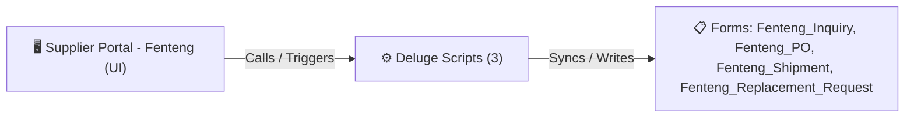

# 🧩 Supplier Portal - Fenteng

> [!INFO] Widget Overview
> - **Module:** `Supplier Portal`
> - **System Stage:** `External Supplier Portal`
> - **Frontend UI File:** [`Widget/Proc/Supplier -Fenteng/Fengteng Inq/_extract_tmp/app/index.html`](file:///C:/Users/Enduser/Desktop/Deluge script/Procurement/Supplier - Fenteng/Widget/Fengteng Inq/_extract_tmp/app/index.html)
> - **Creator Forms & Reports:** `Fenteng_Inquiry`, `Fenteng_PO`, `Fenteng_Shipment`, `Fenteng_Replacement_Request`
> - **Total Deluge Scripts Connected:** **3**

---

## 📖 Description & Purpose
Dedicated supplier portal for Fenteng Lighting to manage Inquiries, PO acknowledgments, and shipments.

---

## 🔄 Architecture & Data Flow

---

## 💻 Frontend HTML Interface
- **HTML Path:** [`Widget/Proc/Supplier -Fenteng/Fengteng Inq/_extract_tmp/app/index.html`](file:///C:/Users/Enduser/Desktop/Deluge script/Procurement/Supplier - Fenteng/Widget/Fengteng Inq/_extract_tmp/app/index.html)
- **Window Title:** `Fenteng Lighting - Portal`

---

## ⚙️ Backing Deluge Scripts (3)

The following Deluge scripts directly power or listen to this widget's lifecycle events:

| Script Name | Source File | Category | Lines |
| :--- | :--- | :--- | :--- |
| [[Procurement/Supplier - Fenteng/Deluge/list Fenteng_Notifications_Report|list Fenteng_Notifications_Report]] | `Deluge Script/Notification\list Fenteng_Notifications_Report.txt` | `06 - Archive (Deluge Script & NEw)` | 94 |
| [[Procurement/Supplier - Fenteng/Deluge/paste-approveRRFenteng|paste-approveRRFenteng]] | `paste-approveRRFenteng.txt` | `02 - Main DelugeScripts` | 42 |
| [[Procurement/Supplier - Fenteng/Deluge/paste-approveRRFenteng|paste-approveRRFenteng]] | `NEw/DelugeScripts\paste-approveRRFenteng.txt` | `06 - Archive (Deluge Script & NEw)` | 42 |

---

## 📋 Associated Creator Forms & Reports
- `Fenteng_Inquiry`
- `Fenteng_PO`
- `Fenteng_Shipment`
- `Fenteng_Replacement_Request`

---

## 📚 Associated Manuals & PDF Documentation

| Manual / Document | Type | Size |
| :--- | :--- | :--- |
| [[_Shared/Docs/01 - Staff & Operations Manuals/Supplier Portal Operations Manual (2026-08-24)|Supplier Portal Operations Manual (2026-08-24)]] | `Supplier Operations Manual` | `3.0 MB` |
| [[_Shared/Docs/01 - Staff & Operations Manuals/Fenteng Lighting Supplier Portal Guide|Fenteng Lighting Supplier Portal Guide]] | `Supplier Portal Manual` | `1.7 MB` |
