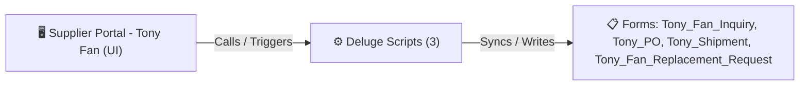

# 🧩 Supplier Portal - Tony Fan

> [!INFO] Widget Overview
> - **Module:** `Supplier Portal`
> - **System Stage:** `External Supplier Portal`
> - **Frontend UI File:** [`Widget/Proc/Supplier - Tony Fan/Tony Inq/_extract_tmp/app/index.html`](file:///C:/Users/Enduser/Desktop/Deluge script/Procurement/Supplier - Tony Fan/Widget/Tony Inq/_extract_tmp/app/index.html)
> - **Creator Forms & Reports:** `Tony_Fan_Inquiry`, `Tony_PO`, `Tony_Shipment`, `Tony_Fan_Replacement_Request`
> - **Total Deluge Scripts Connected:** **3**

---

## 📖 Description & Purpose
Dedicated supplier portal for Tony Fan to view Inquiries, acknowledge POs, and update Shipments.

---

## 🔄 Architecture & Data Flow

---

## 💻 Frontend HTML Interface
- **HTML Path:** [`Widget/Proc/Supplier - Tony Fan/Tony Inq/_extract_tmp/app/index.html`](file:///C:/Users/Enduser/Desktop/Deluge script/Procurement/Supplier - Tony Fan/Widget/Tony Inq/_extract_tmp/app/index.html)
- **Window Title:** `Tony Fan - Portal`

---

## ⚙️ Backing Deluge Scripts (3)

The following Deluge scripts directly power or listen to this widget's lifecycle events:

| Script Name | Source File | Category | Lines |
| :--- | :--- | :--- | :--- |
| [[Procurement/Supplier - Tony Fan/Deluge/list Tony_Notifications_Report|list Tony_Notifications_Report]] | `Deluge Script/Notification\list Tony_Notifications_Report.txt` | `06 - Archive (Deluge Script & NEw)` | 94 |
| [[Procurement/Supplier - Tony Fan/Deluge/paste-approveRRTony|paste-approveRRTony]] | `paste-approveRRTony.txt` | `02 - Main DelugeScripts` | 42 |
| [[Procurement/Supplier - Tony Fan/Deluge/paste-approveRRTony|paste-approveRRTony]] | `NEw/DelugeScripts\paste-approveRRTony.txt` | `06 - Archive (Deluge Script & NEw)` | 42 |

---

## 📋 Associated Creator Forms & Reports
- `Tony_Fan_Inquiry`
- `Tony_PO`
- `Tony_Shipment`
- `Tony_Fan_Replacement_Request`

---

## 📚 Associated Manuals & PDF Documentation

| Manual / Document | Type | Size |
| :--- | :--- | :--- |
| [[_Shared/Docs/01 - Staff & Operations Manuals/Supplier Portal Operations Manual (2026-08-24)|Supplier Portal Operations Manual (2026-08-24)]] | `Supplier Operations Manual` | `3.0 MB` |
| [[_Shared/Docs/01 - Staff & Operations Manuals/Tony Fan Supplier Portal Guide|Tony Fan Supplier Portal Guide]] | `Supplier Portal Manual` | `1.7 MB` |
| [[_Shared/Docs/01 - Staff & Operations Manuals/Tony Fan Portal Guide (Chinese)|Tony Fan Portal Guide (Chinese)]] | `Supplier Portal Manual` | `1.1 MB` |
| [[_Shared/Docs/01 - Staff & Operations Manuals/Tony Fan Portal Guide (English)|Tony Fan Portal Guide (English)]] | `Supplier Portal Manual` | `1.2 MB` |
| [[_Shared/Docs/01 - Staff & Operations Manuals/Tony Fan Portal Walkthrough Script|Tony Fan Portal Walkthrough Script]] | `Training Walkthrough` | `104.3 KB` |
| [[_Shared/Docs/01 - Staff & Operations Manuals/Tony Fan Portal UAT Test Plan|Tony Fan Portal UAT Test Plan]] | `UAT Test Plan` | `23.6 KB` |
