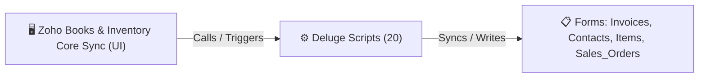

# 🧩 Zoho Books & Inventory Core Sync

> [!INFO] Widget Overview
> - **Module:** `ERP Integrations`
> - **System Stage:** `Core Zoho Books / Inventory Automation`
> - **Frontend UI File:** None (Backend / Direct Zoho Integration)
> - **Creator Forms & Reports:** `Invoices`, `Contacts`, `Items`, `Sales_Orders`
> - **Total Deluge Scripts Connected:** **20**

---

## 📖 Description & Purpose
Deluge automation syncing Payments, Contacts, Invoices, and Item data between Zoho Books/Inventory and Creator.

---

## 🔄 Architecture & Data Flow

---

## 💻 Frontend HTML Interface
- **HTML Path:** None (Backend / Direct Zoho Integration)
- **Window Title:** `None`

---

## ⚙️ Backing Deluge Scripts (20)

The following Deluge scripts directly power or listen to this widget's lifecycle events:

| Script Name | Source File | Category | Lines |
| :--- | :--- | :--- | :--- |
| [[Procurement/Inquiry/Deluge/create_books_contact|create_books_contact]] | `create_books_contact.txt` | `02 - Main DelugeScripts` | 264 |
| [[Procurement/Inquiry/Deluge/create_books_contact|create_books_contact]] | `DMS\DelugeScripts\create_books_contact.txt` | `05 - Widget Scripts` | 264 |
| [[Procurement/Inquiry/Deluge/create_books_contact|create_books_contact]] | `NEw/DelugeScripts\create_books_contact.txt` | `06 - Archive (Deluge Script & NEw)` | 264 |
| [[_Shared/Deluge/Deluge/Customer_Form_Schema|Customer_Form_Schema]] | `Customer_Form_Schema.txt` | `01 - Root Workflows` | 258 |
| [[Fulfillment/SO Report/Deluge/invoice_payment_status_to_so_fulfillment_sync|invoice_payment_status_to_so_fulfillment_sync]] | `invoice_payment_status_to_so_fulfillment_sync.txt` | `03 - Sidequest` | 474 |
| [[Fulfillment/SO Report/Deluge/_variants/Archive-NEw/invoice_payment_status_to_so_fulfillment_sync|invoice_payment_status_to_so_fulfillment_sync]] | `Deluge Script/invoice_payment_status_to_so_fulfillment_sync.txt` | `06 - Archive (Deluge Script & NEw)` | 356 |
| [[_Shared/Deluge/_Unlabelled/Deluge/Payment|Payment]] | `Payment` | `01 - Root Workflows` | 351 |
| [[Fulfillment/Order Readiness/Deluge/readiness_gate_check_payment_status|readiness_gate_check_payment_status]] | `readiness_gate_check_payment_status.txt` | `02 - Main DelugeScripts` | 208 |
| [[Fulfillment/Order Readiness/Deluge/readiness_gate_check_payment_status|readiness_gate_check_payment_status]] | `DMS\DelugeScripts\readiness_gate_check_payment_status.txt` | `05 - Widget Scripts` | 208 |
| [[Fulfillment/Order Readiness/Deluge/readiness_gate_check_payment_status|readiness_gate_check_payment_status]] | `NEw/DelugeScripts\readiness_gate_check_payment_status.txt` | `06 - Archive (Deluge Script & NEw)` | 208 |
| [[Fulfillment/SO Report/Deluge/so_creation_sync|so_creation_sync]] | `so_creation_sync.txt` | `03 - Sidequest` | 723 |
| [[Fulfillment/SO Report/Deluge/_variants/Archive-NEw/so_creation_sync|so_creation_sync]] | `Deluge Script/so_creation_sync.txt` | `06 - Archive (Deluge Script & NEw)` | 723 |
| [[Fulfillment/SO Report/Deluge/_variants/Main-DelugeScripts/so_fulfillment_sync|so_fulfillment_sync]] | `so_fulfillment_sync.txt` | `02 - Main DelugeScripts` | 303 |
| [[Fulfillment/SO Report/Deluge/_variants/Main-DelugeScripts/so_fulfillment_sync|so_fulfillment_sync]] | `production\so_fulfillment_sync.txt` | `02 - Main DelugeScripts` | 627 |
| [[Fulfillment/SO Report/Deluge/so_fulfillment_sync|so_fulfillment_sync]] | `so_fulfillment_sync.txt` | `03 - Sidequest` | 1086 |
| [[Fulfillment/SO Report/Deluge/_variants/Archive-NEw/so_fulfillment_sync|so_fulfillment_sync]] | `Deluge Script/so_fulfillment_sync.txt` | `06 - Archive (Deluge Script & NEw)` | 734 |
| [[Fulfillment/SO Report/Deluge/_variants/Archive-NEw/so_fulfillment_sync|so_fulfillment_sync]] | `NEw/DelugeScripts\so_fulfillment_sync.txt` | `06 - Archive (Deluge Script & NEw)` | 450 |
| [[Fulfillment/SO Report/Deluge/_variants/Archive-NEw/so_fulfillment_sync|so_fulfillment_sync]] | `NEw/DelugeScripts\production\so_fulfillment_sync.txt` | `06 - Archive (Deluge Script & NEw)` | 627 |
| [[Procurement/Purchase Request/Deluge/so_to_pr|so_to_pr]] | `so_to_pr.txt` | `03 - Sidequest` | 1317 |
| [[Procurement/Purchase Request/Deluge/_variants/Archive-NEw/so_to_pr|so_to_pr]] | `Deluge Script/so_to_pr.txt` | `06 - Archive (Deluge Script & NEw)` | 484 |

---

## 📋 Associated Creator Forms & Reports
- `Invoices`
- `Contacts`
- `Items`
- `Sales_Orders`

---

## 📚 Associated Manuals & PDF Documentation

| Manual / Document | Type | Size |
| :--- | :--- | :--- |
| [[_Shared/Docs/03 - Sprint, UAT & Quality Reports/Supply Chain App Health Report (2026-08-15)|Supply Chain App Health Report (2026-08-15)]] | `Health & Performance Report` | `237.5 KB` |
| [[_Shared/Docs/04 - Zoho Reference Guides/Zoho Books — AI Features & Invoices|Zoho Books — AI Features & Invoices]] | `Official Reference Manual` | `24.3 MB` |
| [[_Shared/Docs/04 - Zoho Reference Guides/Zoho Books — Payment Received & Accounting|Zoho Books — Payment Received & Accounting]] | `Official Reference Manual` | `6.0 MB` |
| [[_Shared/Docs/04 - Zoho Reference Guides/Zoho Books — Projects & Timesheet Approval|Zoho Books — Projects & Timesheet Approval]] | `Official Reference Manual` | `6.7 MB` |
| [[_Shared/Docs/04 - Zoho Reference Guides/Zoho Books — Developer & Data Management|Zoho Books — Developer & Data Management]] | `Official Reference Manual` | `16.9 MB` |
| [[_Shared/Docs/04 - Zoho Reference Guides/Deluge Scripting — Basic Guide|Deluge Scripting — Basic Guide]] | `Language Reference` | `11.8 MB` |
| [[_Shared/Docs/04 - Zoho Reference Guides/Deluge Scripting — Intermediate Part 1|Deluge Scripting — Intermediate Part 1]] | `Language Reference` | `30.8 MB` |
| [[_Shared/Docs/04 - Zoho Reference Guides/Deluge Scripting — Intermediate Part 2|Deluge Scripting — Intermediate Part 2]] | `Language Reference` | `3.7 MB` |
| [[_Shared/Docs/04 - Zoho Reference Guides/Deluge Scripting — Intermediate Last Part|Deluge Scripting — Intermediate Last Part]] | `Language Reference` | `10.1 MB` |
| [[_Shared/Docs/04 - Zoho Reference Guides/Deluge Scripting — Advance Part 1|Deluge Scripting — Advance Part 1]] | `Language Reference` | `5.5 MB` |
| [[_Shared/Docs/04 - Zoho Reference Guides/Deluge Scripting — Advance Part 2|Deluge Scripting — Advance Part 2]] | `Language Reference` | `11.2 MB` |
| [[_Shared/Docs/04 - Zoho Reference Guides/Deluge Scripting — Advance Part 3|Deluge Scripting — Advance Part 3]] | `Language Reference` | `5.7 MB` |
| [[_Shared/Docs/04 - Zoho Reference Guides/Deluge Scripting — Advance Part 4|Deluge Scripting — Advance Part 4]] | `Language Reference` | `4.2 MB` |
| [[_Shared/Docs/04 - Zoho Reference Guides/Deluge Scripting — Advance Last Part|Deluge Scripting — Advance Last Part]] | `Language Reference` | `16.8 MB` |
| [[_Shared/Docs/04 - Zoho Reference Guides/Zoho Developer API Reference|Zoho Developer API Reference]] | `API Documentation` | `593.1 KB` |
