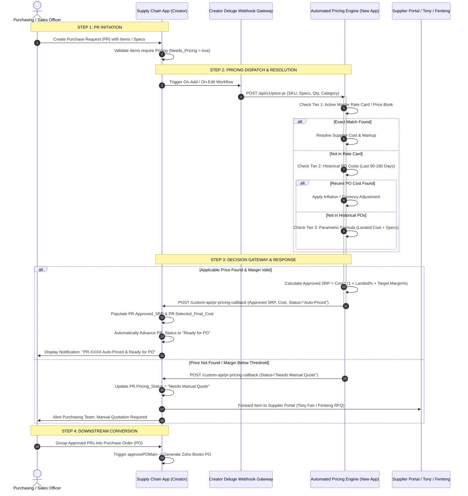

# 🌐 Automated Pricing System — End-to-End Process Flow

> [!INFO] Document Details
> - **Title:** `Automated Pricing System — End-to-End Process Flow`
> - **Target Systems:** Supply Chain App (Creator) ↔ Automated Pricing Engine (External App)
> - **Interactive HTML File:** [`Proposals/Automated_Pricing_Process_Flow_2026-10-07.html`](file:///C:/Users/Enduser/Desktop/Deluge script/_Shared/Docs/Proposals/Automated_Pricing_Process_Flow_2026-10-07.html)
> - **Connected Plan:** [[_Shared/Docs/02 - Architecture, Blueprints & Swimlanes/Automated Pricing System Plan (2026-10-07)|Automated Pricing System Plan (2026-10-07)]]
> - **Connected Widgets:** [[Procurement/Purchase Request/Widget/Purchase Request Widget|Purchase Request Widget]], [[Procurement/Purchase Order/Widget/Purchase Order Widget|Purchase Order Widget]]

---

## 🚀 View Interactive Flow Diagram in Browser
Click below to open the full interactive sequence diagram and summary cards in your default web browser:
👉 **[Open Automated Pricing Process Flow in Browser](file:///C:/Users/Enduser/Desktop/Deluge script/_Shared/Docs/Proposals/Automated_Pricing_Process_Flow_2026-10-07.html)**

---

## 🔄 End-to-End Sequence Diagram

