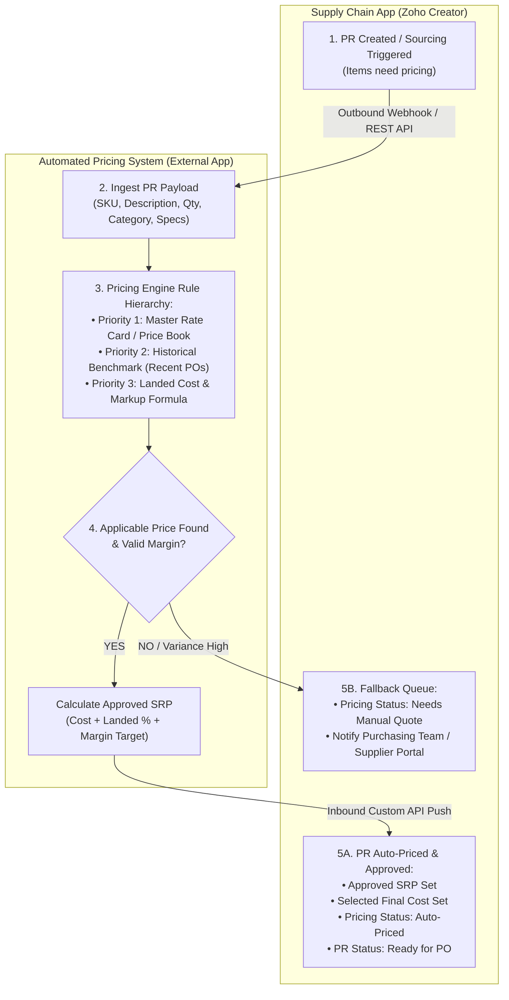

# Project Plan: Automated Pricing System & Supply Chain Integration

**Document Version:** 1.0  
**Date:** 2026-10-07  
**Status:** DRAFT (Ready for Review & Architectural Alignment)  
**Target Systems:**  
1. **Supply Chain App (Zoho Creator)** — Procurement Module (`Purchase_Request1`, PR Widget)  
2. **Automated Pricing System (External Application)** — Pricing Engine & Rate Calculation  

---

## 1. Executive Summary & Objective

In the current Supply Chain App workflow, items requiring quotation or purchase price determination on a **Purchase Request (PR)** often depend on manual supplier inquiries, manual pricing inputs, or separate offline estimations. This creates latency between when a client or project requests an item and when a Purchase Order (PO) or Estimate can be created.

### The Objective
To create an automated, decoupled **Pricing System in a separate application** that receives PR item requirements, automatically identifies the applicable supplier costs and approved **Suggested Retail Price (SRP)**, and synchronizes the approved pricing back into the **Supply Chain App**, enabling immediate progression to `Ready for PO` without human delay.

---

## 2. End-to-End System Architecture



---

## 3. High-Level Process Flow

1. **Trigger in Supply Chain:**
   - A Purchase Request (PR) is created or flagged with `Needs_Pricing = true` / status `For Sourcing`.
   - A Deluge workflow packages the line items and sends an outbound REST payload to the new Pricing System.

2. **Processing in the Pricing Engine (New Application):**
   - The engine parses the item specifications, SKU, and requested quantities.
   - It executes the **Price Finding Algorithm**:
     - Checks active supplier catalogs / negotiated rate cards.
     - Fallback to recent approved PO purchase costs for identical or equivalent items.
     - Applies currency exchange adjustments, import duties, and freight allocations.
     - Computes the **Approved SRP** based on standard margin rules.

3. **Branching & Response:**
   - **Branch A (Price Successfully Found):**
     - The engine POSTs the pricing payload back to the Supply Chain Custom API.
     - Supply Chain updates the PR line items with `Approved_SRP`, `Selected_Final_Cost`, and sets `PR_Status = "Ready for PO"`.
     - An audit log entry is created in the PR Timeline.
   - **Branch B (Price Not Found / Exception):**
     - If the item is custom or no benchmark price exists within tolerance, the system flags the PR as `Needs Manual Quote`.
     - It routes to the standard Supplier Portal (Tony Fan / Fenteng) or alerts the Purchasing Officer.

---

## 4. Pricing Engine Rule Hierarchy

The external pricing engine should evaluate items based on the following precedence order:

| Precedence | Method | Criteria / Data Source | Action |
| :---: | :--- | :--- | :--- |
| **Tier 1** | **Master Price Book / Catalog** | Exact SKU match with active supplier contract valid within the date range. | Direct cost lookup + target SRP calculation. |
| **Tier 2** | **Historical PO Benchmark** | Approved PO rate within the last 90–180 days with identical supplier. | Apply inflation/currency delta + verify active margin. |
| **Tier 3** | **Parametric Formula (Landed Cost)** | Custom dimensions, material, or weight specs against a tiered pricing matrix. | `Cost = Base Rate * Specs` <br> `SRP = Cost * (1 + Landed% + Markup%)` |
| **Tier 4** | **Unmatched / Out of Bounds** | Item not found, or computed margin falls below minimum corporate threshold. | Route to Human Review / Supplier Portal RFQ. |

---

## 5. Integration Data Contracts (API Specifications)

### 5.1 Outbound Payload (Supply Chain App $\rightarrow$ Pricing Engine)

```json
{
  "event": "PR_NEEDS_PRICING",
  "source_app": "Supply Chain App",
  "pr_id": "4662244000018902001",
  "pr_number": "PR-01245",
  "requested_by": "purchasing@homecartel.com",
  "timestamp": "2026-10-07T12:55:00Z",
  "items": [
    {
      "pr_item_id": "4662244000018902005",
      "sku": "HC-LT-PEND-004",
      "item_name": "Modern Nordic Brass Pendant Lamp",
      "quantity": 10,
      "preferred_supplier": "Tony Fan",
      "specifications": {
        "color": "Brushed Gold",
        "voltage": "220V",
        "dimensions": "400x1200mm"
      }
    }
  ]
}
```

### 5.2 Inbound Response Payload (Pricing Engine $\rightarrow$ Supply Chain App)

```json
{
  "event": "PR_PRICING_RESOLVED",
  "pr_id": "4662244000018902001",
  "pr_number": "PR-01245",
  "pricing_status": "AUTO_PRICED",
  "currency": "PHP",
  "items": [
    {
      "pr_item_id": "4662244000018902005",
      "sku": "HC-LT-PEND-004",
      "supplier_name": "Tony Fan",
      "supplier_cost": 2150.00,
      "approved_srp": 4850.00,
      "margin_percentage": 55.67,
      "pricing_method": "Master_Catalog_Tier1",
      "confidence_score": 1.0,
      "notes": "Verified against Tony Fan Active Price Agreement Q3-2026."
    }
  ]
}
```

---

## 6. Schema Changes & Touchpoints in Supply Chain App

### 6.1 Fields on `Purchase_Request1` (Form)
- `Pricing_Status`: Dropdown (`Pending Auto-Pricing`, `Auto-Priced`, `Needs Manual Quote`, `Price Rejected`)
- `Pricing_Source`: Single Line Text (`Automated Pricing Engine`, `Manual Supplier Quote`)
- `Pricing_Resolved_Date`: Date-Time
- `Approved_SRP`: Currency / Decimal (mirrored to `SRP_Approved1` or line item SRP)
- `Pricing_Engine_Log`: Multi-line Text / Notes

### 6.2 Existing Deluge Workflows to Connect
- **`pr_approve_po_custom_api.txt`:** Consumes the approved rate to formulate the Books PO.
- **`create_estimates_button.txt`:** Validates `SRP_Approved1 > 0` before allowing Estimate / SO generation.
- **`pr_to_po_grouping.txt`:** Requires `Selected_Final_Cost` to be set before grouping lines into a Purchase Order.

---

## 7. Implementation Roadmap & Phases

```
┌─────────────┐     ┌─────────────┐     ┌─────────────┐     ┌─────────────┐     ┌─────────────┐
│   PHASE 1   │ ──> │   PHASE 2   │ ──> │   PHASE 3   │ ──> │   PHASE 4   │ ──> │   PHASE 5   │
│ Spec & DB   │     │ Engine Dev  │     │ Supply API  │     │ Integration │     │ UAT & Pilot │
└─────────────┘     └─────────────┘     └─────────────┘     └─────────────┘     └─────────────┘
```

### Phase 1: Specifications & Architectural Alignment (Week 1)
- Finalize the hosting platform for the Pricing Application (Zoho Catalyst vs dedicated Creator app vs custom microservice).
- Define the database schema for the Master Price Catalog and Landed Cost formulas.
- Confirm exact field names in `Purchase_Request1`.

### Phase 2: Pricing Engine Build (Week 2)
- Build the lookup and calculation logic in the new application.
- Implement margin thresholds and tolerance sanity checks.
- Build fallback routing for unpriced items.

### Phase 3: Supply Chain Custom API & Webhook (Week 3)
- Write the outbound Deluge script in Creator to push PR records to the pricing engine.
- Create the inbound Custom Function / API in Creator to receive and validate the approved pricing payload.
- Update PR status triggers (`Ready for PO` gate).

### Phase 4: End-to-End Testing & Sandbox Verification (Week 4)
- Test single and multi-item PR payloads.
- Test edge cases (missing SKU, low margin warning, foreign currency conversion).
- Verify downstream PO creation using the automated rates.

### Phase 5: Production Deployment & Pilot (Week 5)
- Deploy live endpoints and configure production OAuth tokens.
- Pilot with selected supplier categories (e.g. standard lighting / hardware).
- Monitor throughput, exceptions, and audit logs.

---

## 8. Open Architectural Questions for the User

1. **Host Environment:** Will the new pricing application be built in **Zoho Catalyst** (like the Inventory Subsystem), or inside another **Zoho Creator Application**?
2. **Margin Authority:** Does the automated SRP calculation need a secondary human approval step if margin is below a certain percentage (e.g., < 40%)?
3. **Execution Mode:** Should PRs be auto-priced in real-time immediately when submitted, or batched via a button / scheduled job?
