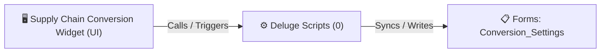

# 🧩 Supply Chain Conversion Widget

> [!INFO] Widget Overview
> - **Module:** `Cross-Module Utilities`
> - **System Stage:** `Currency & Unit Conversions`
> - **Frontend UI File:** [`Widget/Supply Chain Conversion/app/index.html`](file:///C:/Users/Enduser/Desktop/Deluge script/_Shared/Widget/Supply Chain Conversion/app/index.html)
> - **Creator Forms & Reports:** `Conversion_Settings`
> - **Total Deluge Scripts Connected:** **0**

---

## 📖 Description & Purpose
Utility widget handling multi-currency conversion, supplier exchange rates, and unit mappings.

---

## 🔄 Architecture & Data Flow

---

## 💻 Frontend HTML Interface
- **HTML Path:** [`Widget/Supply Chain Conversion/app/index.html`](file:///C:/Users/Enduser/Desktop/Deluge script/_Shared/Widget/Supply Chain Conversion/app/index.html)
- **Window Title:** `Supply Chain Conversion`

---

## ⚙️ Backing Deluge Scripts (0)

The following Deluge scripts directly power or listen to this widget's lifecycle events:

| Script Name | Source File | Category | Lines |
| :--- | :--- | :--- | :--- |
| *(No dedicated scripts classified directly)* | - | - | - |

---

## 📋 Associated Creator Forms & Reports
- `Conversion_Settings`
