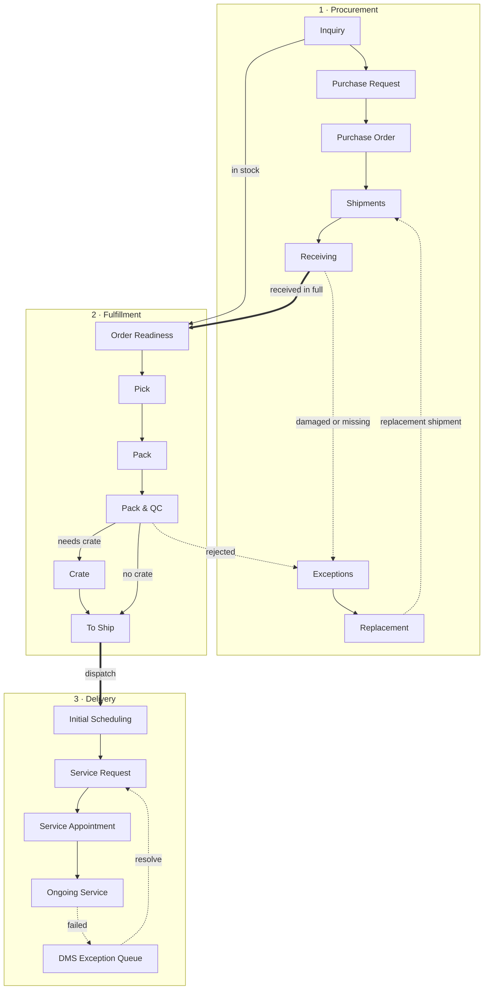

# System Map

From the customer's first inquiry to the truck at their door.

## The three modules

The app has six sections (the dropdown in the top bar). These are the three that carry the order, and the other three are [[Analytic]], [[Tony Fan]] and [[Fenteng Lighting]].

- [[Procurement]]: [[Procurement Dashboard]] → [[Inquiry List]] → [[Purchase Request]] → [[Purchase Order]] → [[Shipments]] → [[Receiving]] → [[Replacement Request]] → [[Exceptions]] → [[Forecast Setting]]
- [[Fulfillment]]: [[Fulfillment Dashboard]] → [[Sales Order Report]] → [[Pre-Order]] → [[Order Readiness]] → [[Pick]] → [[Pack & QC]] → [[Crate]] → [[To Ship]] → [[Exception Control]] → [[Transfer Item]]
- [[Delivery Management]]: [[Delivery Analytics]] → [[Daily Team Availability]] → [[Initial Scheduling]] → [[Service Request]] → [[Service Appointment]] → [[Ongoing Service]] → [[Archived]] → [[Field Service Site Visits]] → [[Sales Returns]] → [[DMS Exception Queue]] → [[Truck Maintenance]] → [[Schedule Requests]]

## The hand-offs between them

| From | To | Happens when | Step |
| --- | --- | --- | --- |
| Inquiry List | Purchase Request + Fulfillment item | The customer approves the estimate | [[inquiryApprove]] |
| Purchase Request | Purchase Order | Ready PRs are converted | [[prConvert]] |
| Purchase Order | Shipment + Receiving | The supplier acknowledges | [[poAcknowledge]] |
| Receiving | Order Readiness (item becomes packageable) | The shipment is received in full | [[receive]] |
| Receiving | Exceptions | Any goods are damaged or missing | [[receive]] |
| Pack & QC | Exceptions | An item is rejected | [[qcReject]] |
| To Ship | Initial Scheduling | The item is dispatched | [[dispatch]] |
| Ongoing Service | DMS Exception Queue | A delivery fails | [[srFail]] |

Other starting points: [[Home]], [[Rules Index]], [[Data Model]].
