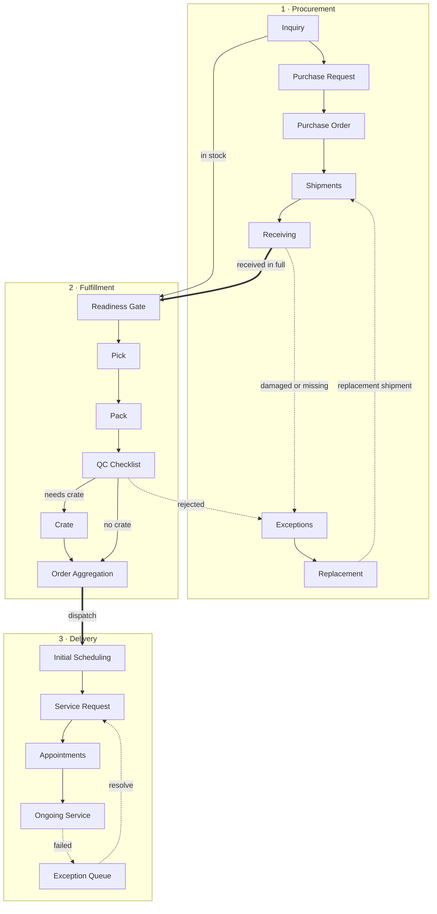

# System Map

From the customer's first inquiry to the truck at their door.

## The three modules

- [[Procurement]]: [[Inquiry]] → [[Purchase Request]] → [[Purchase Order]] → [[Shipments]] → [[Receiving]] → [[Exceptions]] → [[Replacement]]
- [[Fulfillment]]: [[Readiness Gate]] → [[Pick]] → [[Pack]] → [[QC Checklist]] → [[Crate]] → [[Order Aggregation]]
- [[Delivery]]: [[Initial Scheduling]] → [[Service Request]] → [[Appointments]] → [[Ongoing Service]] → [[Exception Queue]] → [[Teams & Capacity]]

## The hand-offs between them

| From | To | Happens when | Step |
| --- | --- | --- | --- |
| Inquiry | Purchase Request + Fulfillment item | The customer approves the estimate | [[inquiryApprove]] |
| Purchase Request | Purchase Order | Ready PRs are converted | [[prConvert]] |
| Purchase Order | Shipment + Receiving | The supplier acknowledges | [[poAcknowledge]] |
| Receiving | Readiness Gate (item becomes packageable) | The shipment is received in full | [[receive]] |
| Receiving | Exceptions | Any goods are damaged or missing | [[receive]] |
| QC Checklist | Exceptions | An item is rejected | [[qcReject]] |
| Order Aggregation | Initial Scheduling | The item is dispatched | [[dispatch]] |
| Ongoing Service | Exception Queue | A delivery fails | [[srFail]] |

Other starting points: [[Home]], [[Rules Index]], [[Data Model]].
